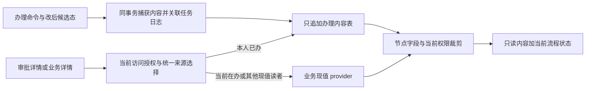

# F-476 审批办理时冻结快照：设计说明

> 状态：设计完成，待第 1 轮独立审查；尚未实现，不代表验收通过。
> 作用对象：复刻系统。DEC-781 已确定“已办读办理时内容、在办读现值”；其余推荐见 §10。
> 基线：`dbca3425bb7511f970900b815f9ee410a65ba722`，含 B1a #569（`425ffc587`）。
> 本单只交设计；不改产品、测试、迁移、生成物、状态登记与恢复点文件。

## 0. 依据与边界

### 0.1 来源及证据等级

| 来源 | 本设计采用的内容 | 证据边界 |
| --- | --- | --- |
| 路线图 `docs/04_路线图/01_分期路线图与开发任务书.md` R1-T07 | 审批中心、最小披露、盲审、并发、同单重提 | 通用能力边界 |
| `docs/09_派发/后续任务.md` F-413 / F-476 | F-413 只完成节点判定同源；全类型内容冻结另设计 | F-476 本单范围 |
| DEC-781 | 办理时存一份，已办读冻结份，在办读现值 | 用户已定，复刻系统要求 |
| `.dev_inputs/rb1a_1.md` P2-1 | HRBP 办理 A，后续驳回改 B，两个详情入口错误返回 B | 本机审查材料，不当作原站证据 |
| `docs/02_业务建模/14_审批流模型_实测.md` §11.2～11.4、§11.8～11.9 | 节点表单、编辑、加签、重提沿原流程版本、记录隐藏 | 不证明已办内容冻结 |
| `docs/02_业务建模/33_组织调整审批_规格.md` OA-R7 / OA-R18 | 审批编辑、节点可见分区、详情及预览 | 不证明历史内容冻结 |
| `docs/03_需求基线/03_需求基线_组织审批调动.md` REQ-APV-001～003 | 已发布版本、节点披露、禁止盲审、管理员不得代签 | 必须继续满足 |
| `docs/05_验收/01_验收场景与追溯表.md` AC-PRM-29 / AC-APV-14、17 | 历史仍按本人权限；不得由审批获得档案 / 附件范围 | 原有 AC 不等于内容冻结 AC |
| `R2-T08_组织调整设计.md` §4.5 | BE-10c 动态快照随编辑 / 刷新基线重算 | 本设计补充已办读取，保留在办重算 |
| `F-048_审批多主体回避_设计.md` §2、§5～7 | 轮次、只追加证据、回避与参与资格分开 | 主体冻结与内容冻结是不同对象 |
| `F-039_权限框架强制_设计.md` §3 | 路由声明、投影器、写前提与运行证据 | §7 列出后续契约登记影响 |
| DEC-402 / 441 / 771 / 786 | 无存量兼容开关；独立审查；P0～P2 阻塞；派发角色 | 本文不宣称已获审查批准 |

本地检索 `docs/01_证据` 的 Markdown 中“已办 / 已审 + 冻结 / 快照 / 内容”和“办理时 + 冻结 / 快照”，
未找到直接证明“办理 A 后改单 B，再以已办身份读到 A”的操作记录。
另核对 `F273A_组织调整取证.md` 与审批模型 §11：有表单 / 预览 / 操作配置，没有该前后对照实验。
导出菜单 JSON 的词语命中不是操作证据；本设计不据此认定原站行为。
**原站是否冻结、抄送取哪份、兼任角色如何选份均待取证**，不影响按 DEC-781 写复刻设计。
维护者取证只需合成单据 A/B、两名审批人和两个入口的前后截图 / 响应；不提交账号或真实员工资料。
本窗口不访问原站、不调用 GitHub；取证事项交 03 / 00 归入所属批次，不擅开新 F。

### 0.2 目标与非目标

- 冻结的是一次办理所依据的**业务详情内容**，包括可展示的头字段、分区、子项及当时引用标签。
- 读取历史时重判当前权限；“曾经看过”不产生永久授权，也不扩大档案、合同、附件访问范围。
- 实例状态、最新待办、动作、当前 revision、日志隐藏规则仍是当前流程事实，不回退成历史状态。
- 不改任职事件版本链，不将审批快照用于业务执行、流程匹配、计票、自动同意或恢复重放。
- 不新增端点，不加租户开关，不回填、兼容或伪造旧办理快照；不冻结整张 HTTP 响应。
- 所有 12 个适配器均纳入接入契约；占位类型明确拒绝，不能伪造“已覆盖可用业务”的验收结论。

## 1. 期望行为与定位

### 1.1 统一读者选择

“已办理”按成功的办理记录判断，不能只看任务不再 pending；cancelled、ended、merged 不等于本人已办。
“在办”是当前 running 实例里本人可执行的 pending 任务；queued 只是等待，不具备决定权。
每次读取先校验租户成员与实例访问资格，再由同一个 `resolveContentView`（拟增）返回内容与节点上下文。
审批中心、业务详情、分区、预览与已有导出调用此结果；不得各写一套“最近节点”。

| 读者 / 情形 | 默认内容 | 节点与权限 | 依据 / 待决 |
| --- | --- | --- | --- |
| 本人当前有 pending 任务 | 现值 | 精确到当前任务节点；当前字段权、当前盲审判定 | DEC-781 |
| 无在办任务，有本人成功办理记录 | 最近一次本人办理的冻结份 | 对应记录的任务 / 节点；§5 三重交集 | DEC-781；多条选择是推荐 |
| 本人在同节点曾办过，又被重新派回 | 新任务现值 | 不复用旧任务的快照作为在办依据 | DEC-781 |
| 发起人且无当前审批任务 | 现值 | 既有发起人字段与记录隐藏规则 | 推荐 D1；不因发起人读到全表 |
| 仅抄送，无本人办理记录 | 现值 | 最近抄送节点表单与当前权限 | 推荐 D1；不冒用发送人的快照 |
| 仅流程管理员 / 异常管理员的管理身份 | 现值 | 现有按钮与实例范围；不得代签 | 推荐 D1；管理员身份不授权历史内容 |
| 异常管理员已实际接手并办理任务 | 本人的冻结份 | 按任务参与人处理，仍受回避与披露限制 | DEC-781 |
| 仅业务 HR / 负责人，有独立业务读取资格 | 现值 | 业务对象、范围、字段原规则 | 推荐 D1 |
| 已办审批人同时具有 HR / 管理员身份 | 默认冻结份 | 参与人分支优先；管理资格不自动并入字段集 | 推荐 D2，防止两个入口 A/B 分叉 |
| 仅待派 / queued 参与人、仅被他人取消的任务持有人 | 现值的受限只读视图 | 既有可打开资格 + 对应任务节点，无审批动作 | 推荐 D1，不伪称已办 |
| 只被 self_skip / subject_skip 留痕的人 | 不凭该任务获得访问资格 | 沿现有 `assertCanOpen` 排除规则 | F-048；其他独立资格另判 |
| 已移出租户、无法打开实例或无法打开业务单的人 | 同既有拒绝 | 不查询 / 返回快照内容与有无快照 | AGENTS §10 |

复合角色优先级：当前本人 pending → 发起人 → 本人办理记录 → 普通参与 / 抄送 → 独立管理 / 业务读取。
发起人与已办兼任属 D1 推荐例外：本人修改重提必须能读到现值；不以此授予自审资格。
业务详情仍须满足原有访问资格，内容选择不将“能打开审批”普遍扩展为“能打开所有业务详情”。
组织调整已有审批参与读取入口保留；其他模块只有独立业务读权时，先过原守卫再选择内容。

### 1.2 精确身份与多轮次

定位键为 `(tenantId, instanceId, taskId, handlingLogId)`；round、nodeKey、activationId 留作核对与检索。
同一轮同一节点可因会签、转交、加签、跳转多次进入，不能用 `(instanceId, round, nodeKey)` 做唯一键。
同一账号两次办理也不能共用 `(instanceId, userId)` 一份可覆盖记录。
跨实例先按 actedAt 降序，平局按实例 createdAt、instanceId、日志 seq 固定排序；同实例严格按日志 seq。
时间相同无法证明两个事务先后时只保证稳定选择，不把 UUID 大小解释为业务发生先后。
日志 `seq` 是实例内确定顺序；不用时间戳相等时的随机顺序，也不用展示窗口的最新 200 条。

1. 实例 ID 已知：仅在该实例内选本人 pending；无在办则按上表选本人最大 handlingLog.seq。
2. 业务 ID 已知：先在该业务全部实例中找本人当前可办任务；再按角色选当前实例或本人最后办理记录。
3. 后一实例存在，不抹掉前一实例的本人办理记录；无本人新任务时仍能定位旧实例办理内容。
4. 每个记录的节点取它关联的流程 versionId，不用新实例或最新发布流程的同名 nodeKey。
5. `viewerNode` 改为消费所选任务 / 记录，不再与内容来源独立地从 `ownTasks.at(-1)` 推断。
6. 返回最少来源元数据 `contentView = { mode, instanceId, taskId, round, actedAt }`，mode 为 live / frozen。
7. 不向调用者提供任意快照 ID 列表；本单不新增历史版本选择器。内部全量记录保留，默认只读本人最近一份。
8. 只读来源的 revision 不作为写命令 revision；写命令仍拿当前实例 / 业务 revision 并重新校验。

### 1.3 状态转换与冻结时点

| 动作 / 事件 | 写入及读取规则 |
| --- | --- |
| 同意 / 不同意 / 驳回到申请人 / 驳回上一步 | 成功关闭本人任务前冻结最终候选内容，与决定 / 日志同事务；驳回人也保留其办理份 |
| 编辑并同意 | 先执行编辑、整单校验及盲审复核，再冻结编辑后内容；任一步失败整笔回滚 |
| 独立编辑、事项勾选 | 只更新现值与必要的并发版本；不制造已办快照，最终决定时再捕获 |
| 驳回 → 修改 → 重提 | 旧记录保持 A；新轮 pending 读 B；本人新一轮办理后新增 B，旧 A 不覆盖 |
| 申请人撤回 / 业务取消 / 删除 | 保留已办记录；未办任务关闭不冒充已办；已办显示历史内容，当前状态显示撤回 / 取消 |
| 审批人撤回同意 retrieve | 原办理记录不可变；回到本人 pending 时默认现值；是否计票继续由 task-history 决定 |
| 主动转交 | 为转交人冻结转交时可见内容上限，事件为 transfer；接收人的新 pending 读现值 |
| 管理员改派 / 停用接管 | 不伪造原持有人的办理；管理员操作只留管理日志；已有本人办理份保持原样 |
| 前加签 | 原任务暂停关闭时记录 add_sign 的内容；原人恢复为新 pending 时读现值，随后决定另存一份 |
| 后加签 | 原人此次同意所依据内容立即冻结；后加签人按各自办理时间冻结，不能共用最后一人的内容 |
| 并加签 / 会签 | 各 task 的成功决定各冻结一份；未投票就 ended / merged 的人不产生本人已办记录 |
| 审批人 jump | 若成功结束本人当前办理，冻结该时刻并标 jump；管理员跳转不伪造个人审批 |
| 自动同意 / 自动跳过 | 留系统处理记录与内容证据，actor 为空；不冒认候选人亲自办理，也不因此增加访问资格 |
| 盲审后系统改派 | 不写拒绝者的成功办理份；沿既有异常管理员任务处理，新在办人读现值 |
| 抄送、催办、查看、失败动作 | 不生成办理份；抄送仅记录其节点与接收关系 |

系统自动记录与人工记录在表中明确区分；人工默认选择仅查 actor = 本人且 kind = human。
`same_skip` / `history_skip` 即使任务 assignee 非空，也不得冒充那个人的人工快照。
被 retrieve / 跳转作废的是计票资格，不是“曾办理过”的事实；历史内容仍可读，且明确当前状态。

## 2. 基线现状核对

### 2.1 共用链路

以下路径相对仓库根，行号固定于本文基线，后续开发不得凭旧行号替代读源码。

| 文件 / 行 | 已确认现状 | 后续改动点 |
| --- | --- | --- |
| `apps/api/src/modules/approval/adapters.ts:65,80,642` | 12 个 BusinessType；snapshot 是动态函数，BusinessSnapshot 带 values / originals 等 | 展示捕获与流程快照分离，注册完整类型集合 |
| `approval/disclosure.ts:80,99,148,158`（均在上述 modules 下） | 每次 readDetail 调适配器；viewerNode 取最后参与任务；披露是节点字段交当前字段权 | 先选内容来源，再加载及裁剪；节点同源 |
| `approval/disclosure.ts:249` | 表单用 snapshot，状态 / revision / tasks / logs 用当前实例 | 保留当前流程信封，替换表单来源 |
| `approval/routes.ts:185,206,218` | 详情与历史调用 readDetail；foreign 字段再检查当前权限 | 统一事务内完成来源与授权；历史日志不拿冻结权兜底 |
| `approval/engine.ts:101,116,143` | 业务锁在实例锁前；openRun 读当前快照；refreshBusinessVersion 改实例版本；persistRun 写审计 / outbox | 冻结接在成功办理事务中；不替换 openRun 的现值 |
| `approval/actions.ts:285,302,348,394,436,613` | 同意可先编辑；不同意 / 驳回 / 加签各自关任务 | 每个成功办理出口共用捕获服务 |
| `approval/engine.ts:313,389,652,973` | 自动任务、推进与重提；resume 加 round | 系统证据分类；旧轮记录永不改写 |
| `approval/task-history.ts:12,27,42` | 撤回可使同意计票失效；自动与人工同意已区分 | 不用有效计票集合代替历史内容集合 |
| `packages/db/src/schema/approval.ts:414,505` | tasks 有 seq / round / activation / actedAt；日志只记事件 detail，无内容冻结实体 | 新建表，勿塞进会直接返回的日志 detail |
| `packages/db/migrations/0029_approval_isolation.sql:27` | tasks / logs 租户隔离；日志只追加 | 新表同等隔离并 FORCE RLS，普通角色验证 |

### 2.2 全部适配器来源与可变性

本表的代码路径均相对 `apps/api/src/modules/`；“变化”指下一次 snapshot 可能改变，不表示允许任意编辑。

| businessType | snapshot 来源 / 行 | 内容与版本 | 随后变化 |
| --- | --- | --- | --- |
| contract | `contracts/adapter.ts:34` | request、target 合同、custom 字段；原值读合同；version=request.revision | 重提改请求、目标合同变化会改变现读结果 |
| employment | `approval/adapters.ts:411` | 任职业务最新载荷、前驱、当前任职、档案、联动合同、离退扩展；version 为载荷 / 联动 / 离退组合 | 编辑 / 重提改载荷；前驱、档案、关联显示值可独立漂移 |
| personnel_change | `approval/adapters.ts:564` | currentChangeValues；originals 固定 targetRevision 子集版本；version=change.revision | 原值较稳定，修正重提的 values 改变 |
| idp | `idp/approval-adapter.ts:111` | stage + plan；values={}，originals=null，changedFields=[]，version=stageId | 流程快照不含计划内容；业务详情目标 / 活动 / 回顾实时变化 |
| talent_review | `talent-review/approval-adapter.ts:1` | 全方法 unavailable 占位，无可用 snapshot | 不可发起本类型；不能当作集合快照已实现 |
| part_time | `employment/part-time/approval-adapter.ts:140` | 请求版本、主职及档案；version=version.id | 请求改版、主职与档案变化影响下次结果 |
| offer | `offer/approval-adapter.ts:65` | Offer 当前行 → offerDto → OFFER_FORM；version=row.revision | 编辑后变化；删除分支生成空值，不是历史内容 |
| offer_batch | `offer/approval-adapter.ts:136,163` | 批单、成员 ID、现行 Offer 行 batchLine；version=批 revision + 子 revision | 子项变化 / 删除影响集合；无独立冻结集合 |
| probation_assessment | `employment/assessment-approval-adapter.ts:54` | 考核当前行 ASSESSMENT_FORM_FIELDS；version=row.revision | 审批编辑 / 重提改变字段；含试用中与转正考核 |
| org_adjustment | `org-adjustment/approval-adapter.ts:32` → `snapshot.ts:79,149` | 现行头与组织行、建行基线 originals；version=view.revision | 编辑、删行、刷新基线后重算；基线仅实现组织分区 |
| retirement_intention | `employment/retirement-intention-adapter.ts:24` | 意向申请当前行及员工 / 当前任职；version=row.revision | 申请改写后变；与退休业务不是同一类型 |
| exit_handover | `employment/exit-handover-adapter.ts:25` | 交接申请 / 离职单及任职路由信息；values={}，version=row.revision | 事项在自有详情实时读写；重新提交可建新实例 |

`employment` 按 `approvalTypeOfBusiness` 覆盖实际任职审批子类型，后续用代码枚举断言映射完整。
特别覆盖入职 / 重聘、调动、离职、退休、转正、实习转正；不把退休遗漏成仅做意向申请。
合同逐 operation 覆盖新建、续签、变更、终止；兼职覆盖新增与结束；员工子集逐 SUBSETS 注册项覆盖。

### 2.3 第二读路径清单

| 类型 | 自有入口 / 实现位置（相对 modules） | 当前取值与改造边界 |
| --- | --- | --- |
| org_adjustment | `read-routes.ts:47,56,66,75`；`disclosure.ts:50`；`detail.ts:23,65`，均在 org-adjustment | HR 分支先返回；审批分支只取披露集；detail 重新 loadHead / loadItems，预览亦独立取现值。须替换内容源 |
| employment | `employment/routes.ts:406` businesses；`exit-routes.ts:546`；`retirement-view-routes.ts:87` | 独立读取业务 / 离退详情；不经 readDetail。审批关联的单据内容统一选择；档案 / 任职履历仍是业务真值 |
| personnel_change | `personnel/request-routes.ts:58` loadChange | 申请详情取当前请求；子集实体 `/.../:id` 是主数据，不改为审批历史 |
| contract | `contracts/routes.ts:541` loadRequest；`:203` loadContract | 请求详情接来源选择；合同记录本身保持当前合同业务规则 |
| idp | `idp/plan-routes.ts:92,97,271`；`plan-view.ts:339,554` | 当前计划详情；需按 stage 与审批实例上下文选冻结计划内容，不能只冻结空 values |
| part_time | `employment/part-time/request-routes.ts:308` loadPartTimeRequestDetail | 请求、主职、员工当前投影；请求历史内容接选择器，兼职记录不变 |
| offer | `offer/routes.ts:231` | 当前 Offer 详情；关联审批内容需接选择器；管理编辑操作仍校验现行 revision |
| offer_batch | `offer/routes.ts:115` 只有批提交入口；批内容在通用审批详情 | 基线没有独立批详情 GET；不凭空增加，已有单 Offer 详情不冒用批审批资格 |
| probation_assessment | `employment/assessment-routes.ts:120` | 当前考核详情；接审批内容选择器 |
| retirement_intention | `employment/retirement-intention-routes.ts:161` | 当前意向单；接审批内容选择器 |
| exit_handover | `employment/exit-handover-routes.ts:181,194` handoverDetail | 交接事项现值；精确申请入口及离职关联入口均定位到被选申请 / 实例 |
| talent_review | `talent-review/approval-adapter.ts:1` | 无可用结果审批详情链路；已有模板 / 项目配置详情不能冒充集合审批详情 |

组织调整注释称“同一份快照”不代表实际读取内容已冻结：`Disclosure` 只返回 view / fields / scope / instanceId。
本单以调用和数据流为准，不把注释或现有 F-413 测试的“双方都等于 B”当作冻结证据。

## 3. 数据模型与迁移草案

### 3.1 方案比较与推荐

| 方案 | 优点 | 缺点 / 结论 |
| --- | --- | --- |
| 只存业务 revision，读取时还原 | 体积小 | 各域不都有完整版本；引用名、档案、IDP、交接及集合无法统一复原，不推荐 |
| 把裁剪后的 HTTP 响应塞进 tasks / logs | 实现表面简单 | 混入动作、权限、日志；多角色复用泄露；日志可能直接出参，不推荐 |
| 独立只追加办理内容表，保存类型化展示内容及披露上限 | 内容独立、可验约束、读时再裁剪 | 多一份存储及投影契约；推荐 |

保存**审批详情的完整业务展示输入**，不是整份数据库行或 HTTP 响应，也不只保存 changedFields。
未变化但当时展示的申请理由、主职、目标明细、名称等都要能稳定复现；changedFields 仅是元数据。
内容在面向特定读者裁剪前采集，同时记录办理时实际可披露的字段 / 行上限，读取再取交集。
结构为版本化 discriminated union；只有声明过的字段能进内容，默认拒绝未知字段，不做通用实体库。
这是不可变审计材料，业务模型仍由各域明确表 / 列承载，不能通过修改 JSON 驱动业务。

### 3.2 表草案 `approval_handling_contents`

| 列 / 分组 | 类型草案 | 约束与用途 |
| --- | --- | --- |
| tenant_id, id | uuid | 租户必填；主键 / 唯一键均带租户 |
| instance_id, task_id, handling_log_id | uuid | 指向实例、任务、办理日志；成功办理必须有确定日志 |
| round, node_key, activation_id, process_version_id | integer / text / uuid | 记录当时坐标；activation 可空仅因现行模型允许，定位不依赖它单独唯一 |
| actor_user_id, handling_kind, action | uuid nullable / enum | human 必有实际操作人；system 不借用 assignee；明确 approve / reject / transfer 等 |
| business_type, business_id, business_version | enum / uuid / text | 区分内容身份与捕获版本；不能被请求体任意指定 |
| content_schema_version | integer | 首版 1；未知版本拒绝读取，不回退到现值 |
| content | jsonb | §3.3 类型化业务内容，不含状态机 / 授权配置 / 原始命令 |
| disclosure_ceiling | jsonb | 字段编码、子项 ID、分区与引用标签权限键；只内部使用 |
| payload_bytes, content_digest | bigint / text | UTF-8 规范编码字节与完整性摘要；不对外返回摘要 |
| acted_at, created_at | UTC timestamp | 办理 / 落库时间；顺序仍以关联日志 seq 为准 |

唯一约束 `(tenant_id, handling_log_id)`；每一终结本人任务的办理事件最多一份。
额外唯一约束 `(tenant_id, task_id)`：一个任务成功关闭只产生一份内容，恢复 / 重派使用新 task。
后加签同时写 approve 与 add_sign 日志时，以 approve 日志作为唯一办理锚点，不能捕获两遍。
并加签发起若原任务仍 pending 则不捕获，实际决定时才捕获；编辑 / 勾选 / 抄送也不入本表。
外键全部带 tenant_id；还须约束 task / log / round / node / version 与 instance 一致。
推荐通过复合引用键和插入守卫实现一致性，不仅各自 FK 存在就算合法；普通角色负例必须覆盖错配。
actor 用内部账号 ID 留历史，不新加会等待成员行的 FK；沿 F-048 做法避免改变既有锁序。
索引 `(tenant_id, instance_id, actor_user_id, handling_log_id)`，日志关联按 seq 降序选择。
业务跨实例选择利用既有 instances 的 `(tenant_id, business_type, business_id)` 索引。

### 3.3 内容边界

| 内容 | 保存办法 | 读出约束 |
| --- | --- | --- |
| 通用字段 | values / changedFields、原值材料、字段对象编码、profileFields、foreign 字段身份、业务类型 | 当前节点 / 权限重新投影；内部路由字段不直接输出 |
| 原值 | 捕获时由既有前驱 / targetRevision / baseVersionId 计算；保存材料及版本引用 | 不给业务对象另加“变更前”列；当前 showOriginals 关闭即不返回 |
| 分区 / 集合 | 行 ID、当时顺序、字段值、引用关系、当时成员集合；不可只存 ID 待读时重新 join | 逐行逐字段再授权，当前新增行不得混入旧集合 |
| 显示标签 | 当时的名称 / 字典标签与其源字段 / 引用权限键一起存 | 权限取消时名称和 ID 一起裁掉，不能用现值补名称 |
| 组织调整预览 | 当时展示树所需的有界节点、关系、标签与字段依赖 | 删掉不可见行及依赖节点后重投影；不得查询当前树来补齐 |
| IDP / 交接 | 类型化详情扩展：目标、活动、回顾或事项内容 / 完成态等实际办理页面字段 | 按模块既有角色 / 阶段 / 事项规则交当前权限，不能拿空节点字段作全字段豁免 |
| 附件 | 本次表单已授权的附件引用及展示元数据，不存文件二进制或下载链接 | 当前登记状态及下载权限重验；删除或无权均不回显旧文件名 |
| 不保存 | conditionValues、审批人来源解析缓存、秘密、凭据、完整日志、动作清单、临时 URL | 写入白名单与泄露扫描保证，不靠开发者自觉 |

“原值材料”是一次办理的证据副本，来源仍为版本链；不成为第二个可更新的业务原值来源。
审批内容摘要不发给前端：隐藏字段改动不能经 hash / 字节数 / 内部错误显露。

### 3.4 隔离、不可变与迁移

- 新表启用与 FORCE RLS；USING / WITH CHECK 都按当前租户，应用角色无 BYPASSRLS。
- 读写全在 withTenant 的同一 Tx；不允许“为冻结”开裸连接或另起事务。
- 应用只授 SELECT / INSERT；数据库触发器禁止 UPDATE / DELETE / TRUNCATE，沿日志不可变范式。
- 快照失败即办理失败，审计或 outbox 不可写也整体回滚；禁止后台异步补冻结。
- 迁移追加新文件，由后续契约 PR 按仓库工具生成编号；本文不预占迁移号。
- 不做回填、双读兼容、功能开关。新系统要求人工已办必须有快照，缺失为完整性故障。
- 缺失记录返回统一 503 业务详情暂不可用；只向已授权读者返回，不泄露缺的是哪份或隐藏对象 ID。
- 业务单删除不级联删除办理材料；删除 / 隐藏是否允许读历史仍按当前可打开规则决定。

### 3.5 体量、保留与恢复

推荐单份规范化内容不超过 16 MiB（D4），超过后明确 413，不截断、不同意后补写。
实现前用各域既有最大合法行数 × 最大字段长度验证；若合法请求可超限，先分块存完整内容或调整预算，
不得让原本合法的最大组织调整 / Offer 批次在最后审批时才必然失败。提交与编辑应提前做同口径预算检查。
分块若必要仍属于一个 content 实体，块序 / 块数 / 摘要受同事务约束，读齐才能投影。
本设计优先单行 JSONB + PostgreSQL 内部大值存储；不为估计规模提前引入对象存储、压缩协议或后台队列。
规模示例（非实测容量承诺）：每单 6 次办理、每份 100 KiB，10 万单约 57 GiB 原始内容，不含索引 / 副本。
集合批准前捕获一次共享不可变内容可在后续测量后去重；首版按记录保存，禁止通过可变共享指针省空间。
首版不自动过期清理（D4）；结束、撤回、作废都保留，与审批实例同寿命。
未来合规删除应设计受审计的租户整体处置，不由日常业务删除或定时 TTL 擅自删除证据。
备份覆盖新表 / 摘要 / 内容版本；恢复沿一致快照 + 附件清单 + 代码迁移版本，不自动重放审批 / 消息。

## 4. 写入协议与原子性

### 4.1 单一捕获服务

拟增 `captureHandlingContent(tx, run, task, handlingEvent)`，各出口只传可信已加载对象。
服务内部按 businessType 调类型化内容收集器，生成内容、权限依赖和该实际办理人的披露上限。
流程使用的 `BusinessAdapter.snapshot` 保留；新增展示捕获端口不得借机改变路由、盲审或自动跳过语义。
`DetailData` 拆分展示内容与当前动作现场；冻结内容不强行伪装为完整 BusinessSnapshot，
不得为了凑类型给 conditionValues 等写假值，更不能将历史字段传入 openRun / 路由求值。
全部适配器有必填的 content provider 登记，禁止缺失时默认 `{}` 或退回普通 snapshot。

办理事务顺序：

1. 原命令幂等与当前权限校验，按既有业务锁 → 实例锁顺序打开 run。
2. 校验 current revision、任务归属 / 状态、回避、按钮、盲审与业务版本。
3. 如编辑并同意，应用改后候选态；重载版本并做整单校验 / 再判盲审。
4. 捕获该决定依据的内容；在业务 approved / rejected 等回调改变单据之前构造证据。
5. 关闭任务，写办理日志取得 ID，插入内容并核对关联关系；审计仅记录安全元数据。
6. 继续加签 / 会签 / 自动推进、调用业务出口、persistRun 与 outbox；一起提交。

事务内顺序可为取得日志 ID 调整，但不能在回调改变内容后重新取“办理时内容”。
后续自动节点若看见了新业务版本，按它自己的处理现场另捕获系统记录，不复用上一个人工决定的版本。

### 4.2 所有出口的接线责任

| 代码族（相对 modules/approval） | 必须纳入 | 不能误加 |
| --- | --- | --- |
| actions.ts 决定类 | approve / disagree / reject / rejectPrevious | 盲审 / 回避 / revision 拒绝不记成功办理 |
| actions.ts / node-actions.ts | 主动 transfer、关闭原任务的 addSign、审批人 jump | cc / urge / separate edit 不伪造办结 |
| engine.ts | 自动同意 / 跳过记录 | self_skip / subject_skip 不增加参与人资格 |
| countersign.ts / add-sign.ts | 各实际决定、后加签原人同意、恢复任务定位 | ended / merged / queued 不伪造本人决定 |
| handover.ts / 管理员干预 | 保留既有办理记录，新任务读取现值 | 接管操作人不替原人“审批” |
| 业务提交 / 撤回 / 取消挂接 | 旧实例保留、新实例与轮次定位 | 不覆盖旧内容，不把业务撤回变成审批人办理 |

现有事务中的幂等命令重放只能返回既有回执，不再捕获内容；相同 commandId 异内容仍 409。
回执丢失后按原 commandId / 对象 revision 查询结果；不得用“又写一份快照”判定成功。
存储故障注入应验证：任务、实例、业务、内容、日志、审计、outbox 要么全写，要么全无。

### 4.3 并发与一致内容

内容收集不能只是对每张表依次 SELECT：READ COMMITTED 下可能读到一半 A 一半 B。
每个 provider 声明稳定读闭包与锁依赖；业务头 / 子行内容写入口必须遵循相同业务头锁或版本校验协议。
有不可加业务锁的名称 / 字典读取，用单条一致性查询获取或读取不可变版本，不混入不同语句时刻的新标签。
集合按既有业务锁序锁头及成员，固定成员清单；所有子项 revision 在捕获前后保持一致。
IDP / 交接原 version 不覆盖详情全部内容，新增展示版本摘要只用于捕获一致性，不替换既有流程版本语义。
若不能稳定读取，返回现有 409 并要求显式刷新；不得自动重试审批决定。
禁止新增“先实例锁再员工 / 组织锁”路径；新增复合 FK 的隐式锁也需 PG 交错验证。

## 5. 读取、当前权限与侧信道

### 5.1 读算法

1. 在当前租户事务中重新确认成员、实例 / 业务打开资格；失败与不存在保持同一 404 文案。
2. 按 §1 选 live 或 frozen，以及唯一任务 / 办理记录；完整任务索引不受展示分页影响。
3. frozen 不调用动态 adapter.snapshot，不重读当前业务详情来填缺字段；内容缺失或损坏显式失败。
4. live 调现行 provider，沿用当前业务校验与并发版本；两类内容均过同一模块展示投影。
5. 用所选流程版本 / 节点、当前字段与关联对象权求披露集，裁剪全部嵌套和元数据。
6. 再按当前实例生成状态 / revision / 可用动作；动作不使用冻结 changedFields 作为当前盲审输入。
7. 历史内容响应只读；若同时有独立管理写权，写操作须刷新现值，不得拿历史画面直接提交。

### 5.2 三重交集（推荐 D3）

`历史可见 = 办理时披露上限 ∩ 所选记录的节点表单 ∩ 读取时当前权限`。
其中当前权限包括本对象、员工档案字段、foreign 对象范围 / 字段、子项角色以及附件授权。
节点是该实例冻结流程版本中的节点，不是管理员后来发布的新版本；“当前权限”不等于替换旧节点。
办理时不可见的字段，后来新增权限也不补露；办理时能看的字段，撤权后立即隐藏。
节点表单变化只随新实例 / 新版本发生，历史记录的上限不被扩大；当前安全约束收紧照常生效。
`showOriginals` 是当前展示设置：现在关闭就隐藏原值；现在开启也只显示既在上限又当前有权的原值。
单字段为空值不表示无权；保留 null / false / 0 / 空数组的业务语义，裁剪用字段缺席表达。

自动记录没有人工办理上限：使用节点表单的内部证据上限；它不成为普通读者默认历史来源。
IDP / 交接节点不使用通用表单字段时，使用其实际详情的模块字段 / 分区权限映射，空集合默认不披露。
IDP 对照 `plan-view.ts:102,339,554`，覆盖 modules / goals / tasks / reviews / analyses / keyInfo 的逐层依赖；
交接对照 `exit-handover.ts:366`，保存事项事实，但 editable / mine 等当前任务派生能力必须读取时重算。
不得以 `values={}` 或 `viewable=undefined` 将扩展内容整包放行。

### 5.3 对象与引用

- 审批任务允许读取本单字段的既有 DEC-057 例外保留；不能为了冻结给审批人新增所有组织范围。
- 独立业务 HR 路径仍按业务范围判；freeze 不把“以前在范围内”当作当前授权。
- 合同 foreign 字段用捕获的对象身份做定位，再实时查其当前归属 / 可见性；不存在与范围外同样裁掉。
- 本单已冻结的普通文本 A 属历史表单值；只要本单及字段当前有权，修改 / 删除源对象不会把 A 变成 B。
- 可导航引用的名称 / ID / 编码 / 附件名属于关联对象披露；对象删除、不可验证或范围外时统一隐藏。
- 组织调整明细自己的 `name=A` 与外部 `targetOrgName` 分别归类，不能借“历史文本”豁免所有名称权限。
- 隐藏字段在 values、originals、changedFields、labels、errors、日志字段名、导出中同时移除。
- 分区成员数只计算可披露集合；不新增隐藏行的差量、快照字节数或摘要侧信道。

### 5.4 两条入口与派生视图

组织调整不再先因 HR 身份返回现值；先取得参与上下文，内容选择后再按所选角色路径授权。
拟改 `Disclosure` 携带内容源对象，detail / items / preview / export 仅消费它，不能再直接 loadItems 拼现值。
preview 冻结的是当时可展示的树输入，读取时按当前字段依赖投影；不能将当前架构树叠加旧明细。
执行状态可另作为明确的当前状态元数据；执行错误详情不拼入冻结申请内容，更不能回显隐藏组织名。
其他模块各自的实际申请详情接同一来源选择器；员工档案、合同实体、任职记录等主数据入口保持独立。
对业务仅以 planId / exitId 定位而有多个阶段 / 申请的，使用已存在 GET 的可选实例上下文约束：
校验实例必须指向该业务对应阶段 / 交接申请且当前读者有权；不接受跨业务 ID，也不新增 GET 路由。
无上下文默认按 §1.2；新增查询参数及 contentView 元数据属于共享契约，须与消费者和 F-039 同片验收。
不自动提供“切成 HR 现值”的旁路参数；如需显式管理视图，D2 另由 00 定。
已有前端名称解析器也必须消费响应中的历史标签，不能收到冻结 ID 后再查询当前字典覆盖标签。
这是后续契约消费者的最小适配，纳入各片估算；业务写按钮须据 contentView 先刷新当前内容。

### 5.5 审查重点

重点对抗：已办兼任 HR、权限撤销后缓存、外部合同撤范围、同一人多任务、多实例、集合删增行、原值显示开关。
只缓存不可变原始内容且缓存键含 tenant / content ID；授权投影不跨请求复用，不共享带人名的响应缓存。
错误、审计、outbox 仅带允许的内部引用 / 动作元数据，不复制 content；普通日志接口不得泄露原始内容。
历史日志继续用 `recordsHidden` / `visibleTasks` / `projectLog`；冻结记录不绕过 DEC-104 / 115。
不修 F-087 清单全部既有问题，但本单新增快照出口不能引用“权限后补”作为放行理由。
设计与后续代码均由 03 另派独立审查；自检和 CI 绿不等于 DEC-441 批准。

## 6. 全业务接入契约与特殊点

| 类型 | 内容 provider 与第二入口接入 | 必须证明的特例 |
| --- | --- | --- |
| org_adjustment | 冻结头 / 组织分区 / 基线 / 名称 / 预览输入，替换四个读出口的数据源 | 首片 A/B 双入口；暂存行照收；未来五分区使用同一强制注册契约 |
| employment | 通用任职内容 + 联动 / 离退扩展；businesses / exits / retirements 共用来源 | 退休不是退休意向；业务通过尚未生效；前驱与档案变化不能改历史 |
| personnel_change | 子集申请全字段与 targetRevision 原值；request-routes 接入 | 显式清空、删除目标记录、全部 SUBSETS 参数化覆盖 |
| contract | 请求内容、目标合同原值与 custom 字段；requests 详情接入 | 四种 operation；续签后目标变更仍读办理时值，撤权要裁掉 |
| part_time | 请求版本 + 当时主职 / 档案展示输入；申请详情接入 | 结束兼职日期及 originalEndDate；主职后续调动不改历史 |
| offer | 当时 OFFER_FORM 及显示依赖；单 Offer 详情接入 | 后续编辑 / 删除时不退化成空 DTO；签署秘密永不捕获 |
| offer_batch | 批头、当时成员与 batchLine 的完整类型化集合 | 不从当前 offerIds / Offer 行重组；每行关联授权，集合不扩散到单 Offer 读权 |
| probation_assessment | 考核表单 / 评价内容与显示依赖；考核详情接入 | 试用中和转正两类；自动生成转正业务不覆盖考核已办内容 |
| retirement_intention | 意向日期 / 原因等全表单；意向详情接入 | 通过只记录，不能把当前预计退休日期冒充办理时意向日期 |
| idp | 独立展示 provider 捕获本 stage 办理页面的计划 / 目标 / 活动 / 回顾 | 制定、执行、回顾不同 stage 分别定位；不得只测试空 values 恒等 |
| exit_handover | 申请头、工作 / 其他事项、当时完成态与办理备注，模块详情投影 | 他人之后勾选不改旧份；重新发起新实例不覆盖旧申请快照 |
| talent_review | 在注册中声明集合内容 schema / 投影协议；目前 provider 保持 unavailable | 本单交契约测试：占位明确拒绝、不插入空快照；真实结果审批接入必须原子提供 provider |

talent_review 的集合协议覆盖活动 / 环节、当时主体行 ID、结果字段 ID、值 / 等级 / 标签、行顺序与版本摘要。
每个结果字段必须映射当前查看规则，隐藏人员行不得经计数 / 标签暴露；不能把模板配置当结果数据采集。
F-476 不顺带实现尚未存在的盘点结果审批功能；设计不留空白：D5 请求 00 确认此“已登记但不可用”交付边界。
若 00 要求本轮同时启用真实盘点审批，须先取得结果模型与发起 / 详情契约，扩成业务开发任务另估算，
不能在本设计中虚构现有表与入口。全类型设计覆盖与全类型可运行验收是两种不同完成口径。

组织调整尚未落地的职位 / 调动 / 编制 / 兼职分区亦非凭空创建；其接入必须满足本次强制内容契约和 AC-16。
已有真实入口的 11 类不得以“先通用快照，业务详情以后再说”交付完成。

## 7. F-039 与共享契约影响

不新增端点；变更的是已存在详情 / 历史 / 业务详情 / 导出和办理写入口的内容来源与投影义务。
以下名称为拟登记名，实施时在 registry / required 中采用仓库现有格式，不能把本文文字当作已登记。

| 义务 | policy / required 声明影响 | 运行探测事实与反证 |
| --- | --- | --- |
| `approval.canOpen` | 保留 relation 与同一 404；业务上下文再核目标关联 | 无成员、跨租户、范围外、猜 snapshot / instance ID 都拒绝 |
| `approval.detail` | 保留 projector，补 frozen 来源及 contentView 白名单；禁整包 content | 撤字段 / 原值开关后值、名称、元数据均无泄露 |
| `approval.content.select`（拟） | required 覆盖在办优先、本人记录、轮次 / task / log 坐标 | 同节点多次激活、超 200 条任务、后来实例均选对 |
| `approval.content.capture`（拟） | write.preconditions 保留原守卫，补完整内容与同事务落库义务 | 故障回滚、幂等重放、409 不残留、编辑后候选态 |
| 模块详情投影 | 各业务 policy 指向同一来源选择；org detail / items / preview / export 全覆盖 | 同用户同实例同字段两入口一致，取消 HR 优先旁路 |
| foreign / profile / 嵌套行 | 各 schema 对应字段依赖加入声明；不能只登记顶层容器 | 单行越权、集合混权、引用删除 / 跨租户、错误信封裁剪 |
| 扩展 schema | IDP / 交接实际页面字段映射登记，不新增授权编码猜默认值 | 空 formFields 不导致整包放行；阶段 / 事项负例 |

具体接线位置：`tests/acceptance/support/route-policy/required/approval.ts`、`required/org-adjustment.ts`，
及同目录 `required/declared/`、`discovery.ts`、`probe.ts` 和 `baseline/probe/`；其余模块随对应片更新。
代码登记与对应 required / 发现探测 / 证据目录在同一契约 PR 更新，不使用白名单绕过或减少变异体。
既有 `approval/policy.ts:90` 的 DETAIL 和 `:342` 的 `approval.canOpen` 是现状锚点，不另起绕行入口。
新增字段必须明确字段所有者；确需扩字段目录时单列共享授权契约，遵守 DEC-439④，不由业务片暗改。
本设计 PR 不改 evidence-core.ts / core-digests.ts，核心门禁变化：无。
后续若触及核心契约投影 / 边界 / 变异体范围，须按 F-072 §2.7 审定并取得总编排同 PR 确认，不能仅重算。

## 8. 后续开发拆分与估算

估算按产品代码与手写总改动分别计数（含新增 / 删除）；生成物与迁移快照不计，手写 SQL / 测试计入手写。
每片产品 ≤1500、手写 ≤3000，预留约 10% 波动；派发前以实际接口清单校准，不用删验收压行数。
第一片就是含组织调整的共享契约片；共用文件归其所有，先合并再派依赖业务片，不让业务片各自改 schema。
首片若因组织预览稳定输入超预算，先在派发前拆小契约子片，首个可运行交付仍必须含组织调整 A/B。
各片不设置开关；必填 provider 注册随契约明确未接入状态，不得将缺 provider 的已办读取伪装成已实现。

| 顺序 / 建议开发片 | 范围与归属 | 产品行估算 | 手写总量估算 | 依赖 / 验收 |
| --- | --- | --- | --- | --- |
| P1 共享契约 + 组织调整 | schema / 迁移、捕获 / 选择 / 投影契约、org 头与明细双入口、required | 1150～1400 | 2400～2900 | 第一片，AC-01～06、11；共用修改只在此契约 PR |
| P2 组织调整派生读闭包 | preview / export 冻结输入、引用标签依赖与同源投影 | 650～1000 | 1800～2500 | P1；AC-01、07、12；组织调整完整交付须 P1+P2 |
| P3 流转出口收口 | 转交 / 加签 / 会签 / retrieve / 自动处理 / 多实例、故障注入 | 700～1100 | 2100～2800 | P1；AC-03～06、09～11；engine 共用变更为第二契约片 |
| P4 任职 / 离退 | employment 展示 provider、business / exit / retire 第二路径 | 800～1200 | 2100～2800 | P3；AC-08、13，所有任职审批子类型 |
| P5 合同 / 子集 / 兼职 | 三 provider 与实际申请详情，foreign 当前授权 | 850～1200 | 2200～2900 | P3；AC-07、08、13 |
| P6 Offer 单与批 | 单 / 集合内容、子项版本与权限、单 Offer 详情 | 700～1100 | 2000～2700 | P3；AC-07、08、14 |
| P7 考核 / 意向退休 | 两 provider、自有详情及原子回调对照 | 550～850 | 1600～2200 | P3；AC-08、13 |
| P8 IDP | stage 上下文、真实详情扩展与目标 / 回顾稳定读 | 800～1250 | 2200～2900 | P3；AC-08、15 |
| P9 交接 + 集合注册收尾 | 事项详情、新实例定位、talent_review 明确不可用契约、全注册矩阵 | 750～1150 | 2100～2850 | P3、P8；AC-08、15、16、17 |

估算总产品约 6950～10250 行，手写约 18500～24550 行，非批准预算也不是实际完成行数。
P1 接入公共捕获时必须为现有类型提供类型化最小 provider，不可使非 org 的既有办理因未注册而坏掉；
“最小”仍要完整保存该类型通用审批表单，IDP / 交接扩展在各片补齐，整项 F-476 完成前不能宣称其内容已冻结。
全部成功动作的挂钩在 P1 建好基本保证，P3 做复杂链路与反证收口，不能等 P3 才给普通转交补持久化。
拆分中间态需在交付中列清覆盖矩阵；后续类型不得通过捕获空对象或历史回退现值掩盖尚未接完的页面。
产品每片若预计超 1500 / 手写超 3000，由 00 在派发前再拆；不在开发中途静默越界。
所有实现片先单独提交旧实现失败的行为测试，再提交实现；本设计片无产品实现，因此不写伪红测。

## 9. 可直接转开发 AC 的验收清单

下列编号为 F-476 局部 AC 草案；后续登记时保留编号映射，本设计未改全局追溯表、未将任何 AC 标绿。
所有值、账号、组织、附件均用合成数据；HTTP 走真实入口，权限负例不能只注入“全部字段可见”。
PG 用 app_owner + FORCE RLS，所有夹具 withTenant；PGlite 与相关 PG 文件分别报结果。

| 编号 | 场景与断言 | 旧实现反证 / 覆盖片 |
| --- | --- | --- |
| AC-F476-01 | HRBP 在 n1 办名称 A；n2 驳回后申请人改 B；HRBP 从审批详情及组织详情 / 明细仍见 A；重提后当前 n2 待办见 B；各按节点字段裁剪 | 当前实现返回 B 必红；不能只比较两个接口相等。P1 / P2 |
| AC-F476-02 | 同一 HRBP 同时有业务 HR / 管理员权限；两个入口仍选其已办 A；无办理的纯 HR 读 B；发起人读 B | 捕获 HR 优先返回现值的旁路。P1 |
| AC-F476-03 | 同一人 n1、n3、多轮重复 n1 / 同轮再次激活；本人有 pending 时读现值；办完读对应 task/log 的新份；旧份数据库不改 | 单靠 nodeKey / userId 索引会失败。P1 / P3 |
| AC-F476-04 | 编辑并同意 A→C，冻结 C；独立编辑不新增办理份；整单 / 盲审 / revision 校验失败内容零新增 | 冻结编辑前 A 或失败也写入会失败。P1 / P3 |
| AC-F476-05 | 同意 / 不同意 / 两种驳回、主动转交、前 / 后 / 并加签、jump，各验证办理份及接手人 live | 不得只覆盖 approve。P3 |
| AC-F476-06 | 会签某人未办即 ended、接管 / 自审跳过 / 自动同意、retrieve 后转交；不冒造个人办理，旧份保留但不用于计票 | 实际办理与 task status、计票集合混用必失败。P3 |
| AC-F476-07 | 冻结后撤字段权、外部合同范围、附件权；名称 / 原值 / changedFields / 错误 / 导出均消失；新增权限不超办理上限 | frozen 原样返回或仅裁顶层必失败。P2 / P5 / P6 |
| AC-F476-08 | 表 §2.2 每个真实类型通过办理→修改→两路径读取；无第二路径的批单明确只验已有入口 | 参数矩阵锁定 ADAPTERS 全集；IDP / 交接必须含非空内容。P4～P9 |
| AC-F476-09 | 同 commandId 重放只一份；异内容 409；回执丢失后回查；插入快照 / 审计 / outbox 失败全部回滚 | 比较任务、实例、业务、日志、内容、审计、outbox 全表增量。P1 / P3 |
| AC-F476-10 | 真 PG 交错：编辑与同意、子项改动与集合办理、成员停用与接管；只得完整 A 或完整 B / 409 | 屏障制造稳定交错，不能以 Promise.all 偶然不重现代替。P3 / P6 / P8 / P9 |
| AC-F476-11 | 跨租户 task/log 错配、普通角色裸读写、UPDATE / DELETE / TRUNCATE、新记录缺内容；超 200 条任务仍定位正确 | RLS、复合关联、不可变、缺份禁止现值兜底。P1 / P3 |
| AC-F476-12 | 冻结后新增 / 删除组织明细、改引用名称、改预览树；原集合与标签不漂移；无权引用与不存在一致 | 详情、分区、预览、已有导出四路径。P2 |
| AC-F476-13 | 任职全部子类型、退休与离职扩展、合同四操作、兼职两操作、考核两类、意向退休；原值从正确版本捕获 | 包括未来生效，批准不等于生效；主数据接口仍现值。P4 / P5 / P7 |
| AC-F476-14 | Offer 批成员删增 / 顺序变化、子项内容修改、部分行撤权；冻结原成员、顺序、值，隐藏行不经统计暴露 | 不从当前成员列表重建。P6 |
| AC-F476-15 | IDP 同计划多个 stage；交接重新发起新实例、他人后勾事项；选对实例且保存非空真实详情 | 空 values 的通用快照不能算通过。P8 / P9 |
| AC-F476-16 | 注册清单与 ADAPTERS / 实际审批子类型一致；未知 provider 拒绝；talent_review 占位不能生成成功实例 / 空快照 | 未来启用适配器而漏 provider 时测试必红。P9 |
| AC-F476-17 | 空集、现行最大合法集合 / 字段长度、null/false/0、特殊字符、UTC 与租户日期、16 MiB 边界 | 不截断、不误伤合法极值；记录捕获耗时与体积。各片 / P9 |

另补 showOriginals 当前开 / 关、记录隐藏、源对象删除、非参与人、发起人 / 抄送 / 管理员角色矩阵。
先红须指向原产品返回 B / 漏字段裁剪等业务断言，不能是缺表、缺 import、schema 未注册等装配失败。
F-413 旧测试应改为明确 A/B 内容断言；暂时恢复动态读取后同一断言必须失败，保留文字证据。
本设计验证仅 diff check、F290 / F303；实际业务 AC 和性能容量尚未运行，不声称已满足。

## 10. 未决、推荐及取证交接

下表均作用于**复刻系统**；推荐形成可审方案，不伪装成用户已定，开发派发前由 00 追认或改定。
DEC-781 的核心行为已定，以下可在文档中完整表达，当前不阻塞提交设计；不据此启动产品实现。

| ID | 选项 | 推荐与白话例子 | 决策影响 |
| --- | --- | --- | --- |
| D1 其他读者 | A 发起人 / 仅抄送 / 仅管理员读现值；B 抄送另存发送时份，管理员可选全历史 | 推荐 A：申请人把单据改 B 后能继续修改 B；抄送仅看其节点有权的当前 B；管理员不因身份获得他人旧字段 | B 会新增抄送冻结事件与历史选择权限，需补估算 |
| D2 兼任 HR | A 默认本人办理份优先；B HR 权限优先现值；C 增加显式管理现值模式 | 推荐 A：HRBP 同时是 HR，两个详情入口都看到自己办过的 A；纯 HR 看当前 B | C 如采纳须单独授权上下文、动作和前端提示，不能隐式混用 |
| D3 历史披露 | A 当时上限与当前权取交集；B 只看当前权；C 只看当时权 | 推荐 A：当时没权限的薪资后来也不补露，当时可见但现在撤权的名称隐藏；B 会补露历史，C 会维持已撤权字段 | 推荐偏保守，涉及披露口径须独立审查 |
| D4 预算与保留 | A 首版 16 MiB 上限且不自动清理；B 更小上限 / 固定 TTL；C 首版即分块归档 | 推荐 A 并先测合法上限：一张大组织调整不能办到最后才发现装不下；撤回单也保留办理材料 | 若测得合法最大值超限，开发前改预算 / 分块，不得直接拒绝合法单 |
| D5 占位类型 | A 本单交全类型契约，盘点占位明确拒绝；B 本单同时做完整盘点结果审批 | 推荐 A：当前连盘点审批都发不起来，不能声称保存了某个真实盘点结果；一旦启用必须带集合 provider 才能通过门禁 | B 属新增业务功能，需要先补模型与派单估算；不是偷偷漏做已有类型 |
| D6 历史选择 | A 默认本人最近人工办理，当前任务优先，不开放任意历史浏览；B 增加每次办理选择器 | 推荐 A：同人办过 A 后第二轮办 B，默认看 B，A 仍在审计材料；回到在办就看最新候选值 | B 涉及读权限与 UI，本单不新增端点 |

待取证 E1：原站 A→驳回→B 的已办 / 在办读取，组织调整与另一人事类型，两个入口分别记录。
待取证 E2：抄送、HR 兼任审批人、同人多轮办理、审批人撤回后的默认详情版本。
待取证 E3：IDP 与离职交接已办理者查看后续修改的实际页面行为；集合审批成员变化后的已办详情。
这些是原站行为待核验；复刻冻结主规则已获 DEC-781，不把待取证擅改成“原站已证实”。
缺失材料：本派单列出的 `.dev_inputs/rb1a_1.md`、`selfcheck.md` 均在，未依赖工作树外审查文件。
既有 `F-087` 仅作为边界清单阅读；本设计不修改后续任务、状态或 Q-M0 行，不新增已满足状态。

## 11. 文档交审与自查边界

- 唯一提交文件为本设计文档；一个中文 `docs(F-476): …` 提交。
- 自查按 `.dev_inputs/selfcheck.md` 1～11 与 `.agents/skills/dev-selfcheck/SKILL.md` 执行，结果在本地交接文件。
- `.opencodereview/rule.json` 明确排除 docs；文档仍人工核对权限、证据、完整覆盖、事务、估算和未决。
- 本单不修改 API / web / DB，所以实际写出口测试、浏览器回调、表头联动等实现检查不适用，转为设计 AC。
- F290 / F303 仅证明证据门禁工具回归通过，不证明本设计已完成原站取证或产品验收。
- 不 fetch / push / 开 PR / 贴评论 / 发起审查；结果和 PR 正文草稿交 03，正式审查结论另行给出。
