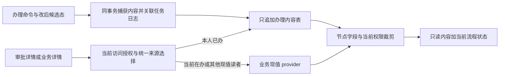

# F-476 审批办理时冻结快照：设计说明

> 状态：F-476r 按 DEC-805 / DEC-807 / DEC-808 修订，待第 1 轮独立审查；仅设计，产品尚未实现。
> **F-476r 合入后 P10 起即可派（DEC-808，修订 DEC-805④）**；仍遵守片间依赖和真实源前置，不再等待原站补证。
> 作用对象：复刻系统。DEC-781 已确定“已办读办理时内容、在办读现值”；DEC-801 已定 D1～D6，见 §10。
> 本轮基线：`08717b1da955dfa71a670093e4648e0e15b30989`（#591 合入后的 main）；不 fetch、不合 main、不改分支。
> §2～§5 既有代码行号沿 #591 设计锚点保留，后续实现须在派发 head 重核。
> 本单只交设计；不改产品、测试、迁移、生成物、状态登记与恢复点文件。

## 0. 依据与边界

### 0.1 来源及证据等级

| 来源                                                              | 本设计采用的内容                                            | 证据边界                                                         |
| ----------------------------------------------------------------- | ----------------------------------------------------------- | ---------------------------------------------------------------- |
| 路线图 `docs/04_路线图/01_分期路线图与开发任务书.md` R1-T07       | 审批中心、最小披露、盲审、并发、同单重提                    | 通用能力边界                                                     |
| `docs/09_派发/后续任务.md` F-413 / F-476                          | F-413 只完成节点判定同源；全类型内容冻结另设计              | F-476 本单范围                                                   |
| DEC-801                                                           | D1 / D2 / D3 / D4 / D6=A，D5=B；结果审批纳入 F-476          | 已登记；其他取舍不变                                             |
| DEC-805 / DEC-807 / DEC-808                                       | 源版本冲突、进行中重叠、只读办理、披露与删除例外、P10+ 放行 | 用户已定；DEC-807①管理者集合按本次派单补充口径，不扩大 #591 §6.5 |
| 本机 `.dev_inputs/f476_d5_evidence.md` §2～§7                     | E4～E9、校准会入口和结束的实测结论                          | 只读输入；仅中性结论入库，不复制单据 ID、测试人员编号或账号      |
| DEC-781                                                           | 办理时存一份，已办读冻结份，在办读现值                      | 用户已定，复刻系统要求                                           |
| `.dev_inputs/rb1a_1.md` P2-1                                      | HRBP 办理 A，后续驳回改 B，两个详情入口错误返回 B           | 本机审查材料，不当作原站证据                                     |
| `docs/02_业务建模/14_审批流模型_实测.md` §11.2～11.4、§11.8～11.9 | 节点表单、编辑、加签、重提沿原流程版本、记录隐藏            | 不证明已办内容冻结                                               |
| `docs/02_业务建模/33_组织调整审批_规格.md` OA-R7 / OA-R18         | 审批编辑、节点可见分区、详情及预览                          | 不证明历史内容冻结                                               |
| `docs/03_需求基线/03_需求基线_组织审批调动.md` REQ-APV-001～003   | 已发布版本、节点披露、禁止盲审、管理员不得代签              | 必须继续满足                                                     |
| `docs/05_验收/01_验收场景与追溯表.md` AC-PRM-29 / AC-APV-14、17   | 历史仍按本人权限；不得由审批获得档案 / 附件范围             | 原有 AC 不等于内容冻结 AC                                        |
| `R2-T08_组织调整设计.md` §4.5                                     | BE-10c 动态快照随编辑 / 刷新基线重算                        | 本设计补充已办读取，保留在办重算                                 |
| `F-048_审批多主体回避_设计.md` §2、§5～7                          | 轮次、只追加证据、回避与参与资格分开                        | 主体冻结与内容冻结是不同对象                                     |
| `F-039_权限框架强制_设计.md` §3                                   | 路由声明、投影器、写前提与运行证据                          | §7 列出后续契约登记影响                                          |
| DEC-402 / 441 / 771 / 786                                         | 无存量兼容开关；独立审查；P0～P2 阻塞；派发角色             | 本文不宣称已获审查批准                                           |

本地检索 `docs/01_证据` 的 Markdown 中“已办 / 已审 + 冻结 / 快照 / 内容”和“办理时 + 冻结 / 快照”，
未找到直接证明“办理 A 后改单 B，再以已办身份读到 A”的操作记录。
另核对 `F273A_组织调整取证.md` 与审批模型 §11：有表单 / 预览 / 操作配置，没有该前后对照实验。
导出菜单 JSON 的词语命中不是操作证据；本设计不据此认定原站行为。
**原站是否冻结、抄送取哪份、兼任角色如何选份均待取证**，不影响按 DEC-781 写复刻设计。
维护者取证只需合成单据 A/B、两名审批人和两个入口的前后截图 / 响应；不提交账号或真实员工资料。
本窗口不访问原站、不调用 GitHub；取证事项交 03 / 00 归入所属批次，不擅开新 F。

### 0.2 目标与非目标

- 冻结的是一次办理所依据的**业务详情内容**，包括可展示的头字段、分区、子项及当时引用标签。
- 读取历史时重判当前权限；“曾经看过”不产生永久授权，也不扩大档案、合同、附件访问范围。
- 实例状态、最新待办、动作、当前 revision、日志隐藏规则仍是当前流程事实，不回退成历史状态。
- 不改任职事件版本链，不将通用本人办理快照用于业务执行、流程匹配、计票、自动同意或恢复重放；D5 通过回写使用独立的提交材料（§6.4），不是本人办理份。
- 既有类型冻结不新增端点；D5 新功能仅加 §6.7 的四个必要端点（含草稿暂存 / 提交）。不加租户开关，不回填、兼容或伪造旧办理快照；不冻结整张 HTTP 响应。
- 所有 12 个适配器均须最终真实接入；talent_review 由占位改为结果审批，不能以占位或替身结项。

## 1. 期望行为与定位

### 1.1 统一读者选择

“已办理”按成功的办理记录判断，不能只看任务不再 pending；cancelled、ended、merged 不等于本人已办。
“在办”是当前 running 实例里本人可执行的 pending 任务；queued 只是等待，不具备决定权。
每次读取先校验租户成员与实例访问资格，再由同一个 `resolveContentView`（拟增）返回内容与节点上下文。
审批中心、业务详情、分区、预览与已有导出调用此结果；不得各写一套“最近节点”。

| 读者 / 情形                                      | 默认内容                 | 节点与权限                                   | 依据 / 已定项                             |
| ------------------------------------------------ | ------------------------ | -------------------------------------------- | ----------------------------------------- |
| 本人当前有 pending 任务                          | 现值                     | 精确到当前任务节点；当前字段权、当前盲审判定 | DEC-781                                   |
| 无在办任务，有本人成功办理记录                   | 最近一次本人办理的冻结份 | 对应记录的任务 / 节点；§5 三重交集           | DEC-781；D6=A（DEC-801）                  |
| 本人在同节点曾办过，又被重新派回                 | 新任务现值               | 不复用旧任务的快照作为在办依据               | DEC-781                                   |
| 发起人且无当前审批任务                           | 现值                     | 既有发起人字段与记录隐藏规则                 | D1=A（DEC-801）；不因发起人读到全表       |
| 仅抄送，无本人办理记录                           | 现值                     | 最近抄送节点表单与当前权限                   | D1=A（DEC-801）；不冒用发送人的快照       |
| 仅流程管理员 / 异常管理员的管理身份              | 现值                     | 现有按钮与实例范围；不得代签                 | D1=A（DEC-801）；管理员身份不授权历史内容 |
| 异常管理员已实际接手并办理任务                   | 本人的冻结份             | 按任务参与人处理，仍受回避与披露限制         | DEC-781                                   |
| 仅业务 HR / 负责人，有独立业务读取资格           | 现值                     | 业务对象、范围、字段原规则                   | D1=A（DEC-801）                           |
| 已办审批人同时具有 HR / 管理员身份               | 默认冻结份               | 参与人分支优先；管理资格不自动并入字段集     | D2=A（DEC-801），防止两个入口 A/B 分叉    |
| 仅待派 / queued 参与人、仅被他人取消的任务持有人 | 现值的受限只读视图       | 既有可打开资格 + 对应任务节点，无审批动作    | D1=A（DEC-801），不伪称已办               |
| 只被 self_skip / subject_skip 留痕的人           | 不凭该任务获得访问资格   | 沿现有 `assertCanOpen` 排除规则              | F-048；其他独立资格另判                   |
| 已移出租户、无法打开实例或无法打开业务单的人     | 同既有拒绝               | 不查询 / 返回快照内容与有无快照              | AGENTS §10                                |

复合角色优先级：当前本人 pending → 发起人 → 本人办理记录 → 普通参与 / 抄送 → 独立管理 / 业务读取。
发起人与已办兼任属 D1=A 已定例外：本人修改重提必须能读到现值；不以此授予自审资格。
业务详情仍须满足原有访问资格，内容选择不将“能打开审批”普遍扩展为“能打开所有业务详情”。
组织调整已有审批参与读取入口保留；其他模块只有独立业务读权时，先过原守卫再选择内容。

D5 的“现值”特指结果审批单当前的不可变提交材料，不是源项目最新结果；一单一快照，无驳回重提。
D5 可打开与催办资格严格按 §6.5；本节通用抄送 / 管理关系不另给 D5 增加读者，终态无动作。

### 1.2 精确身份与多轮次

定位键为 `(tenantId, instanceId, taskId, handlingLogId)`；round、nodeKey、activationId 留作核对与检索。
同一轮同一节点可因会签、转交、加签、跳转多次进入，不能用 `(instanceId, round, nodeKey)` 做唯一键。
同一账号两次办理也不能共用 `(instanceId, userId)` 一份可覆盖记录。
跨实例先按 actedAt 降序，平局按实例 createdAt、instanceId、日志 seq 固定排序；同实例严格按日志 seq。
时间相同无法证明两个事务先后时只保证稳定选择，不把 UUID 大小解释为业务发生先后。
日志 `seq` 是实例内确定顺序；不用时间戳相等时的随机顺序，也不用展示窗口的最新 200 条。

1. 实例 ID 已知：仅在该实例内选本人 pending；无在办则按上表选本人最大 handlingLog.seq。
2. 业务 ID 已知：先在该业务全部实例中找本人当前可办任务；再按角色选当前实例或本人最后办理记录。
3. 后一实例存在，不抹掉前一实例的本人办理记录；无本人新任务时仍能定位旧实例办理内容。
4. 每个记录的节点取它关联的流程 versionId，不用新实例或最新发布流程的同名 nodeKey。
5. `viewerNode` 改为消费所选任务 / 记录，不再与内容来源独立地从 `ownTasks.at(-1)` 推断。
6. 返回最少来源元数据 `contentView = { mode, instanceId, taskId, round, actedAt }`，mode 为 live / frozen。
7. 不向调用者提供任意快照 ID 列表；本单不新增历史版本选择器。内部全量记录保留，默认只读本人最近一份。
8. 只读来源的 revision 不作为写命令 revision；写命令仍拿当前实例 / 业务 revision 并重新校验。

### 1.3 状态转换与冻结时点

| 动作 / 事件                               | 写入及读取规则                                                                        |
| ----------------------------------------- | ------------------------------------------------------------------------------------- |
| 同意 / 不同意 / 驳回到申请人 / 驳回上一步 | 成功关闭本人任务前冻结最终候选内容，与决定 / 日志同事务；驳回人也保留其办理份         |
| 编辑并同意                                | 先执行编辑、整单校验及盲审复核，再冻结编辑后内容；任一步失败整笔回滚                  |
| 独立编辑、事项勾选                        | 只更新现值与必要的并发版本；不制造已办快照，最终决定时再捕获                          |
| 驳回 → 修改 → 重提                        | 旧记录保持 A；新轮 pending 读 B；本人新一轮办理后新增 B，旧 A 不覆盖                  |
| 申请人撤回 / 业务取消 / 删除              | 保留已办记录；未办任务关闭不冒充已办；已办显示历史内容，当前状态显示撤回 / 取消       |
| 审批人撤回同意 retrieve                   | 原办理记录不可变；回到本人 pending 时默认现值；是否计票继续由 task-history 决定       |
| 主动转交                                  | 为转交人冻结转交时可见内容上限，事件为 transfer；接收人的新 pending 读现值            |
| 管理员改派 / 停用接管                     | 不伪造原持有人的办理；管理员操作只留管理日志；已有本人办理份保持原样                  |
| 前加签                                    | 原任务暂停关闭时记录 add_sign 的内容；原人恢复为新 pending 时读现值，随后决定另存一份 |
| 后加签                                    | 原人此次同意所依据内容立即冻结；后加签人按各自办理时间冻结，不能共用最后一人的内容    |
| 并加签 / 会签                             | 各 task 的成功决定各冻结一份；未投票就 ended / merged 的人不产生本人已办记录          |
| 审批人 jump                               | 若成功结束本人当前办理，冻结该时刻并标 jump；管理员跳转不伪造个人审批                 |
| 自动同意 / 自动跳过                       | 留系统处理记录与内容证据，actor 为空；不冒认候选人亲自办理，也不因此增加访问资格      |
| 盲审后系统改派                            | 不写拒绝者的成功办理份；沿既有异常管理员任务处理，新在办人读现值                      |
| 抄送、催办、查看、失败动作                | 不生成办理份；抄送仅记录其节点与接收关系                                              |

上表是其他业务的通用动作全集；D5 仅启用 §6.3 的动作，不开放编辑、驳回、重提、撤回、retrieve 或加签。
D5 主动转交仍可留办理证据，但不形成新业务轮次；管理员改派不伪造原审批人已办记录。

系统自动记录与人工记录在表中明确区分；人工默认选择仅查 actor = 本人且 kind = human。
`same_skip` / `history_skip` 即使任务 assignee 非空，也不得冒充那个人的人工快照。
被 retrieve / 跳转作废的是计票资格，不是“曾办理过”的事实；历史内容仍可读，且明确当前状态。

## 2. 基线现状核对

### 2.1 共用链路

以下路径相对仓库根，行号固定于本文基线，后续开发不得凭旧行号替代读源码。

| 文件 / 行                                                     | 已确认现状                                                                                          | 后续改动点                                       |
| ------------------------------------------------------------- | --------------------------------------------------------------------------------------------------- | ------------------------------------------------ |
| `apps/api/src/modules/approval/adapters.ts:65,80,642`         | 12 个 BusinessType；snapshot 是动态函数，BusinessSnapshot 带 values / originals 等                  | 展示捕获与流程快照分离，注册完整类型集合         |
| `approval/disclosure.ts:80,99,148,158`（均在上述 modules 下） | 每次 readDetail 调适配器；viewerNode 取最后参与任务；披露是节点字段交当前字段权                     | 先选内容来源，再加载及裁剪；节点同源             |
| `approval/disclosure.ts:249`                                  | 表单用 snapshot，状态 / revision / tasks / logs 用当前实例                                          | 保留当前流程信封，替换表单来源                   |
| `approval/routes.ts:185,206,218`                              | 详情与历史调用 readDetail；foreign 字段再检查当前权限                                               | 统一事务内完成来源与授权；历史日志不拿冻结权兜底 |
| `approval/engine.ts:101,116,143`                              | 业务锁在实例锁前；openRun 读当前快照；refreshBusinessVersion 改实例版本；persistRun 写审计 / outbox | 冻结接在成功办理事务中；不替换 openRun 的现值    |
| `approval/actions.ts:285,302,348,394,436,613`                 | 同意可先编辑；不同意 / 驳回 / 加签各自关任务                                                        | 每个成功办理出口共用捕获服务                     |
| `approval/engine.ts:313,389,652,973`                          | 自动任务、推进与重提；resume 加 round                                                               | 系统证据分类；旧轮记录永不改写                   |
| `approval/task-history.ts:12,27,42`                           | 撤回可使同意计票失效；自动与人工同意已区分                                                          | 不用有效计票集合代替历史内容集合                 |
| `packages/db/src/schema/approval.ts:414,505`                  | tasks 有 seq / round / activation / actedAt；日志只记事件 detail，无内容冻结实体                    | 新建表，勿塞进会直接返回的日志 detail            |
| `packages/db/migrations/0029_approval_isolation.sql:27`       | tasks / logs 租户隔离；日志只追加                                                                   | 新表同等隔离并 FORCE RLS，普通角色验证           |

### 2.2 全部适配器来源与可变性

本表的代码路径均相对 `apps/api/src/modules/`；“变化”指下一次 snapshot 可能改变，不表示允许任意编辑。

| businessType         | snapshot 来源 / 行                                             | 内容与版本                                                                                   | 随后变化                                                 |
| -------------------- | -------------------------------------------------------------- | -------------------------------------------------------------------------------------------- | -------------------------------------------------------- |
| contract             | `contracts/adapter.ts:34`                                      | request、target 合同、custom 字段；原值读合同；version=request.revision                      | 重提改请求、目标合同变化会改变现读结果                   |
| employment           | `approval/adapters.ts:411`                                     | 任职业务最新载荷、前驱、当前任职、档案、联动合同、离退扩展；version 为载荷 / 联动 / 离退组合 | 编辑 / 重提改载荷；前驱、档案、关联显示值可独立漂移      |
| personnel_change     | `approval/adapters.ts:564`                                     | currentChangeValues；originals 固定 targetRevision 子集版本；version=change.revision         | 原值较稳定，修正重提的 values 改变                       |
| idp                  | `idp/approval-adapter.ts:111`                                  | stage + plan；values={}，originals=null，changedFields=[]，version=stageId                   | 流程快照不含计划内容；业务详情目标 / 活动 / 回顾实时变化 |
| talent_review        | `talent-review/approval-adapter.ts:1`                          | 全方法 unavailable 占位，无可用 snapshot                                                     | 不可发起本类型；不能当作集合快照已实现                   |
| part_time            | `employment/part-time/approval-adapter.ts:140`                 | 请求版本、主职及档案；version=version.id                                                     | 请求改版、主职与档案变化影响下次结果                     |
| offer                | `offer/approval-adapter.ts:65`                                 | Offer 当前行 → offerDto → OFFER_FORM；version=row.revision                                   | 编辑后变化；删除分支生成空值，不是历史内容               |
| offer_batch          | `offer/approval-adapter.ts:136,163`                            | 批单、成员 ID、现行 Offer 行 batchLine；version=批 revision + 子 revision                    | 子项变化 / 删除影响集合；无独立冻结集合                  |
| probation_assessment | `employment/assessment-approval-adapter.ts:54`                 | 考核当前行 ASSESSMENT_FORM_FIELDS；version=row.revision                                      | 审批编辑 / 重提改变字段；含试用中与转正考核              |
| org_adjustment       | `org-adjustment/approval-adapter.ts:32` → `snapshot.ts:79,149` | 现行头与组织行、建行基线 originals；version=view.revision                                    | 编辑、删行、刷新基线后重算；基线仅实现组织分区           |
| retirement_intention | `employment/retirement-intention-adapter.ts:24`                | 意向申请当前行及员工 / 当前任职；version=row.revision                                        | 申请改写后变；与退休业务不是同一类型                     |
| exit_handover        | `employment/exit-handover-adapter.ts:25`                       | 交接申请 / 离职单及任职路由信息；values={}，version=row.revision                             | 事项在自有详情实时读写；重新提交可建新实例               |

`employment` 按 `approvalTypeOfBusiness` 覆盖实际任职审批子类型，后续用代码枚举断言映射完整。
特别覆盖入职 / 重聘、调动、离职、退休、转正、实习转正；不把退休遗漏成仅做意向申请。
合同逐 operation 覆盖新建、续签、变更、终止；兼职覆盖新增与结束；员工子集逐 SUBSETS 注册项覆盖。

### 2.3 第二读路径清单

| 类型                 | 自有入口 / 实现位置（相对 modules）                                                         | 当前取值与改造边界                                                                                  |
| -------------------- | ------------------------------------------------------------------------------------------- | --------------------------------------------------------------------------------------------------- |
| org_adjustment       | `read-routes.ts:47,56,66,75`；`disclosure.ts:50`；`detail.ts:23,65`，均在 org-adjustment    | HR 分支先返回；审批分支只取披露集；detail 重新 loadHead / loadItems，预览亦独立取现值。须替换内容源 |
| employment           | `employment/routes.ts:406` businesses；`exit-routes.ts:546`；`retirement-view-routes.ts:87` | 独立读取业务 / 离退详情；不经 readDetail。审批关联的单据内容统一选择；档案 / 任职履历仍是业务真值   |
| personnel_change     | `personnel/request-routes.ts:58` loadChange                                                 | 申请详情取当前请求；子集实体 `/.../:id` 是主数据，不改为审批历史                                    |
| contract             | `contracts/routes.ts:541` loadRequest；`:203` loadContract                                  | 请求详情接来源选择；合同记录本身保持当前合同业务规则                                                |
| idp                  | `idp/plan-routes.ts:92,97,271`；`plan-view.ts:339,554`                                      | 当前计划详情；需按 stage 与审批实例上下文选冻结计划内容，不能只冻结空 values                        |
| part_time            | `employment/part-time/request-routes.ts:308` loadPartTimeRequestDetail                      | 请求、主职、员工当前投影；请求历史内容接选择器，兼职记录不变                                        |
| offer                | `offer/routes.ts:231`                                                                       | 当前 Offer 详情；关联审批内容需接选择器；管理编辑操作仍校验现行 revision                            |
| offer_batch          | `offer/routes.ts:115` 只有批提交入口；批内容在通用审批详情                                  | 基线没有独立批详情 GET；不凭空增加，已有单 Offer 详情不冒用批审批资格                               |
| probation_assessment | `employment/assessment-routes.ts:120`                                                       | 当前考核详情；接审批内容选择器                                                                      |
| retirement_intention | `employment/retirement-intention-routes.ts:161`                                             | 当前意向单；接审批内容选择器                                                                        |
| exit_handover        | `employment/exit-handover-routes.ts:181,194` handoverDetail                                 | 交接事项现值；精确申请入口及离职关联入口均定位到被选申请 / 实例                                     |
| talent_review        | `talent-review/approval-adapter.ts:1`                                                       | 无可用结果审批详情链路；已有模板 / 项目配置详情不能冒充集合审批详情                                 |

组织调整注释称“同一份快照”不代表实际读取内容已冻结：`Disclosure` 只返回 view / fields / scope / instanceId。
本单以调用和数据流为准，不把注释或现有 F-413 测试的“双方都等于 B”当作冻结证据。

## 3. 数据模型与迁移草案

### 3.1 方案比较与选择

| 方案                                               | 优点                           | 缺点 / 结论                                                           |
| -------------------------------------------------- | ------------------------------ | --------------------------------------------------------------------- |
| 只存业务 revision，读取时还原                      | 体积小                         | 各域不都有完整版本；引用名、档案、IDP、交接及集合无法统一复原，不采用 |
| 把裁剪后的 HTTP 响应塞进 tasks / logs              | 实现表面简单                   | 混入动作、权限、日志；多角色复用泄露；日志可能直接出参，不采用        |
| 独立只追加办理内容表，保存类型化展示内容及披露上限 | 内容独立、可验约束、读时再裁剪 | 多一份存储及投影契约；采用                                            |

保存**审批详情的完整业务展示输入**，不是整份数据库行或 HTTP 响应，也不只保存 changedFields。
未变化但当时展示的申请理由、主职、目标明细、名称等都要能稳定复现；changedFields 仅是元数据。
内容在面向特定读者裁剪前采集，同时记录办理时实际可披露的字段 / 行上限，读取再取交集。
结构为版本化 discriminated union；只有声明过的字段能进内容，默认拒绝未知字段，不做通用实体库。
这是不可变审计材料，业务模型仍由各域明确表 / 列承载，不能通过修改 JSON 驱动业务。

### 3.2 表草案 `approval_handling_contents`

| 列 / 分组                                          | 类型草案              | 约束与用途                                                                        |
| -------------------------------------------------- | --------------------- | --------------------------------------------------------------------------------- |
| tenant_id, id                                      | uuid                  | 租户必填；主键 / 唯一键均带租户                                                   |
| instance_id, task_id, handling_log_id              | uuid                  | 指向实例、任务、办理日志；成功办理必须有确定日志                                  |
| round, node_key, activation_id, process_version_id | integer / text / uuid | 记录当时坐标；activation 可空仅因现行模型允许，定位不依赖它单独唯一               |
| actor_user_id, handling_kind, action               | uuid nullable / enum  | human 必有实际操作人；system 不借用 assignee；明确 approve / reject / transfer 等 |
| business_type, business_id, business_version       | enum / uuid / text    | 区分内容身份与捕获版本；不能被请求体任意指定                                      |
| content_schema_version                             | integer               | 首版 1；未知版本拒绝读取，不回退到现值                                            |
| content                                            | jsonb                 | §3.3 类型化业务内容，不含状态机 / 授权配置 / 原始命令                             |
| disclosure_ceiling                                 | jsonb                 | 字段编码、子项 ID、分区与引用标签权限键；只内部使用                               |
| payload_bytes, content_digest                      | bigint / text         | UTF-8 规范编码字节与完整性摘要；不对外返回摘要                                    |
| acted_at, created_at                               | UTC timestamp         | 办理 / 落库时间；顺序仍以关联日志 seq 为准                                        |

唯一约束 `(tenant_id, handling_log_id)`；每一终结本人任务的办理事件最多一份。
额外唯一约束 `(tenant_id, task_id)`：一个任务成功关闭只产生一份内容，恢复 / 重派使用新 task。
后加签同时写 approve 与 add_sign 日志时，以 approve 日志作为唯一办理锚点，不能捕获两遍。
并加签发起若原任务仍 pending 则不捕获，实际决定时才捕获；编辑 / 勾选 / 抄送也不入本表。
外键全部带 tenant_id；还须约束 task / log / round / node / version 与 instance 一致。
通过复合引用键和插入守卫实现一致性，不仅各自 FK 存在就算合法；普通角色负例必须覆盖错配。
actor 用内部账号 ID 留历史，不新加会等待成员行的 FK；沿 F-048 做法避免改变既有锁序。
索引 `(tenant_id, instance_id, actor_user_id, handling_log_id)`，日志关联按 seq 降序选择。
业务跨实例选择利用既有 instances 的 `(tenant_id, business_type, business_id)` 索引。

### 3.3 内容边界

| 内容         | 保存办法                                                                                  | 读出约束                                                                 |
| ------------ | ----------------------------------------------------------------------------------------- | ------------------------------------------------------------------------ |
| 通用字段     | values / changedFields、原值材料、字段对象编码、profileFields、foreign 字段身份、业务类型 | 当前节点 / 权限重新投影；内部路由字段不直接输出                          |
| 原值         | 捕获时由既有前驱 / targetRevision / baseVersionId 计算；保存材料及版本引用                | 不给业务对象另加“变更前”列；当前 showOriginals 关闭即不返回              |
| 分区 / 集合  | 行 ID、当时顺序、字段值、引用关系、当时成员集合；不可只存 ID 待读时重新 join              | 逐行逐字段再授权，当前新增行不得混入旧集合                               |
| 显示标签     | 当时的名称 / 字典标签与其源字段 / 引用权限键一起存                                        | 权限取消时名称和 ID 一起裁掉，不能用现值补名称                           |
| 组织调整预览 | 当时展示树所需的有界节点、关系、标签与字段依赖                                            | 删掉不可见行及依赖节点后重投影；不得查询当前树来补齐                     |
| IDP / 交接   | 类型化详情扩展：目标、活动、回顾或事项内容 / 完成态等实际办理页面字段                     | 按模块既有角色 / 阶段 / 事项规则交当前权限，不能拿空节点字段作全字段豁免 |
| 附件         | 本次表单已授权的附件引用及展示元数据，不存文件二进制或下载链接                            | 当前登记状态及下载权限重验；删除或无权均不回显旧文件名                   |
| 不保存       | conditionValues、审批人来源解析缓存、秘密、凭据、完整日志、动作清单、临时 URL             | 写入白名单与泄露扫描保证，不靠开发者自觉                                 |

“原值材料”是一次办理的证据副本，来源仍为版本链；不成为第二个可更新的业务原值来源。
审批内容摘要不发给前端：隐藏字段改动不能经 hash / 字节数 / 内部错误显露。

### 3.4 隔离、不可变与迁移

- 新表启用与 FORCE RLS；USING / WITH CHECK 都按当前租户，应用角色无 BYPASSRLS。
- 读写全在 withTenant 的同一 Tx；不允许“为冻结”开裸连接或另起事务。
- 应用只授 SELECT / INSERT；数据库触发器禁止 UPDATE / DELETE / TRUNCATE，沿日志不可变范式。
- 快照失败即办理失败，审计或 outbox 不可写也整体回滚；禁止后台异步补冻结。
- 迁移追加新文件，由后续契约 PR 按仓库工具生成编号；本文不预占迁移号。
- 不做回填、双读兼容、功能开关。新系统要求人工已办必须有快照，缺失为完整性故障。
- 缺失记录返回统一 503 业务详情暂不可用；只向已授权读者返回，不泄露缺的是哪份或隐藏对象 ID。
- 业务单删除不级联删除办理材料；删除 / 隐藏是否允许读历史仍按当前可打开规则决定。

### 3.5 体量、保留与恢复

单份规范化内容不超过 16 MiB（D4=A，DEC-801），超过后明确 413，不截断、不同意后补写。
实现前用各域既有最大合法行数 × 最大字段长度验证；若合法请求可超限，先分块存完整内容或调整预算，
不得让原本合法的最大组织调整 / Offer 批次在最后审批时才必然失败。提交与编辑应提前做同口径预算检查。
分块若必要仍属于一个 content 实体，块序 / 块数 / 摘要受同事务约束，读齐才能投影。
本设计优先单行 JSONB + PostgreSQL 内部大值存储；不为估计规模提前引入对象存储、压缩协议或后台队列。
规模示例（非实测容量承诺）：每单 6 次办理、每份 100 KiB，10 万单约 57 GiB 原始内容，不含索引 / 副本。
集合批准前捕获一次共享不可变内容可在后续测量后去重；首版按记录保存，禁止通过可变共享指针省空间。
首版不自动过期清理（D4）；结束、撤回、作废都保留，与审批实例同寿命。
未来合规删除应设计受审计的租户整体处置，不由日常业务删除或定时 TTL 擅自删除证据。
备份覆盖新表 / 摘要 / 内容版本；恢复沿一致快照 + 附件清单 + 代码迁移版本，不自动重放审批 / 消息。

## 4. 写入协议与原子性

### 4.1 单一捕获服务

拟增 `captureHandlingContent(tx, run, task, handlingEvent)`，各出口只传可信已加载对象。
服务内部按 businessType 调类型化内容收集器，生成内容、权限依赖和该实际办理人的披露上限。
流程使用的 `BusinessAdapter.snapshot` 保留；新增展示捕获端口不得借机改变路由、盲审或自动跳过语义。
`DetailData` 拆分展示内容与当前动作现场；冻结内容不强行伪装为完整 BusinessSnapshot。
不得为了凑类型给 conditionValues 等写假值，更不能将历史字段传入 openRun / 路由求值。
D5 provider 读取提交材料，不读取源结果拼“现值”；源 result_seq 只供通过校验，不能冒充业务单内容版本。
全部适配器有必填的 content provider 登记，禁止缺失时默认 `{}` 或退回普通 snapshot。

办理事务顺序：

1. 原命令幂等与当前权限校验，按既有业务锁 → 实例锁顺序打开 run。
2. 校验 current revision、任务归属 / 状态、回避、按钮、盲审与业务版本。
3. 如编辑并同意，应用改后候选态；重载版本并做整单校验 / 再判盲审。
4. 捕获该决定依据的内容；在业务 approved / rejected 等回调改变单据之前构造证据。
5. 关闭任务，写办理日志取得 ID，插入内容并核对关联关系；审计仅记录安全元数据。
6. 继续加签 / 会签 / 自动推进、调用业务出口、persistRun 与 outbox；一起提交。

事务内顺序可为取得日志 ID 调整，但不能在回调改变内容后重新取“办理时内容”。
D5 同意在本协议第 4 步前先做 §6.6 的删除分组与全集合 CAS；冲突走系统终止分支，不进入人工捕获 / closeTask / approved 回调。
后续自动节点若看见了新业务版本，按它自己的处理现场另捕获系统记录，不复用上一个人工决定的版本。

### 4.2 所有出口的接线责任

| 代码族（相对 modules/approval） | 必须纳入                                         | 不能误加                                  |
| ------------------------------- | ------------------------------------------------ | ----------------------------------------- |
| actions.ts 决定类               | approve / disagree / reject / rejectPrevious     | 盲审 / 回避 / revision 拒绝不记成功办理   |
| actions.ts / node-actions.ts    | 主动 transfer、关闭原任务的 addSign、审批人 jump | cc / urge / separate edit 不伪造办结      |
| engine.ts                       | 自动同意 / 跳过记录                              | self_skip / subject_skip 不增加参与人资格 |
| countersign.ts / add-sign.ts    | 各实际决定、后加签原人同意、恢复任务定位         | ended / merged / queued 不伪造本人决定    |
| handover.ts / 管理员干预        | 保留既有办理记录，新任务读取现值                 | 接管操作人不替原人“审批”                  |
| 业务提交 / 撤回 / 取消挂接      | 旧实例保留、新实例与轮次定位                     | 不覆盖旧内容，不把业务撤回变成审批人办理  |

现有事务中的幂等命令重放只能返回既有回执，不再捕获内容；相同 commandId 异内容仍 409。
回执丢失后按原 commandId / 对象 revision 查询结果；不得用“又写一份快照”判定成功。
存储故障注入应验证：任务、实例、业务、内容、日志、审计、outbox 要么全写，要么全无。

### 4.3 并发与一致内容

内容收集不能只是对每张表依次 SELECT：READ COMMITTED 下可能读到一半 A 一半 B。
每个 provider 声明稳定读闭包与锁依赖；业务头 / 子行内容写入口必须遵循相同业务头锁或版本校验协议。
有不可加业务锁的名称 / 字典读取，用单条一致性查询获取或读取不可变版本，不混入不同语句时刻的新标签。
集合按既有业务锁序锁头及成员，固定成员清单；所有子项 revision 在捕获前后保持一致。
IDP / 交接原 version 不覆盖详情全部内容，新增展示版本摘要只用于捕获一致性，不替换既有流程版本语义。
若不能稳定读取，返回现有 409 并要求显式刷新；不得自动重试审批决定。
禁止新增“先实例锁再员工 / 组织锁”路径；新增复合 FK 的隐式锁也需 PG 交错验证。

## 5. 读取、当前权限与侧信道

### 5.1 读算法

1. 在当前租户事务中重新确认成员、实例 / 业务打开资格；失败与不存在保持同一 404 文案。
2. 按 §1 选 live 或 frozen，以及唯一任务 / 办理记录；完整任务索引不受展示分页影响。
3. frozen 不调用动态 adapter.snapshot，不重读当前业务详情来填缺字段；内容缺失或损坏显式失败。
4. live 调现行 provider，沿用当前业务校验与并发版本；两类内容均过同一模块展示投影。
5. 用所选流程版本 / 节点、当前字段与关联对象权求披露集，裁剪全部嵌套和元数据。
6. 再按当前实例生成状态 / revision / 可用动作；动作不使用冻结 changedFields 作为当前盲审输入。
7. 历史内容响应只读；若同时有独立管理写权，写操作须刷新现值，不得拿历史画面直接提交。

### 5.2 三重交集（D3=A，DEC-801）

`历史可见 = 办理时披露上限 ∩ 所选记录的节点表单 ∩ 读取时当前权限`。
其中当前权限包括本对象、员工档案字段、foreign 对象范围 / 字段、子项角色以及附件授权。
节点是该实例冻结流程版本中的节点，不是管理员后来发布的新版本；“当前权限”不等于替换旧节点。
办理时不可见的字段，后来新增权限也不补露；办理时能看的字段，撤权后立即隐藏。
节点表单变化只随新实例 / 新版本发生，历史记录的上限不被扩大；当前安全约束收紧照常生效。
`showOriginals` 是当前展示设置：现在关闭就隐藏原值；现在开启也只显示既在上限又当前有权的原值。
单字段为空值不表示无权；保留 null / false / 0 / 空数组的业务语义，裁剪用字段缺席表达。

自动记录没有人工办理上限：使用节点表单的内部证据上限；它不成为普通读者默认历史来源。
IDP / 交接节点不使用通用表单字段时，使用其实际详情的模块字段 / 分区权限映射，空集合默认不披露。
IDP 对照 `plan-view.ts:102,339,554`，覆盖 modules / goals / tasks / reviews / analyses / keyInfo 的逐层依赖；
交接对照 `exit-handover.ts:366`，保存事项事实，但 editable / mine 等当前任务派生能力必须读取时重算。
不得以 `values={}` 或 `viewable=undefined` 将扩展内容整包放行。

### 5.3 对象与引用

- 审批任务允许读取本单字段的既有 DEC-057 例外保留；不能为了冻结给审批人新增所有组织范围。
- 独立业务 HR 路径仍按业务范围判；freeze 不把“以前在范围内”当作当前授权。
- 合同 foreign 字段用捕获的对象身份做定位，再实时查其当前归属 / 可见性；不存在与范围外同样裁掉。
- 本单已冻结的普通文本 A 属历史表单值；只要本单及字段当前有权，修改 / 删除源对象不会把 A 变成 B。
- 可导航引用的名称 / ID / 编码 / 附件名属于关联对象披露；对象删除、不可验证或范围外时统一隐藏。
- 组织调整明细自己的 `name=A` 与外部 `targetOrgName` 分别归类，不能借“历史文本”豁免所有名称权限。
- 隐藏字段在 values、originals、changedFields、labels、errors、日志字段名、导出中同时移除。
- 分区成员数只计算可披露集合；不新增隐藏行的差量、快照字节数或摘要侧信道。

### 5.4 两条入口与派生视图

组织调整不再先因 HR 身份返回现值；先取得参与上下文，内容选择后再按所选角色路径授权。
拟改 `Disclosure` 携带内容源对象，detail / items / preview / export 仅消费它，不能再直接 loadItems 拼现值。
preview 冻结的是当时可展示的树输入，读取时按当前字段依赖投影；不能将当前架构树叠加旧明细。
执行状态可另作为明确的当前状态元数据；执行错误详情不拼入冻结申请内容，更不能回显隐藏组织名。
其他模块各自的实际申请详情接同一来源选择器；员工档案、合同实体、任职记录等主数据入口保持独立。
对业务仅以 planId / exitId 定位而有多个阶段 / 申请的，使用已存在 GET 的可选实例上下文约束：
校验实例必须指向该业务对应阶段 / 交接申请且当前读者有权；不接受跨业务 ID，也不新增 GET 路由。
无上下文默认按 §1.2；新增查询参数及 contentView 元数据属于共享契约，须与消费者和 F-039 同片验收。
按 D2=A（DEC-801），不提供“切成 HR 现值”的旁路参数，不扩为显式管理现值模式。
已有前端名称解析器也必须消费响应中的历史标签，不能收到冻结 ID 后再查询当前字典覆盖标签。
这是后续契约消费者的最小适配，纳入各片估算；业务写按钮须据 contentView 先刷新当前内容。

D5 两入口均受 §6.5 同一白名单约束；管理读者只投影当前 TalentReview 人员范围内的行，催办另判参与资格。
D5 源对象移出后，原提交行仍保留，外部引用按本节裁剪；写回跳过与披露权限分别判断。

### 5.5 审查重点

重点对抗：已办兼任 HR、权限撤销后缓存、外部合同撤范围、同一人多任务、多实例、集合删增行、原值显示开关。
只缓存不可变原始内容且缓存键含 tenant / content ID；授权投影不跨请求复用，不共享带人名的响应缓存。
错误、审计、outbox 仅带允许的内部引用 / 动作元数据，不复制 content；普通日志接口不得泄露原始内容。
历史日志继续用 `recordsHidden` / `visibleTasks` / `projectLog`；冻结记录不绕过 DEC-104 / 115。
不修 F-087 清单全部既有问题，但本单新增快照出口不能引用“权限后补”作为放行理由。
设计与后续代码均由 03 另派独立审查；自检和 CI 绿不等于 DEC-441 批准。

## 6. 全业务接入契约与特殊点

| 类型                 | 内容 provider 与第二入口接入                                                     | 必须证明的特例                                                                                          |
| -------------------- | -------------------------------------------------------------------------------- | ------------------------------------------------------------------------------------------------------- |
| org_adjustment       | 冻结头 / 组织分区 / 基线 / 名称 / 预览输入，替换四个读出口的数据源               | 首片 A/B 双入口；暂存行照收；未来五分区使用同一强制注册契约                                             |
| employment           | 通用任职内容 + 联动 / 离退扩展；businesses / exits / retirements 共用来源        | 退休不是退休意向；业务通过尚未生效；前驱与档案变化不能改历史                                            |
| personnel_change     | 子集申请全字段与 targetRevision 原值；request-routes 接入                        | 显式清空、删除目标记录、全部 SUBSETS 参数化覆盖                                                         |
| contract             | 请求内容、目标合同原值与 custom 字段；requests 详情接入                          | 四种 operation；续签后目标变更仍读办理时值，撤权要裁掉                                                  |
| part_time            | 请求版本 + 当时主职 / 档案展示输入；申请详情接入                                 | 结束兼职日期及 originalEndDate；主职后续调动不改历史                                                    |
| offer                | 当时 OFFER_FORM 及显示依赖；单 Offer 详情接入                                    | 后续编辑 / 删除时不退化成空 DTO；签署秘密永不捕获                                                       |
| offer_batch          | 批头、当时成员与 batchLine 的完整类型化集合                                      | 不从当前 offerIds / Offer 行重组；每行关联授权，集合不扩散到单 Offer 读权                               |
| probation_assessment | 考核表单 / 评价内容与显示依赖；考核详情接入                                      | 试用中和转正两类；自动生成转正业务不覆盖考核已办内容                                                    |
| retirement_intention | 意向日期 / 原因等全表单；意向详情接入                                            | 通过只记录，不能把当前预计退休日期冒充办理时意向日期                                                    |
| idp                  | 独立展示 provider 捕获本 stage 办理页面的计划 / 目标 / 活动 / 回顾               | 制定、执行、回顾不同 stage 分别定位；不得只测试空 values 恒等                                           |
| exit_handover        | 申请头、工作 / 其他事项、当时完成态与办理备注，模块详情投影                      | 他人之后勾选不改旧份；重新发起新实例不覆盖旧申请快照                                                    |
| talent_review        | DEC-801 D5=B：实现项目 / 校准会来源的集合结果审批及真实 provider，详见 §6.1～6.8 | 暂存 / 提交、只读办理、不同意终态、版本冲突、删除例外与生命周期全部验收；启用前修正 TalentReview 范围桶 |

组织调整尚未落地的职位 / 调动 / 编制 / 兼职分区仍按原任务推进，接入必须满足强制内容契约和 AC-16。
已有真实入口的 11 类不得以“先通用快照，业务详情以后再说”交付完成；第 12 类须按下节真实启用。

### 6.1 DEC-801 D5=B：现状与功能前置

结果审批属于本次 F-476 的开发范围，必须交付可发起、可办理、可回写的真实链路，不能以占位契约结项。
本节依据 `26_人才盘点_规格.md` §2、§3.6～3.7（TR-R36～41），及已审 `R3-T04_人才盘点_设计.md`
§2.5～2.6、§3.1～3.5、§6；TR-R41 才是结果审批规则，不能把 TR-R37 的“发起校准会”误读成结果审批。

| 能力                            | 本工作树代码证据（相对仓库根）                                                                          | 结论                                                                                    |
| ------------------------------- | ------------------------------------------------------------------------------------------------------- | --------------------------------------------------------------------------------------- |
| 项目及状态                      | `packages/db/src/schema/talent-review.ts:1128,1151,1173`；`talent-review/project-service.ts:94,114,137` | 有 new / in_progress / ended、结束禁止改、重启；不能把项目状态当结果审批状态            |
| 模板 / 字段 / 评价规则 / 九宫格 | `apps/api/src/modules/talent-review/routes.ts:39`；`packages/domain/src/talent-review/catalog.ts`       | 已接配置路由；九宫格定义存在不等于对象落位、校准会运行时存在                            |
| 盘点对象 / 结果                 | 全仓 src/schema、modules 与 SQL 迁移检索 `talent_review_objects` / `result_seq`                         | 没有对象结果持久化实现；`project-guards.ts:22` 仍是待 PR-C 登记的对象存在性端口         |
| 校准会                          | 同范围检索 `talent_review_meetings`，核对 routes 挂载                                                   | 无 Meeting / 参与者 / 会中对象 / 路径运行时与读写路由；旧设计中有表草案，不是现成产品   |
| 结果审批注册                    | `packages/domain/src/talent-review/catalog.ts:177`；`approval/types.ts:708`                             | 有 ResultApproval 目录和 talent_review_result 类型；formFields 为空、approvalEdit=false |
| 预置流程                        | `packages/domain/src/approval/presets.ts:581`                                                           | 有草稿预置；须按 §6.2 接显式审批主体人主职部门负责人，不能任取集合第一人                |
| 适配器 / 表                     | `talent-review/approval-adapter.ts:10`；检索 result_approvals 表与路由                                  | 全方法 409 unavailable；无结果审批头 / 明细表及发起入口                                 |
| 范围 / foreign                  | `approval/access.ts:377,408`；`approval/foreign-fields.ts:61`                                           | talent_review 落任职范围兜底；foreign 只实现合同对象，不能直接承接盘点结果字段          |
| 同步                            | `talent-review/sync-port.ts:1`、`sync-port-memory.ts:1`                                                 | 接口与测试替身存在，非真实对象结果来源；不能将内存替身装入产品以宣称 D5 完成            |

表内省略前缀的 API 文件均位于 `apps/api/src/modules/`。检索未命中只描述本固定基线，不推断其他分支进度。
依赖既有 T04 PR-C 的 C0 / C1a / C1b / C1c 真实对象、字段与结果读取，允许真实初始空值，不要求完成评价；
校准会入口另依赖原 T04 PR-D 的 Meeting、成员、校准、比例与结束服务（旧设计 §3.5）。
这些原 T04 能力不是新发起的 F 单，也不在 F-476 重建第二套对象或计算引擎；由 03 先核定其合入状态。
若派发时仍与本基线相同，P10 的完整接线及其后依赖片等待这些真实前序；不得把结果状态手工置为 flow_ended 伪造来源。
F-476 的新增八片见 §8，真实前序未交付时 F-476 整项不得记完成，不能只交“以后接 provider”。

### 6.2 发起人、入口、集合与流程

本节采用 E4 / E6 / E8 的已取证结论，并以 DEC-805 / 807 / 808 收紧复刻口径。
TR-R41 的“审批人可编辑”与旧 T04 的多轮候选设计由 DEC-805③ 覆盖，仅在 D5 删除；其他业务不变。

- 两个入口分别为项目详情、校准会详情 → 盘点对象 → 选人 → 更多操作 → 发起结果审批（结果确认组）。
  打开同一发起页，页头都是项目信息。会内单只列在该会“结果审批流程”，项目页签仅列无 meetingId 的单。
- 发起人仍是管理范围内的项目管理员；host / calibrator / viewer 不因此获得发起权。
  单据只属一个项目；meetingId 必须属该项目，所有选择须是该会成员且仍在项目中。
- 新建、进行中的项目都可发起；项目或来源会已结束则禁止。对象状态不构成资格门槛，初始、计算失败、终止均可选，
  空值按真实结果保留；不存在与范围外统一拒绝，不伪造源行。会未结束时沿 T04 真实成员关系校验。
- 表头复选框仅选当前页，另有跨页“选择全部”。提交显式 objectIds、源版本与项目 revision，不能保存动态筛选代替集合。
  原站发起页侧未见人数上限，仅实测到 37 人，未测更大集合与提交后的服务端行为；复刻上限见下。
- 提交必填审批流程、审批主体人；主体人必须是所选对象之一。说明选填，最多 1000 字（Unicode 码点），前后端一致校验。
  打开发起页建草稿；可暂存，提交前确认人员范围及披露提示。草稿允许流程 / 主体暂未填写，提交时必验；选择集仍不能为空。
  草稿不建实例 / 待办、不占用对象。
  暂存可调整选择、主体、流程和说明，不能编辑结果；预览重取须显式刷新并确认，不能提交时静默改值。
- 首次直接提交和暂存转提交共用同一服务：锁内重验权限、成员、版本、流程和占用，冻结确认过的内容后创建实例。
  暂存中源版本过期返回 409，保留草稿并要求刷新确认；提交成功后不允许修改任何申请内容。
- 已有通过、不通过或已终止单不挡再发；有另一张本租户进行中的结果审批单占用任一所选对象，整单 409
  `RESULT_APPROVAL_IN_PROGRESS`，点名当前有权选择的冲突对象，不泄露对方单号、发起人或无权名称；并发保障见 §6.6。
- 原站只有一级“组织负责人审批”。复刻预置沿该结构、类型为 `talent_review_result`，保留 DEC-332 的 avoidSelf / avoidSubjects，不改 DEC-053 的通用流程可配置结论。
  本次发起只接受该类型已发布、满足条件且与只读单节点动作契约一致的流程版本；不跨类型兜底。
  路由主体是用户显式选中的审批主体人，按发起时租户业务日期的有效主职部门负责人解析，不取项目 / 会负责人或集合第一人。
  F-048 的回避 subjects 仍包含全部成员，与单个路由主体分开；避开自己 / 主体后无可用审批人则发起失败。
  无主职、无负责人、无法映射有效租户账号或缺失发布版本均 fail-closed，不创建无待办的 running 单。
  原站审批人此前“异常”已更正为记录错误，实测符合主职部门负责人规则，不实现所谓异常兼容。
- 发起人接收本单抄送；不借抄送扩大 §6.5 读者集合。通过意见必填，不同意意见选填。

**原站未测、按复刻口径实现（DEC-808）**：服务端固定 `MAX_RESULT_APPROVAL_OBJECTS = 200`，
保存 / 提交均拒绝第 201 人（413 `RESULT_APPROVAL_TOO_LARGE`），不静默截断或自动拆单。200 是同步事务首版预算，
覆盖已实测 37 人并限制排序锁、逐字段授权和快照成本，不是推定原站限制。大集合通过多个独立单显式发起。
提交同步完成，成功响应前必须实例、待办与提交材料同事务提交，不返回异步 accepted；超时走命令回查。
此人数上限和 §3.5 的单份 16 MiB 上限同时适用，提交前测完整材料预算；200 人最大合法字段体量须做容量验收。

发起页明细列按证据 §4：校准后业绩 / 绩效 / 能力 / 潜力、待发展项、优势项、发展建议、标签、目标职位、
目标关键岗位、是否继任、准备度，另有校准后九宫格；可按部门与校准后四维筛选。
办理页默认列在上述基础上去掉目标关键岗位、标签，增加校准后离职概率、校准后离职影响、校准原因，全部只读。
E7 另一角色还见标签、意向城市、备注，证据未确定是否列设置差异；复刻默认采用 §4，扩展列仅在对应当前字段权下展示，
不把列差异当作权限依据。两页九宫格与计数均只用可披露行 / 字段，列隐藏不豁免服务端裁剪。

### 6.3 状态与回写：一单一快照

项目、对象与审批单状态独立。审批单草稿为 draft（无实例）；提交后镜像实例 running / approved / disapproved /
cancelled，分别展示审批中 / 通过 / 不通过 / 已终止。D5 不进入 returned / withdrawn，不提供重提或多轮材料。

| 操作                           | 单据与任务                                                                                             | 对源结果的影响                                   |
| ------------------------------ | ------------------------------------------------------------------------------------------------------ | ------------------------------------------------ |
| 暂存 / 提交                    | draft / running；提交冻结一次集合与结果，建立单节点待办、抄送                                          | 不改源结果或对象状态                             |
| 同意且剩余源版本全匹配         | approved；关闭待办，留本人办理份与逐对象回写回执                                                       | 只回写快照的校准后字段；被移出项目的行跳过       |
| 同意时未删对象中任一源版本变更 | cancelled；系统终止，释放占用，移除待办；409 `RESULT_CHANGED_REINITIATE`，文案“结果已变更，请重新发起” | 全单零源写入，不生成成功同意记录；保留原提交材料 |
| 不同意                         | disapproved，终态；留本人办理份，关闭待办、释放占用                                                    | 不碰源对象结果、状态、序列                       |
| 项目结束                       | 本项目所有 running 单（含会来源）cancelled，关闭待办、释放占用                                         | 结束本身沿项目规则执行；不会执行审批回写         |
| 项目重启                       | 旧 cancelled 单不恢复；可新建单                                                                        | 不重放旧结果、不重新发待办                       |
| 校准会结束                     | 仅该会来源 running 单 cancelled；会全部操作置灰且不可重启                                              | 会结束自身同步沿 TR-R39；不能调用已终止单回写    |
| 源对象移出项目                 | 旧单仍 running，提交快照保留该行                                                                       | 通过时按 §6.6 跳过，不重建对象                   |
| 主动转交 / 合法管理改派        | 仍为同单同快照；按通用权限 / 回避规则转派当前任务                                                      | 不改源、不追加申请轮次；管理员不得代签           |

选择冲突后 **cancelled**，复用 `approval/actions.ts` 的 `revokeBySystem`“已终止”语义：
源变更不是审批人的“不通过”意见，也不应留下无法通过、又阻挡重新发起的 running 占用。
该终止是受控系统事件，actor 为空，记录触发人内部引用与原因；不冒造本人成功办理或自动同意。
取消及错误回执的事务边界见 §6.6，不能直接抛错把终止也回滚。

没有编辑、编辑并同意、驳回、重提、申请人撤回、审批人 retrieve、完成后撤销，也不开放加签 / 跳转新增节点。
通用 API 直接调用这些动作同样拒绝，不只藏按钮；再发只能新建审批单与实例。
结束后的项目办理页已实测只读；会结束后办理页**原站未测、按复刻口径实现**：按 §6.5 继续授权只读，所有动作禁用。
终态不可催办，项目结束期间草稿不能提交；重启后旧草稿须重验版本和权限，旧终态单永远不能恢复。

### 6.4 持久化与 DEC-781 单轮语义

沿用 `talent_review_result_approvals` / `talent_review_result_approval_details` 命名，
所有表、唯一键、外键、索引、命令台账、审计和 outbox 带 tenant_id。

| 数据          | 落地内容                                                                                                     | 不变量                                                                            |
| ------------- | ------------------------------------------------------------------------------------------------------------ | --------------------------------------------------------------------------------- |
| 审批头 / 草稿 | project_id、可空 meeting_id、initiated_by、审批主体 object_id、流程版本、说明、status、revision、可空实例 ID | 草稿无实例；提交后申请字段不可改；project / meeting / instance 关系同租户         |
| 草稿选择      | object_id、有序位置、预览源 result_seq 与确认版本                                                            | 仅 draft 可暂存；不提供结果编辑字段；提交重验，过期不自动刷新                     |
| 唯一提交快照  | approval_id、object_id、employee_id、有序位置、源 result_seq、类型化校准后结果及展示标签 / 字段身份          | `(tenant_id, approval_id, object_id)` 唯一；只追加一次，不设 round / 候选编辑版本 |
| 进行中占用    | tenant_id、object_id、approval_id                                                                            | `(tenant_id, object_id)` 唯一；提交至终态持有，项目 / 会入口共用                  |
| 最终处理回执  | approval_id、object_id、applied 或 removed、发起源版本、发布后的 result_seq（removed 时为空）                | 全单通过时同事务追加；removed 文案“已移出项目”；失败不留半份 applied              |
| 本人办理内容  | §3 的 approval_handling_contents，引用 / 捕获不可变提交值及当时披露上限                                      | 同意 / 不同意 / 主动转交沿通用捕获协议；非人工终止不伪造本人份                    |

核心结果沿 T04 类型化字段 / 既有值表，JSON 仅作类型化证据；不保留“审批候选值”或“审批修改版本”实体。
提交快照与办理证据职责不同，但业务申请只有一份不可变内容，最终回执不再复制一套可变决定快照。
快照引用对象的历史身份不得因源删除级联清除；用稳定对象身份 / 删除审计证明移出，不把数据库读失败当删除。
重新添加同一员工是新对象身份，旧单只能指向旧 object_id，不能按 employee_id 找新人回写。

DEC-781 在 D5 下：在办读本单“现值”，即唯一提交快照；已办读本人办理时的同值材料与披露上限。
源结果从 A 改 B 后，两入口在办仍见本单 A，已办也见办理份 A，绝不改读源 B；状态 / revision / 动作保持当前事实。
通过尝试另行检查源版本，失败终止；用户新发一张单才能提交 B。转交不会产生新轮次，后续任务仍读 A。
通用 §1～§5 对其他业务的多轮、编辑捕获继续保留，D5 不复用其重提 / 修改能力。

### 6.5 TalentReview 范围、字段与回避

**保留 #591 已定管理者集合，不扩大**。开放前删除 talent_review 的任职范围兜底，新增独立 TalentReview 范围桶。
集合范围通过审批头 → 项目求实例可见性；显式路由主体不能代替整单人员范围。
实例列表、详情、管理日志、接管候选、错误 / 命令重放共用该业务分支；范围为空 / 关联不可验证默认拒绝。
DEC-807①及本次派单补充口径覆盖原站“有链接即可看 / 催办”。

| 读写者（沿 #591 集合）              | 查看与操作                                                                                                                                          | 负例                                                                         |
| ----------------------------------- | --------------------------------------------------------------------------------------------------------------------------------------------------- | ---------------------------------------------------------------------------- |
| 项目管理员发起 / 暂存 / 提交        | ResultApproval create / update、project manage、全部成员在本人 TalentReview.Object 人员范围；所有提交字段可见；草稿仅发起人且当前仍有相应权限可读写 | readonly 共享或向下公开不授发起；Employment 全范围不能兜底；不能编辑结果     |
| 发起人                              | 已提交本单快照，当前字段 / 引用权限；running 时可催办                                                                                               | 发起资格不授代签；不能凭发起身份读取其他单                                   |
| 当前 / 曾被合法分配的本单审批人     | task 关系限定本单，节点表单 ∩ Object 当前字段权；只有本人 pending 可决定；running 时可催办                                                          | 无任务关系的被盘点对象本人、仅知道链接者无权；被系统自审跳过者不凭 skip 获权 |
| 已办人                              | 本人办理份，办理时上限 ∩ 本节点 ∩ 当前字段 / 引用权限；running 时可催办                                                                             | 新授权不补露历史，撤权裁掉值、姓名、标签、原值、错误与日志                   |
| 仅校准会 host / calibrator / viewer | 会内既有读 / 校准资格不授结果审批快照查看或催办                                                                                                     | 非参与且不满足下列原定管理路径时，两个详情入口均返回无权                     |
| 非参与人的管理读者                  | ResultApproval 查看权 + 项目可见 + 当前 TalentReview 范围；逐行按 Object 人员范围、逐字段裁剪                                                       | 只看范围内行；不能催办，隐藏行不经计数、排序、九宫格、错误泄露               |
| 流程管理员 / 接管替代人             | 原定管理按钮与 TalentReview 项目范围；快照查看还须上述管理读取与逐行条件，接管后按真实任务关系判断                                                  | 管理头衔或候选身份本身不放行快照，不授催办 / 代签；不得借管理日志读范围外行  |

无任何上述查看路径者，无论是否持链接，点查返回与不存在一致的 404（用户提示无权或记录不可用），列表不可发现。
催办独立校验：仅发起人、本单审批人、已办人且 running 可用；合法管理读者仍是非参与人，直接调用催办亦拒绝。
终态一律无操作；权限错误和幂等回执按当前权限重新裁剪，不因命令曾成功而放行。

DEC-057 本单例外只免独立 Object 人员范围，不免节点 / 字段权；不授员工档案、附件、其他盘点项目访问。
`foreignVisibility` 使用 projectId / objectId / employeeId / fieldId 的显式 TalentReview.Object 身份，
先核本单与租户，再选参与或管理路径；缺源行时历史成员材料可证明本单关系，外部引用仍按 §5.3 裁剪。
管理路径无法证明当前人员范围的行直接隐藏，不从曾经可见的快照反推授权。
ForeignField 共享契约补判别身份，合同分支不变；字段编码复用 T04 C0 目录 / `registerTenantFieldSource`，
`details` 展开为 objectId × fieldId，值、originals、changedFields、标签、错误与日志逐层同裁。
同意 / 不同意都做完整集合盲审，包括显式 null，不只看首人或 details 容器；不可见的已提交结果不能被批准。
F-048 subjects 始终是冻结的全员集合（含后移出者），路由主体变化不缩小自审回避；系统跳过不伪造人工办理。

E7 的范围外项目管理员、仅校准会参与者、字段撤权前后仍**原站未测、按复刻口径实现**：分别按当前范围拒绝 / 裁行、
无独立资格拒绝、办理上限与当前权限交集执行，AC-22 / 23 必须使三类越权实现失败。

### 6.6 并发、删除例外与原子回写

沿 `R3-T04_人才盘点_设计.md` §9 已定锁序：项目 → 校准会（有来源时）→ 结果审批单业务头 →
已有 calc / sync run 锁（本动作涉及时）→ 按 object_id 排序的对象身份 / 结果锁 → 审批实例。
对象级操作的项目锁为 FOR SHARE，项目结束 / 重启为 FOR UPDATE；会内操作为会 FOR SHARE，结束为 FOR UPDATE；
审批单头与对象为 FOR UPDATE。不把所有对象级操作改成项目排他锁，也不改变 T04 消费页专用锁序。
审批动作在 openRun 取实例锁前由 adapter.lock 取得全部业务锁；项目 / 会结束先按 ID 锁全体受影响的审批业务头，
再沿既有 run / 对象锁序处理，最后按 ID 锁审批实例；不能结束一个实例后再取另一个业务头。
校准、计算发布、对象移出 / 再加入与审批终态共享对象锁协议；占用释放在终态事务内，不从源删除级联释放。
源删除后保留可锁定的稳定对象身份 / 删除证据（不保留可写结果）；删除与审批通过都锁该身份，可靠区别移出和读取失败。
身份缺失且无删除证据、查询异常或材料损坏返回 503 并整笔回滚，不把异常当成删除例外。

**重叠防护（DEC-805②）**：锁内先验全部成员权限，再查占用并一次性插入占用行；唯一键
`(tenant_id, object_id)` 是最后防线（对象 ID 已属唯一项目，跨项目不同对象身份不按 employeeId 合并）。
直接提交 / 暂存转提交、项目 / 会入口都走同一服务；草稿无占用。唯一冲突转换为明确 409，整单不留实例、待办或部分占用。
占用在 approved / disapproved / cancelled 同事务删除；对象移出时暂不释放旧单占用，直至旧单终态。
真 PG 用两个独立 app_owner 连接与屏障，让重叠提交在事务提交前竞争，断言恰一张 running、一份占用，失败者无残留。

**通过判定顺序（DEC-805①、DEC-807②）**：

1. withTenant 同一事务按上述顺序锁定项目 / 会、单据、对象身份与结果、实例；校验命令、revision、有效租户成员、任务、回避、完整集合盲审。
   项目 / 会已结束时不发布，沿系统终止事实返回终态冲突；所有状态判定在锁内，不能用 HTTP 前置读取代替。
2. 冻结集合 S 分成 D（有可靠移出证据的旧对象）和 R（仍在项目的对象）。只从校准会移出、仍在项目中的对象属于 R。
   D 先标为本次应跳过，不查其已消失结果、不把删除导致的版本缺失当作“源结果变更”；旧快照行不删。
3. 对 **R 全集合** 比较提交时冻结的 result_seq 与当前源 result_seq，任一不等即冲突；改后改回同值仍算改过。
   不以整个项目 revision 或含删除的对象 revision 代替结果版本，避免删除例外被其他版本守卫提前整单拒绝。
   任一冲突时 **R 全部零写入**，D 也不产生成功回写回执；单据和实例转 cancelled、关待办、释放全部占用，
   写系统终止原因、审计 / outbox、命令错误回执并提交，然后在事务外返回 409“结果已变更，请重新发起”。
   返回结构化拒绝结果，禁止在提交前 throw 导致终止回滚；审计 / outbox / 台账失败则全部回滚为原 running，返回 503。
   同键重放返回同一经当前授权投影的冲突结果，不重复终止；不自动重试，不把当前源 B 替入快照 A。
4. R 全部匹配才原子发布：只写入提交快照中由 T04 字段目录标为校准后结果的字段（含对应校准后位置），
   原值与显式 null 原样处理；普通展示字段、校准前字段、对象状态、人工调整列表、流程路径均不改。
   不触发计算 / 重算、校准路径或自动继任同步；各结果写新的 result_seq，决定回执逐行记 applied。
   D 记 removed、“已移出项目”，无发布序列，不重建对象；同事务完成本人办理证据、审批记录、approved、待办关闭、
   占用释放、审计与 outbox。记录 / 审计展示仍按当前行与字段权限裁剪。任一步失败整笔回滚，不允许部分发布。
5. 若 R 为空，允许整单通过且全部记 removed，零源写入；这是复刻对删除例外的完备定义，不能因空剩余集造新对象。

校准后字段的写回集合必须在 P10 以稳定 fieldId / 类型声明，P11 验证快照完整；禁止遍历所有展示列直接 UPDATE。
源结果所有写入口都递增 result_seq；读取失败不可当空值，缺乏序列的源链路不得启用审批。
项目结束与通过并发只允许一种串行结果：通过先完成则结束不撤销已通过单；结束先完成则单已终止、零审批写回。
会结束同理，且其自身 TR-R39 同步与终止本会在途单处于同一业务事务；其他来源单不因此终止，源版本有变则通过时冲突。
项目 / 会终止与待办移除为同一数据库事务，通知事件走 outbox；失败不能留下“项目已结束但任务仍可办”的半状态。

### 6.7 端点与 F-039 增量

D5 共 **4 个**新增业务端点（比 #591 增加草稿暂存 / 提交一路，删除编辑 / 重提契约），
前缀 `/api/tenant/talent-review`；路径是复刻设计，不冒充原站接口。

| 新端点                                | 用途 / 输入                                                                                                         | 授权、并发、投影                                                                                            |
| ------------------------------------- | ------------------------------------------------------------------------------------------------------------------- | ----------------------------------------------------------------------------------------------------------- |
| POST `/projects/:id/result-approvals` | 创建草稿或直接提交：mode=draft/submit、可空 meetingId、显式 objectIds / 源版本、projectRevision、流程、主体人、说明 | 新单 revision=0 + commandId；锁内校验，submit 同步提交；201 返回裁剪引用                                    |
| PATCH `/result-approvals/:id/draft`   | 仅 draft 暂存或转提交，action=save/submit；同上述申请字段                                                           | 原发起人且当前仍可发起；expectedRevision + commandId，重验源版本 / 占用；不能接收结果值，不能对已提交单调用 |
| GET `/projects/:id/result-approvals`  | 有界列表 / 分页；省略 meetingId 只列项目直发单，给 meetingId 只列该会单                                             | 项目及会来源授权、ResultApproval 查看权与范围；过滤后分页计数；草稿仅本人                                   |
| GET `/result-approvals/:id`           | 草稿预览 / 提交后业务详情，值与标签取同一 contentView                                                               | 已提交按 §6.5；无权与不存在同 404，历史集合逐层裁剪                                                         |

写端点只收 JSON；为 200 个人员 ID / 版本对将这两路请求体显式限为 128 KiB，其余维持 32 KiB。
请求不传结果值，服务端从真实源捕获；人数、说明与 16 MiB 完整材料预算分别校验，413 不留下半张单。
草稿保存对非法结果字段直接 400，不忽略字段并返回假成功；已提交调用草稿 PATCH 为 409，零变更。
审批中心复用通用任务同意 / 不同意、合法转交 / 改派、催办与详情；不新增独立审批编辑端点，adapter.edit 拒绝。
通用 withdraw / resubmit / reject / retrieve / add_sign / jump 也须按 D5 能力拒绝，伪造编辑载荷的 approve 不得执行或静默忽略。
业务详情不能直接写源结果。项目对象 / 校准会候选复用 T04 真实读取端点，不再造候选编辑接口。
命令未知按 commandId 回查及原单 revision 定位，使用现有命令回执能力；当前权限重验，不盲重发。

新增四路逐项登记 object / button / relation / scope / fields / replay，写入口接 CommandGuard、审计复合谓词。
同步 policy / required / declared / discovery / probe；通用审批端点新增本类型只读动作和催办义务。
P10 先合范围桶、foreign 身份、formFields、approvalEdit=false、动作能力及 schema；P12 再接发起服务，P15 挂完整路由。
标准授权变更沿 DEC-439④，核心影响沿 §7，不用白名单或 viewable=undefined 放宽字段。

### 6.8 取证与启用门禁

E4 / E5 / E6、E7 已覆盖多角色、E8 发起页侧、E9 回写及项目结束 / 重启 / 对象删除、校准会入口 / 结束均已取证。
各已取证结论与限制见 §10.2；不把局部实测写成全覆盖。下列事项不再等待补证，均为 **原站未测、按复刻口径实现**：

| 未测项                     | 复刻规则 / 验收                                                           | 影响片                            |
| -------------------------- | ------------------------------------------------------------------------- | --------------------------------- |
| 提交后异步与服务端人数上限 | 同步提交、固定 200 人、201 拒绝；37 / 200 边界与故障回滚，AC-18 / 28 / 29 | P10 / P11 / P12 / P15 / P16 / P17 |
| 会结束后的办理页           | §6.3 终态只读且仍走 §6.5；催办与所有办理命令拒绝，AC-26                   | P13 / P15 / P16 / P17             |
| 范围外项目管理员           | 不新增访问资格，原定管理路径逐行裁范围；空范围拒绝，AC-22 / 23            | P10 / P15 / P17                   |
| 仅校准会参与者             | 无其他参与 / 管理资格时不可读快照、不可催办或发起，AC-19 / 22             | P10 / P15 / P16 / P17             |
| 字段撤权前后               | 办理时上限 ∩ 节点 ∩ 当前权限，缓存 / 重放亦重新裁剪，AC-20 / 23           | P10 / P11 / P15 / P17             |

审批人解析已复核，无原站异常待解；解析不到有效负责人账号的负例按 DEC-054 / DEC-808 fail-closed，AC-27。
**F-476r 合入后 P10 起即可派（DEC-808，修订 DEC-805④）**；只保留 §8 的代码依赖、真实源和正式审查门槛。
P12 内部服务、P13 生命周期和 P14 原子发布完备后 P15 开放项目入口，P16 接会入口，P17 验收全部 12 类型。
不能以 unavailable 负例或测试替身宣称 D5 完成；不会为未测项保留隐含开关或放松安全规则。

## 7. F-039 与共享契约影响

既有类型只变更详情 / 历史 / 业务详情 / 导出和办理写入口的内容来源与投影义务；D5 新增四路见 §6.7。
以下名称为拟登记名，实施时在 registry / required 中采用仓库现有格式，不能把本文文字当作已登记。

| 义务                             | policy / required 声明影响                                                   | 运行探测事实与反证                                                                              |
| -------------------------------- | ---------------------------------------------------------------------------- | ----------------------------------------------------------------------------------------------- |
| `approval.canOpen`               | 保留 relation 与同一 404；业务上下文再核目标关联                             | 无成员、跨租户、范围外、猜 snapshot / instance ID 都拒绝                                        |
| `approval.detail`                | 保留 projector，补 frozen 来源及 contentView 白名单；禁整包 content          | 撤字段 / 原值开关后值、名称、元数据均无泄露                                                     |
| `approval.content.select`（拟）  | required 覆盖在办优先、本人记录、轮次 / task / log 坐标                      | 同节点多次激活、超 200 条任务、后来实例均选对                                                   |
| `approval.content.capture`（拟） | write.preconditions 保留原守卫，补完整内容与同事务落库义务                   | 故障回滚、幂等重放、失败不留成功办理份；D5 源冲突另按 §6.6 提交系统终止，其他类型保留编辑后捕获 |
| 模块详情投影                     | 各业务 policy 指向同一来源选择；org detail / items / preview / export 全覆盖 | 同用户同实例同字段两入口一致，取消 HR 优先旁路                                                  |
| foreign / profile / 嵌套行       | 各 schema 对应字段依赖加入声明；不能只登记顶层容器                           | 单行越权、集合混权、引用删除 / 跨租户、错误信封裁剪                                             |
| 扩展 schema                      | IDP / 交接实际页面字段映射登记，不新增授权编码猜默认值                       | 空 formFields 不导致整包放行；阶段 / 事项负例                                                   |

具体接线位置：`tests/acceptance/support/route-policy/required/approval.ts`、`required/org-adjustment.ts`，
及同目录 `required/declared/`、`discovery.ts`、`probe.ts` 和 `baseline/probe/`；其余模块随对应片更新。
代码登记与对应 required / 发现探测 / 证据目录在同一契约 PR 更新，不使用白名单绕过或减少变异体。
既有 `approval/policy.ts:90` 的 DETAIL 和 `:342` 的 `approval.canOpen` 是现状锚点，不另起绕行入口。
新增字段必须明确字段所有者；确需扩字段目录时单列共享授权契约，遵守 DEC-439④，不由业务片暗改。
本设计 PR 不改 evidence-core.ts / core-digests.ts，核心门禁变化：无。
后续若触及核心契约投影 / 边界 / 变异体范围，须按 F-072 §2.7 审定并取得总编排同 PR 确认，不能仅重算。

## 8. 后续开发拆分与估算

估算按产品代码与手写总改动分别计数（含新增 / 删除）；生成物与迁移快照不计，手写 SQL / 测试计入手写。
每片产品 ≤1500、手写 ≤3000，预留约 10% 波动；派发前以实际接口清单校准，不用删验收压行数。
第一片就是含组织调整的共享契约片；共用文件归其所有，先合并再派依赖业务片，不让业务片各自改 schema。
首片若因组织预览稳定输入超预算，先在派发前拆小契约子片，首个可运行交付仍必须含组织调整 A/B。
各片不设置开关；必填 provider 注册随契约明确未接入状态，不得将缺 provider 的已办读取伪装成已实现。

| 顺序 / 建议开发片          | 范围与归属                                                           | 产品行估算 | 手写总量估算 | 依赖 / 验收                                        |
| -------------------------- | -------------------------------------------------------------------- | ---------- | ------------ | -------------------------------------------------- |
| P1 共享契约 + 组织调整     | schema / 迁移、捕获 / 选择 / 投影契约、org 头与明细双入口、required  | 1150～1400 | 2400～2900   | 第一片，AC-01～06、11；共用修改只在此契约 PR       |
| P2 组织调整派生读闭包      | preview / export 冻结输入、引用标签依赖与同源投影                    | 650～1000  | 1800～2500   | P1；AC-01、07、12；组织调整完整交付须 P1+P2        |
| P3 流转出口收口            | 转交 / 加签 / 会签 / retrieve / 自动处理 / 多实例、故障注入          | 700～1100  | 2100～2800   | P1；AC-03～06、09～11；engine 共用变更为第二契约片 |
| P4 任职 / 离退             | employment 展示 provider、business / exit / retire 第二路径          | 800～1200  | 2100～2800   | P3；AC-08、13，所有任职审批子类型                  |
| P5 合同 / 子集 / 兼职      | 三 provider 与实际申请详情，foreign 当前授权                         | 850～1200  | 2200～2900   | P3；AC-07、08、13                                  |
| P6 Offer 单与批            | 单 / 集合内容、子项版本与权限、单 Offer 详情                         | 700～1100  | 2000～2700   | P3；AC-07、08、14                                  |
| P7 考核 / 意向退休         | 两 provider、自有详情及原子回调对照                                  | 550～850   | 1600～2200   | P3；AC-08、13                                      |
| P8 IDP                     | stage 上下文、真实详情扩展与目标 / 回顾稳定读                        | 800～1250  | 2200～2900   | P3；AC-08、15                                      |
| P9 交接 + 既有类型注册收尾 | 事项详情、新实例定位、原 11 类注册矩阵；盘点真实启用由 P10～P17 完成 | 750～1150  | 2100～2850   | P3、P8；AC-08、15、16、17                          |

原 P1～P9 产品估算 6950～10250 行，手写 18500～24550 行；D5 新增八片及新增 / 总量见下表。
P1 接入公共捕获时必须为现有类型提供类型化最小 provider，不可使非 org 的既有办理因未注册而坏掉；
“最小”仍要完整保存该类型通用审批表单，IDP / 交接扩展在各片补齐，整项 F-476 完成前不能宣称其内容已冻结。
全部成功动作的挂钩在 P1 建好基本保证，P3 做复杂链路与反证收口，不能等 P3 才给普通转交补持久化。
拆分中间态需在交付中列清覆盖矩阵；后续类型不得通过捕获空对象或历史回退现值掩盖尚未接完的页面。
产品每片若预计超 1500 / 手写超 3000，由 00 在派发前再拆；不在开发中途静默越界。
所有实现片先单独提交旧实现失败的行为测试，再提交实现；本设计片无产品实现，因此不写伪红测。

### 8.1 D5 修订后的八片（P10～P17 编号保留）

删除原 P13 的候选编辑 / 驳回重提 / 撤回 / 多轮服务，其编号改用于终态和生命周期；候选版本与多轮表从 P10 删除。
草稿暂存合并进 P12，独立草稿 PATCH 与页面合并进 P15，不另开编辑片。P14 保留全集合 CAS，加入删除例外和冲突终止。
P16 复用发起服务与终止协议；P17 删除多轮编辑验收，加入安全差异、并发与未测项的复刻口径验收。

| 片                       | 修订范围                                                                                                           | 产品行     | 手写总行   | 前置 / 对应 AC                                         |
| ------------------------ | ------------------------------------------------------------------------------------------------------------------ | ---------- | ---------- | ------------------------------------------------------ |
| P10 盘点审批共享契约     | 头 / 草稿选择 / 单份快照 / 占用 / 回执 schema 与迁移；TalentReview 范围桶、foreign / F-048、只读动作契约；不挂路由 | 1100～1400 | 2300～2900 | P3、T04 C0 / C1b；AC-22 / 23 / 27 / 28                 |
| P11 真实源与唯一提交材料 | 真实结果与空值读取、源 result_seq、类型化写回字段映射、快照与删除身份、200 人 / 16 MiB 检查                        | 650～950   | 1600～2300 | P10、T04 C1b / C1c；AC-20 / 21 / 28                    |
| P12 草稿与原子发起       | 暂存 / 提交共用服务、主职负责人解析、全成员范围 / 回避、占用唯一保障、同步与幂等                                   | 900～1200  | 2100～2800 | P11；AC-18 / 19 / 25 / 27 / 28；不提前挂公开入口       |
| P13 终态与生命周期       | 不同意、项目结束 / 重启、会结束的系统终止、占用释放、动作拒绝与转交；不做审批编辑                                  | 700～1000  | 1700～2500 | P12、T04 项目 / 会生命周期锁接口；AC-20 / 24 / 26      |
| P14 原子通过与冲突终止   | 先判删除再对剩余集 CAS、冲突 409 提交终止回执、只写校准后字段、逐行 removed 审计、故障回滚                         | 950～1300  | 2200～2900 | P13、T04 结果写服务；AC-21 / 24 / 25 / 26              |
| P15 项目入口与两路详情   | 四路端点 / F-039、草稿与提交确认页面、逐行字段投影、详情只读、参与人催办和未知结果恢复                             | 1000～1400 | 2300～2950 | P14、T04 项目对象页面；AC-18 / 20 / 22 / 23 / 28 / 29  |
| P16 校准会来源接线       | 同页发起、独立页签归属、会成员与结束禁用、跨页选择、会结束与结果写并发回归                                         | 650～950   | 1700～2400 | P15、T04 Meeting 真实运行时；AC-19 / 21 / 25 / 26 / 29 |
| P17 全类型启用验收       | 12 类型真实矩阵；D5 单快照 / 多角色、删除变更组合、并发 / 容量 / 只读动作反证收口                                  | 350～600   | 1600～2200 | P1～P16；AC-08 / 16 / 18～29，真 DB / HTTP 与页面链路  |

D5 修订后产品 **6300～8800** 行，手写 **15500～20950** 行；相对 #591 的 6850～9850 / 17000～22250，
产品下限 / 上限分别减少 550 / 1050 行，手写下限 / 上限分别减少 1500 / 1300 行（不是实测 diff）。
F-476 仍为 **17 片**，产品合计 **13250～19050** 行，手写合计 **34000～45500** 行。
每片产品 ≤1500、手写 ≤3000；手写包括测试 / 手写迁移 / 接线，生成物另计。派发前校准规模，超限再拆，不删验收压数。
删除编辑工作量并不意味着终态并发、安全披露与暂存免费；已分别计入 P12～P17，依赖单向，无循环。

### 8.2 真实源前置与可派范围

| 前置                     | 固定基线状态 / 所需产物                                                                          | 依赖片                                                                    |
| ------------------------ | ------------------------------------------------------------------------------------------------ | ------------------------------------------------------------------------- |
| T04 C0 / C1a / C1b / C1c | 需真实对象 / 类型化结果、字段目录、稳定 result_seq、删除身份与人员范围；已有配置不能替代对象结果 | P10 目录 / 外键接线，P11 起读取真实结果；空值合法，不需夹具硬改为流程结束 |
| T04 结果写入口           | 计算 / 校准 / 导入等全部结果写递增 result_seq，采用统一锁序                                      | P11 / P14 / P16；缺任何写入口版本闭包，CAS 验收不能通过                   |
| T04 校准会运行时         | Meeting / 参与者 / 成员 / 校准 / 比例与结束服务，结束与终止协议可在同事务调用                    | P13 生命周期接口、P16 真实入口；不能另造简化会绕过 TR-R37～R41            |
| T04 页面                 | 真实项目对象列表、校准会选人 / 详情                                                              | P15 / P16；缺页面不能宣称用户可发起                                       |

前置仍归既有 T04，不重复计作 F-476 新功能，也不以测试替身绕过。03 派片时核对前序产物与实际 SHA，
尚未交付则先续派既有前序；这属于代码依赖，不再是 E4～E9 取证门禁。
F-476r 合入后 P10 起即可按上表依赖派发；P1～P9 原依赖、组织调整 A→B 首片及其他 DEC 结论不变。
完整 F-476 须 P1～P17 全部真实接入，未清代码依赖的片不得挂半成品路由或转完成。

## 9. 可直接转开发 AC 的验收清单

下列编号为 F-476 局部 AC 草案；后续登记时保留编号映射，本设计未改全局追溯表、未将任何 AC 标绿。
所有值、账号、组织、附件均用合成数据；HTTP 走真实入口，权限负例不能只注入“全部字段可见”。
PG 用 app_owner + FORCE RLS，所有夹具 withTenant；PGlite 与相关 PG 文件分别报结果。

| 编号       | 场景与断言                                                                                                                 | 旧实现反证 / 覆盖片                                                                  |
| ---------- | -------------------------------------------------------------------------------------------------------------------------- | ------------------------------------------------------------------------------------ |
| AC-F476-01 | HRBP 在 n1 办名称 A；n2 驳回后申请人改 B；HRBP 从审批详情及组织详情 / 明细仍见 A；重提后当前 n2 待办见 B；各按节点字段裁剪 | 当前实现返回 B 必红；不能只比较两个接口相等。P1 / P2                                 |
| AC-F476-02 | 同一 HRBP 同时有业务 HR / 管理员权限；两个入口仍选其已办 A；无办理的纯 HR 读 B；发起人读 B                                 | 捕获 HR 优先返回现值的旁路。P1                                                       |
| AC-F476-03 | 同一人 n1、n3、多轮重复 n1 / 同轮再次激活；本人有 pending 时读现值；办完读对应 task/log 的新份；旧份数据库不改             | 单靠 nodeKey / userId 索引会失败。P1 / P3                                            |
| AC-F476-04 | 编辑并同意 A→C，冻结 C；独立编辑不新增办理份；整单 / 盲审 / revision 校验失败内容零新增                                    | 冻结编辑前 A 或失败也写入会失败。P1 / P3                                             |
| AC-F476-05 | 同意 / 不同意 / 两种驳回、主动转交、前 / 后 / 并加签、jump，各验证办理份及接手人 live                                      | 不得只覆盖 approve。P3                                                               |
| AC-F476-06 | 会签某人未办即 ended、接管 / 自审跳过 / 自动同意、retrieve 后转交；不冒造个人办理，旧份保留但不用于计票                    | 实际办理与 task status、计票集合混用必失败。P3                                       |
| AC-F476-07 | 冻结后撤字段权、外部合同范围、附件权；名称 / 原值 / changedFields / 错误 / 导出均消失；新增权限不超办理上限                | frozen 原样返回或仅裁顶层必失败。P2 / P5 / P6                                        |
| AC-F476-08 | 表 §2.2 每个真实类型通过办理→修改→两路径读取（D5 改源结果 / 再发新单，不改旧申请）；无第二路径的批单明确只验已有入口       | 参数矩阵锁定 ADAPTERS 全集；IDP / 交接必须含非空内容。P4～P9；盘点 P17               |
| AC-F476-09 | 同 commandId 重放只一份；异内容 409；回执丢失后回查；插入快照 / 审计 / outbox 失败全部回滚                                 | 比较任务、实例、业务、日志、内容、审计、outbox 全表增量。P1 / P3                     |
| AC-F476-10 | 真 PG 交错：编辑与同意、子项改动与集合办理、成员停用与接管；只得完整 A 或完整 B / 409                                      | 屏障制造稳定交错，不能以 Promise.all 偶然不重现代替。P3 / P6 / P8 / P9               |
| AC-F476-11 | 跨租户 task/log 错配、普通角色裸读写、UPDATE / DELETE / TRUNCATE、新记录缺内容；超 200 条任务仍定位正确                    | RLS、复合关联、不可变、缺份禁止现值兜底。P1 / P3                                     |
| AC-F476-12 | 冻结后新增 / 删除组织明细、改引用名称、改预览树；原集合与标签不漂移；无权引用与不存在一致                                  | 详情、分区、预览、已有导出四路径。P2                                                 |
| AC-F476-13 | 任职全部子类型、退休与离职扩展、合同四操作、兼职两操作、考核两类、意向退休；原值从正确版本捕获                             | 包括未来生效，批准不等于生效；主数据接口仍现值。P4 / P5 / P7                         |
| AC-F476-14 | Offer 批成员删增 / 顺序变化、子项内容修改、部分行撤权；冻结原成员、顺序、值，隐藏行不经统计暴露                            | 不从当前成员列表重建。P6                                                             |
| AC-F476-15 | IDP 同计划多个 stage；交接重新发起新实例、他人后勾事项；选对实例且保存非空真实详情                                         | 空 values 的通用快照不能算通过。P8 / P9                                              |
| AC-F476-16 | 注册清单与 ADAPTERS / 实际审批子类型一致；未知 provider 拒绝；最终 talent_review 必须有真实非空结果审批与 provider         | 漏 provider 时测试必红；旧占位“恒 409”断言仅属历史基线，最终须改为真实链路。P9 / P17 |
| AC-F476-17 | 空集、现行最大合法集合 / 字段长度、null/false/0、特殊字符、UTC 与租户日期、16 MiB 边界                                     | 不截断、不误伤合法极值；记录捕获耗时与体积。各片 / P9                                |

### 9.1 D5 修订验收（保留 AC-F476-18～29 映射）

以下是后续实现的行为验收，当前仅文档，不宣称已运行。每项须至少有一条对应错误实现会失败的断言，
使用真实源、HTTP 与普通角色 PG；P17 收口不替代所属片交付时先红后绿。单轮规则仅适用 D5，AC-01～17 其他类型不删。

| 编号       | 场景与断言                                                                                                                                                                                                                                                               | 错误实现反证 / 覆盖片                                                                                                                                 |
| ---------- | ------------------------------------------------------------------------------------------------------------------------------------------------------------------------------------------------------------------------------------------------------------------------ | ----------------------------------------------------------------------------------------------------------------------------------------------------- |
| AC-F476-18 | 新建 / 进行中项目选两人（含初始空值、计算失败、终止对象）都可暂存 / 提交；空集拒绝；流程、主体必填且主体属选择集；说明 1000 成功 / 1001 拒绝（含非 BMP 字符）；草稿可缺流程 / 主体，提交必填；提交确认后同步产生真实实例 / 待办 / 抄送与唯一快照                         | 以对象状态拒绝或用空伪快照、无负责人也报成功必红；直接提交与暂存转提交共用断言。P11 / P12 / P15                                                       |
| AC-F476-19 | 两入口打开相同项目头发起页；会内单仅在对应会页签，项目直发仅在项目页签；跨会 / 项目 / 租户成员拒绝；仅 host 无项目管理资格不能发起，也不能凭关系读快照或催办                                                                                                             | 只按 meetingId 格式、项目页混入会单、会参与即授权必红。P12 / P15 / P16                                                                                |
| AC-F476-20 | 提交 A 后源改 B，在办两详情仍读本单 A；不同意后已办读 A，源 B 不动；新发单才读 B，旧快照不变；转交仍同快照；撤字段权后旧值裁掉                                                                                                                                           | 从当前源拼值、同单重提、以管理身份读另一份、撤权仍露 A 必红。P11 / P13 / P15 / P17                                                                    |
| AC-F476-21 | 删除一个：原快照仍两行，仅未删行回写、删除行记录“已移出项目”；修改一个：整单源零写、409 指定文案、cancelled 并释放占用；删一个且改另一个：仍整单零写且终止；全删：approved、全 removed、零源写；删后重加同员工不写新 objectId                                            | 三种组合分别断言源值 / result_seq / 状态 / 回执 / 审计，能杀死静默覆盖、删除整单拒绝、只写未冲突行；会移人但仍在项目需正常 CAS。P11 / P14 / P16 / P17 |
| AC-F476-22 | 非参与员工 / 被盘点人 / 仅会参与者持链接，两详情均 404 且不能催办；只有 Employment 全范围无 TalentReview 仍拒绝；原定管理读者有 TalentReview 范围时只能读范围内行，不能催办；发起人 / 审批人 / 已办人按本单关系可读                                                      | “有链接即可看”“非参与人可催办”“范围管理者看到范围外行”三个变异分别必红；含管理列表、日志、候选与重放。P10 / P15 / P17                                 |
| AC-F476-23 | 两行中一行范围外，管理路径计数 / 九宫格 / 标签 / 原值 / 错误均无该行；审批人缺第二行变化字段（含 null）不得同意 / 不同意；办理后撤字段权、范围变化及缓存 / 幂等回执再读均重裁，新授权不补历史                                                                            | 只查第一人、只裁 details 顶层、缓存旧权限必红；范围外管理员、字段撤权未测项在复刻执行。P10 / P11 / P15 / P17                                          |
| AC-F476-24 | UI 无编辑 / 编辑并同意 / 驳回 / 重提 / 撤回 / retrieve；直调 adapter.edit、通用相关动作、approve 夹带编辑载荷均拒绝且无任何值 / revision 变化；不同意终态，再发必须新单；正常通过只写校准后字段、不改校准前 / 状态 / 人工调整列表 / 流程路径，不重算，重复命令不重复发布 | 保留审批编辑或隐藏按钮但服务端放行必红；不同意不碰源；终态撤销 / 重提均拒绝。P10 / P13 / P14 / P15                                                    |
| AC-F476-25 | 真 PG 双连接屏障：项目 / 会入口及暂存转提交对重叠对象并发，恰一 running，失败整单无实例 / 待办 / 部分占用且点名有权冲突对象；通过 / 不通过 / 终止后可新发；校准 / 计算与同意交错、改后改回值仍触发版本冲突；发布中故障整笔回滚                                           | 不拦重叠、仅应用层先查后插、以值相等跳过 result_seq、部分发布或冲突事务回滚掉终止必红；app_owner + FORCE RLS。P12 / P14 / P16 / P17                   |
| AC-F476-26 | 项目结束终止项目及会来源在途单、待办消失、两详情只读、不能提交 / 催办 / 办理；重启不恢复旧单，只能新发；会结束仅终止本会单、全部操作置灰且无重启；真 PG 屏障竞争结束 / 通过只得合法串行结果                                                                              | 先查状态后写、终止后残留待办、重启重放旧快照、会结束后链接仍可办必红；会结束办理页为复刻口径。P13 / P14 / P15 / P16 / P17                             |
| AC-F476-27 | 显式选第二人为主体，第一人与其主职部门负责人不同；只解析所选主体的有效主职部门负责人，不取项目 / 会负责人；无主职 / 负责人 / 有效账号及回避后无人均 fail-closed、无实例 / 占用；subjects 覆盖全员，管理员不能代签                                                        | 任取第一人、解析失败创建无待办单、只对主体人回避必红；主动转交 / 改派不新增申请轮次。P10 / P12 / P17                                                  |
| AC-F476-28 | 当前页选择与跨页全选精确对照；37 / 200 人可提交，201、重复 ID、超 128 KiB 请求拒绝；200 人最大字段材料与 16 MiB 边界、缺份 / 损坏 / 删除读异常、RLS / 跨租户均有反例；草稿过期必须显式刷新确认，结果值载荷拒绝                                                           | 截断集合、把缺源当删除、把暂存当提交占用、提交时静默刷新必红；记录捕获耗时 / 大小，容量未过不能开放入口。P10 / P11 / P12 / P15 / P16 / P17            |
| AC-F476-29 | 项目 / 会真实 UI 暂存、确认提交、未知结果按原 commandId 回查；409 源冲突显示指定文案与已终止、再发新单；409 占用显示有权对象，其他 409 刷新确认；四端点 F-039 与审批中心动作矩阵收口                                                                                     | 仅内部服务 / 替身不算；注入响应丢失与审计 / outbox 故障，成功 / 冲突重放无重复副作用；最终 12 类型真实 provider。P15 / P16 / P17                      |

另补 showOriginals 当前开 / 关、记录隐藏、源对象删除、非参与人、发起人 / 抄送 / 管理员角色矩阵。
先红须指向原产品返回 B / 漏字段裁剪等业务断言，不能是缺表、缺 import、schema 未注册等装配失败。
F-413 旧测试应改为明确 A/B 内容断言；暂时恢复动态读取后同一断言必须失败，保留文字证据。
本设计验证仅 diff check、改动文档 Prettier、F290 / F303；实际业务 AC 和性能容量尚未运行，不声称已满足。

## 10. 已定决策与取证交接

D1～D6 均已定（DEC-801），作用对象为**复刻系统**；直接按已定项派发，不重复确认这些取舍。
DEC-801 / 805 / 807 / 808 已在基线登记；DEC-807①范围管理者补充采用本次派单，不改状态登记文件。

| ID       | 已定项                                           | 生效规则与例子                                                                                        |
| -------- | ------------------------------------------------ | ----------------------------------------------------------------------------------------------------- |
| D1       | 已定 A：发起人 / 仅抄送 / 仅管理员读现值         | 申请人改 B 后读 B；抄送仅看其节点当前有权字段；不获得他人历史快照权限                                 |
| D2       | 已定 A：默认本人办理份优先                       | HRBP 兼 HR，两个详情入口均读本人办理的 A；纯 HR 读 B；不新增管理现值模式                              |
| D3       | 已定 A：办理时上限与当前权限取交集               | 后来新增薪资权不补露旧薪资，当前撤掉名称权则隐藏历史名称                                              |
| D4       | 已定 A：16 MiB 初始上限，不自动清理              | 先测合法最大单；若会误拒，开发前调整预算 / 分块；不得悄悄截断或以 TTL 删证据                          |
| D5       | 已定 B：F-476 内开发真实人才盘点结果审批，可拆片 | §6.1～6.8、P10～P17 覆盖发起至回写；已有 T04 真实源缺口须作为前置兑现，不能只留占位                   |
| D6       | 已定 A：本人最近人工办理，当前任务优先           | 先办 A 再办 B 默认 B，旧 A 保留；不新增历次办理选择器                                                 |
| DEC-805① | 已定：源结果自发起后改过则拒绝通过，提示重新发起 | §6.6 对未删剩余全集合 CAS；零源写入、系统终止；删除例外见 DEC-807②                                    |
| DEC-805② | 已定：所选对象已在另一张进行中单据则拦截         | 提交 / 暂存转提交同守卫，事务锁 + 唯一占用，整单拒绝并点名有权冲突对象                                |
| DEC-805③ | 已定：办理页只读，删除审批编辑                   | 删除编辑 / 编辑并同意、候选编辑版本、对应契约与工作量；通用动作亦不得绕过                             |
| DEC-805④ | 已定：补 E7 多角色与 E9 生命周期取证             | 已补取；原“P10 起等补证”由 DEC-808 修订，不再作为派发门禁                                             |
| DEC-807① | 已定：fail-closed 披露与催办                     | 发起人、审批人、已办人可看；按本次补充保留 #591 §6.5 原定范围管理者只读范围内行；催办仅参与三类且在途 |
| DEC-807② | 已定：已从项目删除对象跳过，其他对象照常生效     | 先分删除集再验剩余源版本；记录“已移出项目”，剩余有改仍全单拒绝；项目结束终止在途、重启不恢复          |
| DEC-808  | 已定：修订 DEC-805④，F-476r 合入后 P10+ 放开     | 原站未测项依复刻规则落设计与 AC；同步、上限 200；负责人解析 fail-closed；无需继续等待补证             |

### 10.1 原有取证 E1～E3

待取证 E1：原站 A→驳回→B 的已办 / 在办读取，组织调整与另一人事类型，两个入口分别记录。
待取证 E2：抄送、HR 兼任审批人、同人多轮办理、审批人撤回后的默认详情版本。
待取证 E3：IDP 与离职交接已办理者查看后续修改的实际页面行为；集合审批成员变化后的已办详情。
这些核验原站差异，不阻塞 DEC-781 / DEC-801 已定冻结口径的开发，也不能用原站较宽披露推翻已定权限交集。

### 10.2 E4～E9 取证结论与边界

本机输入为 `.dev_inputs/f476_d5_evidence.md`，只在本机读取；以下仅记中性结论，不收录任何单据 ID、人员编号或账号。
原站已测行为与复刻规则分列，DEC-805 / 807 不随原站宽松行为回退，DEC-808 不把未测写成已测。

| 编号                   | 状态与证据章节                              | 原站结论                                                                                                                                      | 复刻处理 / 影响片                                                                                        |
| ---------------------- | ------------------------------------------- | --------------------------------------------------------------------------------------------------------------------------------------------- | -------------------------------------------------------------------------------------------------------- |
| E4 入口 / 资格         | 已取证，§2 / §2.1                           | 项目与会两入口同页，项目头；会单只列会页签；新建项目可发起、对象不按状态拦，只拦空集；有暂存 / 确认                                           | §6.2 / §6.7 加权限、关系与进行中占用守卫；P11 / P12 / P15 / P16                                          |
| E5 不同意 / 再发       | 已取证，§3                                  | 单节点不同意即不通过，无驳回 / 重提 / 撤回；完成不可撤销，再发新单，发起人抄送                                                                | §6.3 一单一快照，删多轮；P10 / P13 / P15 / P17                                                           |
| E6 只读 / 审批人       | 已取证，§4 / §7 更正                        | 无编辑，页面列有差异；审批人均符合显式主体人主职部门负责人，先前异常记录已更正                                                                | DEC-805③；只读、有效账号解析与回避；P10 / P12 / P15 / P17                                                |
| E7 多角色              | 已取证已覆盖部分，§7；其余三项逐项列于 §6.8 | 发起 / 在办 / 已办及非参与角色都能见整张快照，非参与人曾可催办；结束后无按钮                                                                  | DEC-807① 不复制链接放行，保留原管理集合逐行裁剪；P10 / P15 / P17                                         |
| E8 发起页侧 / 并发行为 | 已取证已覆盖部分，§5 / §5.1                 | 当前页与跨页全选、37 人可进发起页无上限提示；通过 / 终止对象可选；重叠不拦；审批中可改源                                                      | DEC-805①② 防覆盖 / 重叠；提交后异步与服务端上限未测，按 §6.8 复刻实现；P11 / P12 / P14 / P15 / P16 / P17 |
| E9 回写 / 项目生命周期 | 已取证，§6 / §6.1 / §6.2                    | 通过把快照校准后字段写源，不重算、不改状态、不增路径；原站覆盖期间改动；项目结束终止 / 移除待办，重启不恢复；删除后快照还在、通过且不加回对象 | DEC-805①拒绝覆盖；DEC-807②明确跳过并标记“已移出项目”，不是原站已证实逐字段跳过；P13 / P14 / P15 / P17    |
| 校准会入口 / 结束      | 已取证，§2.1 / §6.3                         | 会单独页签；结束使会内单已终止、全部会操作置灰、不可重启                                                                                      | §6.3 / §6.6；结束后办理页未实测，按 §6.8 终态授权只读；P13 / P15 / P16 / P17                             |

E7 尚未覆盖：范围外项目管理员、仅校准会参与者、字段撤权前后；E8 尚未覆盖：提交后的异步 / 服务端人数上限；
校准会尚未覆盖：结束后的办理页。均逐项标“原站未测、按复刻口径实现”，规则、AC、影响片见 §6.8。
不把项目结束的办理页观察充作会结束的实测，不把添加对象异步类推为结果审批异步。
D5 的取证等待由 DEC-808 解除；E1～E3 仍是原有差异核验，其他 DEC 结论不变。本单不修改全局取证表、DEC 登记或恢复点。

## 11. 文档交审与自查边界

- 唯一提交文件为本设计文档；一个中文 `docs(F-476r): …` 提交，末尾加指定 Codex Co-Authored-By。
- 自查按 `.agents/skills/dev-selfcheck/SKILL.md` 和本次派单执行；不 fetch / 合 main，结果写 `.dev_result.md`，PR 草稿写 `.dev_pr_body.md`。
- `.opencodereview/rule.json` 明确排除 docs；文档仍人工核对权限、证据、完整覆盖、事务、估算和未决。
- 本单不修改 API / web / DB，所以实际写出口测试、浏览器回调、表头联动等实现检查不适用，转为设计 AC。
- F290 / F303 仅验证证据门禁工具回归，不证明 D5 产品验收通过；原站取证边界以上述本机材料为准。
- 验证前取得全机锁 owner `F-476r`，结束释放；派单的 `doc` 类型被本机脚本拒绝，实际使用支持的 `dev` 类型。检查相对 `08717b1da` 的提交 diff 与改动文档 Prettier，不跑产品全量测试。
- 不 fetch / push / 开 PR / 贴评论 / 发起审查；结果和 PR 正文草稿交 03，正式审查结论另行给出。
