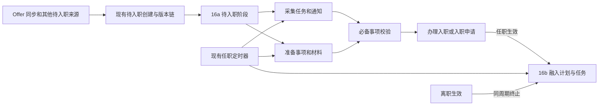

# R2-T01 信息采集、扫码与融入（BE-16）：设计说明（v1.1）

> 状态：第 1 轮返工，第 2 轮设计待审。§13.2 对应上一轮 `0b9ee6b7064f0fd5192e98ca05c9f357832a0fe2` 的两项 P2。DEC-957 恢复 BE-16 排期，设计通过后由 03 按 §11 拆派。基线为 `ea790874abeeb3ab3f71de4b93cb414720a0656a`，含 BE-2a #358、BE-2b #361 及已合入的 BE-14。
> 依据：路线图 R2-T01，规格 34 EN-R2～R16 / ON-R1～R5 / §5～6，规格 30 DM-R8，需求基线 REQ-EN-001 / REQ-ON-001，差距表 A26～30、A40～45、A47 与 F-171。DEC-915 下候选人页写明未证并使用合成桩。DEC-402 下无需给上线前数据补建任务。派单要求依规格和已定决策收敛，复刻取舍见 §12。

## 0. 总体设计

- **16a** 以每次待入职为单位，维护采集、准备、材料及其状态。改期或编辑可能替换任职业务 ID，稳定的阶段 ID 承接任务，当前业务 ID 承接授权与并发复核。必备事项在直接办理和发起入职申请时拦截。
- **16b** 从入职生效事实发起按任职周期隔离的融入计划，保存方案、阶段、任务及办理规则快照。离职在同一生效事务终止该周期在途融入。
- **三种码的用途独立**。采集通用码仅用于已存在的待入职记录，长期有效直到重置或停用。扫码添加码用于新建待入职，默认 30 天、最长 365 天。扫码报到按规格 34 §5 暂缓，A45 首版仅管理端手册设计与预览。
- **候选人页使用合成桩**。16a 交付管理端规则、模板、二维码管理、任务与状态，验证与提交用桩覆盖交互。§5 给出上线所需的访问契约与关闭边界。

## 1. 范围与分期

| 差距行 | 首版交付                                                                                                   | 边界                                                                                                                            |
| ------ | ---------------------------------------------------------------------------------------------------------- | ------------------------------------------------------------------------------------------------------------------------------- |
| A26    | 信息采集详情、模板/必填子集、单人/批量发起与催办、协作文字记录、专属访问模型、通用码、可选审批与待确认重聘 | 候选人填写、验证、提交及撤回交互用合成桩。无真实候选人完成通道期间，采集必备开关保持关闭，见 §4、§5                             |
| A27    | 扫码添加码签发、到期/撤销、管理端预览/复制/下载                                                            | 添加动作经 A44 方案和 §5 访问契约，生产匿名写入随 16a-6b2 验收后开通                                                            |
| A28    | 融入五视图、任务池、计划、手动/批量/自动发起、手动催办、撤销和重新发起                                     | 学习计划、试用期目标计划按 ON-R1 暂缓，问卷调查按 DEC-527② 暂缓。新员工介绍支持管理端任务配置与预览，员工端介绍展示用桩并标未证 |
| A29    | 采集模板、范围/优先级、发起/催办、验证方式及审批开关                                                       | 出厂开启自动采集（DEC-529⑥），匹配和启用校验见 §3、§5                                                                           |
| A30    | 融入方案、阶段、任务、办理人、自动发起及到期提醒                                                           | ON-R2 全字段见 §7；配置仅允许本期能执行的动作，绩效活动依 DEC-958 留待后续                                                      |
| A40    | 准备事项目录、类别、办理表单、编码回写映射                                                                 | 事项定义无办理人字段，办理人归 A41（差距表、F-171）                                                                             |
| A41    | 按范围设置发起/催办时机与办理人，手动/定时发起和批量办理                                                   | 生成邮箱复用 BE-2 规则，分配工号沿现有员工工号约束及专用写端口，见 §6                                                           |
| A42    | 配置采集、材料及准备三项入职门禁，出厂全关                                                                 | 覆盖直办/申请/批量；与原有合同、编制、重聘门禁叠加                                                                              |
| A43    | 欢迎信模板管理、管理端渲染预览及正式通知接线                                                               | 发送时点为复刻建议，见 U5。预览无真实收件人                                                                                     |
| A44    | 扫码添加方案、绑定签发码、方案组织及表单白名单                                                             | 正式添加经 BE-2 创建和审批/编制/黑名单等现有校验；匿名创建契约见 §5                                                             |
| A45    | 入职手册管理端设计、预览                                                                                   | 生产扫码报到、报到写入、报到码及候选端手册发布按规格 34 §5 关闭                                                                 |
| A47    | 材料规则、清单投影、人工确认接收及催办、入职后自动催办、附件权限                                           | 复用通用附件元数据与绑定端口，相应候选人提交交互用合成桩                                                                        |

电子签、背调、身份证读卡、健康证 OCR、试工、正式薪资/社保写入按规格 34 §5 暂缓。招聘入口、Offer 审批和状态机、BE-15 转正/考核规则、入职四视图和人员档案主体继续使用现有实现。引用 DEC-532 / DEC-533 / DEC-537 的 Offer 状态及同步只作为接线约束；DEC-539 的“立即执行”专属 BE-15，BE-16 调度沿用 F-171 的现有定时器口径。

## 2. 现有实现与接线位置

下列路径相对 `apps/api/src/modules/`，除另注外均已在基线核对。

| 能力                | 基线                                                                                                                                            | 设计接线                                                                                                                                                 |
| ------------------- | ----------------------------------------------------------------------------------------------------------------------------------------------- | -------------------------------------------------------------------------------------------------------------------------------------------------------- |
| 待入职创建与替换    | `employment/write-service.ts:createEmploymentBusiness`；`entry-actions.ts:replacePendingEntry`；`employment_entry_actions.previous_business_id` | 首次待入职创建阶段；替换经同一事务移动阶段指针。替换内部的删旧、新建须携带内部生命周期意图，避免被监听器当终止和重复发起                                 |
| 待入职取消/删除     | `employment/entry-actions.ts:cancelEntryCore`、`deletePendingEntry`；`transitions.ts` 的删除；`offer/linkage.ts` 同样到达这些内核               | 接业务事务内的受信端口，覆盖通用删除、Offer 拒绝/失效及实习结束联动。现有 `entry-source-events.ts` 是电子签语义，BE-16 单独传阶段/替换意图               |
| Offer 同步/显式推送 | `offer/sync.ts:createSyncTarget`，`offer/linkage.ts:pushEditToEntry`，`employment/entry-actions.ts:pushOfferToPendingEntry`                     | 创建按实际 `pending_entry` 分支，沿创建端口；显式推送选“是”经替换或资料更新端口，保持任职锁序，待入职改动继续单向，实习转正分支按生效接 16b              |
| 入职与入职申请      | `employment/entry-routes.ts`、`employee-status.ts:completePendingEntry`、`write-service.ts`、`transitions.ts`、`activation-service.ts`          | 复用直接办理和入职类型创建/提交编排，§6 门禁；当前已有路由继续使用原回执。批量/申请入口有对应写内核时接该门禁，缺的公开入口归各自任务                    |
| 任职生效和离职      | `write-service.ts:notifyMaterialized`、`record-events.ts:recheckRecordEvent`、`exit-post-effect-hooks.ts:onEffective`                           | 区分已经建记录和业务生效。直接办理补写生效候选，审批通过但未到期只待排期，离职按周期同事务终止                                                           |
| 人员与材料          | `personnel/employee-write.ts:appendEmployee`、`personnel/subsets.ts:saveSubset`、`subset-policy.ts`；`attachments/routes.ts`                    | 人员补丁与子集走版本、策略、附件授权、审计及 outbox 链路。材料为入职域用途，遵守通用附件的租户、所有权和下载复核                                         |
| 通知、台账、定时器  | `approval/notifications.ts`、`offer/send.ts`、`employment/outbox-consumer.ts`、`employment/activation-scheduler.ts`；API 的 `commands.ts`       | 复用审批通知、任职定时器和 outbox 模式。入职域待办、通知消费者按片接线；候选人渠道按实际接通，现有 Offer 发送记录只证明入队。管理端写命令走 `runCommand` |
| 前端与 F-039        | `apps/web/src/entries/{pages,model,commands}.ts`、`EntriesPage.tsx`；任职、Offer 的 `policy.ts`                                                 | 复用入口注册、行/列表动作披露、F-123 表单与恢复槽；各片按 §9 登记实装路由                                                                                |

## 3. 数据模型

### 3.1 共用约束

以下为逻辑表名，`onboarding_` 为新表前缀。每表有 `tenant_id NOT NULL`；业务主键/唯一约束带租户，子项以组合 FK 指向同租户父表。涉及待入职、员工、任职周期的引用校验同一员工，引用现有 `employment_business_objects(tenant_id,employee_id,id)`、`employment_cycles(tenant_id,employee_id,id)` 及员工键。组织、法人、职位和引用成员分别用同租户实体键（成员用 `(tenant_id,user_id)`），附件关系使用租户及其用途。引用已生成业务的规则、模板、定义只归档/禁用，历史指向保留。

配置头、业务头、可独立编辑对象带 `revision`、创建/修改时间与操作者；子项跟随聚合版本。日期用 `date`，事件和令牌有效期用 UTC `timestamptz`。核心对象用列和关系表，结构化 JSON 仅用于受现有字段目录校验的表单定义、条件、局部表单快照或渲染内容。状态枚举、可空字段搭配、日期区间及唯一活跃项设 CHECK/UNIQUE；动态条件和状态流转由写内核锁内校验。

每张新租户表启用并 **FORCE RLS**，读写沿项目的租户 GUC 策略和 `withTenant`，`USING`/`WITH CHECK` 对称。平台仅枚举启用租户或经公共路由定位可信租户键，逐租户执行业务。组合 FK 的引用端按真实读路径建索引，范围过滤先于排序、计数和分页。首次迁移以当时 main 生成编号，按批新增迁移。无历史补数，缺阶段行时读出明确的未发起/无配置投影。

### 3.2 16a

| 表或聚合                                                                                     | 列、关系及主要索引                                                                                                                                                                                                                                                                                                                                                                                                                                  |
| -------------------------------------------------------------------------------------------- | --------------------------------------------------------------------------------------------------------------------------------------------------------------------------------------------------------------------------------------------------------------------------------------------------------------------------------------------------------------------------------------------------------------------------------------------------- |
| `onboarding_entry_cases`                                                                     | `id,employee_id,root_business_id,current_business_id,state,pending_date,hired_record_id,hired_on,revision`。状态 `pending / cancelled / hired / deleted`。root/current 同员工 FK，`UNIQUE(tenant_id,root_business_id)` 和当前业务唯一；入职后以实际生效任职业务关联材料，改期历史来自现有动作链。索引 `(tenant_id,state,pending_date,id)`                                                                                                           |
| `onboarding_collection_templates`、`collection_fields`、`collection_rules`                   | 模板名称、启停、通知模板内容；字段子表含对象/子集编码、字段编码、分组、顺序、必填、可编辑。规则含条件白名单、组织范围关系、优先级、模板 FK、验证码模式、必填子集、可选审批及自动催办参数。租户单行 `collection_settings` 持自动开关（出厂开）。同一匹配按较小优先级值，等优先级重叠返回配置冲突；匹配无结果不发空任务                                                                                                                               |
| `onboarding_collection_tasks`、`collection_submissions`、`collection_comments`               | 任务带 case FK、模板/规则 revision 与冻结字段清单、状态、审批实例 FK、发起/提交/完成时刻、下一催办日。最多一件活跃任务/阶段；提交追加版本，记录字段或子集 ID、基线 revision 与严格校验的值；协作记录带任务 FK、作者、纯文本、创建时间。索引任务 `(tenant_id,case_id,status)` 和 `(tenant_id,status,next_remind_on,id)`，提交/协作按 `(tenant_id,task_id,version/created_at,id)`                                                                     |
| `onboarding_public_codes`、`collection_access_grants`                                        | 码用途 `collection_shared / add_pending`、独立公开标识、令牌摘要、版本、签发人、签发时刻、过期/撤销时刻、可空方案 FK（添加必填）；每租户至多一个在用采集码，每方案最多一个当前添加码。专属授权绑定 task、case、渠道指纹、用途（填写或撤回）、代数、到期和撤销/消费时刻；候选人会话保存授权或来源码的租户 FK、代数、独立摘要及到期，类型决定可绑定的目标。令牌摘要唯一，索引 `(tenant_id,task_id,generation)`。暂不启用真实候选人授权会话写入，见 §5 |
| `onboarding_add_schemes`、`add_scheme_fields`                                                | 名称、启停、有效期天数（默认 30，1～365）、目标组织/岗位或表单引用、白名单字段与必填列；编辑改变会影响创建的配置时同事务撤销旧码。码索引可定位启用方案，禁止客户端提交可信默认值                                                                                                                                                                                                                                                                    |
| `onboarding_preparation_items`、`preparation_rules`、`preparation_rule_assignees`            | 类别 `employee_code / work_email / other`、名称、表单、回写编码目录；规则独立存事项 FK、范围/优先级、立即/提前 N 天、催办起点；办理人规则子项存类型、角色/成员/职位/职务/身份引用。一类内相同编码唯一；单事项规则按范围及唯一优先级命中                                                                                                                                                                                                             |
| `onboarding_preparation_tasks`、`preparation_assignees`                                      | 阶段/事项/规则 FK、规则和表单快照、下一调度日、状态、结果与完成者；活跃键 `(tenant_id,case_id,item_id)`。分派表唯一 `(tenant_id,task_id,user_id)`，带待办状态、完成/撤销时间，按 `(tenant_id,user_id,status,task_id)` 查询。任务索引 `(tenant_id,status,next_due_on,id)`                                                                                                                                                                            |
| `onboarding_material_rules`、`material_rule_items`、`material_items`、`material_submissions` | 规则范围/优先级与材料定义、必备、可补交、入职后催办开关/期限；实例按 `(tenant_id,case_id,definition_id)` 唯一，保存定义 revision、提交和确认状态，提交版本带附件 FK、提交/确认人和时刻并可留历史。催办按当前入职周期及 `(tenant_id,next_remind_on,case_id)`                                                                                                                                                                                         |
| `onboarding_requirements`、`requirement_items`                                               | 租户版本化聚合；三项是否启用，材料和准备的启用项用子行 FK 指向定义。启用指定项须有目标，仍被启用规则引用的定义不可停用或删除                                                                                                                                                                                                                                                                                                                        |
| `onboarding_welcome_letters`、`handbooks`                                                    | 名称、标题/正文、管理端模板内容、启停、revision；欢迎信保存通知变量白名单，租户内最多一个启用发送模板，手册存受校验的渲染配置。手册预览只渲染管理员提供的样例。首版没有报到事件或报到写表                                                                                                                                                                                                                                                           |
| `onboarding_notifications`、`onboarding_jobs`                                                | 通知用途、业务引用、收件人/渠道、业务周期、状态、次数/错误、下次尝试时间、可空加密载荷；租户内按用途+对象+周期+收件人唯一。任务队列按种类/业务键唯一，状态 `pending / running / done / skipped / failed`，到期 UTC、次数/原因、租约或事务锁、下一重试时间。就绪索引 `(tenant_id,kind,state,ready_at,id)`；按各片实际用途新增。业务事实及其事件用现有事务 outbox                                                                                     |

### 3.3 16b

| 表或聚合                                                                                                    | 列、关系及主要索引                                                                                                                                                                                                                                                                                                                                         |
| ----------------------------------------------------------------------------------------------------------- | ---------------------------------------------------------------------------------------------------------------------------------------------------------------------------------------------------------------------------------------------------------------------------------------------------------------------------------------------------------- |
| `onboarding_integration_task_pool`                                                                          | 稳定任务编码、名称/说明、类别、启停、表单/流程或考核动作引用、revision。编码租户内唯一，按类别/状态分页。历史计划任务保留任务池 FK，关联或生成过即禁止删除                                                                                                                                                                                                 |
| `onboarding_integration_schemes`、`integration_scope_orgs`、`integration_stages`、`integration_stage_tasks` | 方案名称（现有多语言值结构）、优先级、说明、失败通知成员、组织范围、附加人员条件、到期提醒策略、revision；阶段和任务配置顺序及起止偏移；任务绑定任务池、办理人策略、员工是否可见、提醒覆盖项。关系索引按 `(tenant_id,scheme_id/stage_id,order,id)`，并索引任务池反查                                                                                       |
| `onboarding_integration_settings`、`integration_plans`                                                      | 设置持自动发起总开关与 revision。计划持 `employee_id,staff_id,source_business_id,scheme_id,scheme_revision,entry_on,attempt,status,started_at,ended_at,revision`；保存方案/阶段快照。每周期最多一条进行中计划，`(tenant_id,staff_id,attempt)` 唯一；周期、状态与截止查询建索引。自动发起的幂等键每周期唯一                                                 |
| `onboarding_integration_tasks`、`integration_assignees`                                                     | 计划、池任务、阶段定义引用，冻结任务名、说明、表单、流程、拟定办理规则和员工可见性，存开/截止业务日、状态、办理结果、revision、外部流程或活动 ID、下一提醒时点。办理人按阶段解算结果绑定租户成员。索引 `(tenant_id,status,start_on,id)`、`(tenant_id,status,due_on,id)`、`(tenant_id,plan_id,id)` 和成员待办索引；重新发起沿方案任务稳定标识追溯已完成事项 |

## 4. 采集、材料与状态

### 4.1 采集任务（A26 / A29）

1. 待入职生成后，在锁内以**该待入职的当前版本**求值。组织与人员条件取员工信息、任职、待入职合同公司的白名单字段。组织按租户业务日对应的行政树，条件组复用仓库条件表达式与字段目录。按优先级数值升序选唯一模板。无命中返回 `COLLECTION_RULE_NOT_MATCHED`（手动）或跳过并记原因（自动），任职创建照常提交。配置重叠不能唯一确定时报 `COLLECTION_RULE_AMBIGUOUS`，禁止跨范围回退。
2. 命中后冻结模板字段/必填子集、验证方式、审批开关及映射。姓名、个人邮箱、证件类型可从待入职资料预填，按字段允许列表输出。在途修订规则不隐式扩充表单。候选人桩以合成值展示这些配置和隐私先行交互，标“未证”。
3. 管理端动作按任务状态提供：已匹配但未送达（`ready`）、已发送（`sent`）、已暂存（`draft`）、已提交待审批（`in_review`）、已退回（`returned`）、待确认重聘（`rehire_pending`）、已完成（`completed`）、已终止/已撤回（`closed / withdrawn`）。已发送以投递适配器接单为准，接受投递与确认实际到达分别记录。首版没有真实投递通道时，自动/人工发起只能保存就绪任务与受控预览，列表显示未发送；发起回执说明通道状态。重复发起相同阶段不生成第二条活跃任务。催办适用未完成任务，依 §8 逐次去重。
4. 候选人提交的领域端口固定为 `saveDraft`、`submit`、`withdraw`。桩仅在本页面合成数据中模拟。内部测试可以直接调用受信的事务端口检验后续联动。正式提交只接当次已签发配置与当前保守白名单的交集。服务端按任务字段白名单解码，检查当前上下文、只读字段、必填项、子集基线及材料引用；不信任客户端给出的审批状态、来源、人员或范围。证件号匹配到同租户离职人员时先进入待确认重聘并给当前有权的 HR 发待办；沿 EN-R13 规则由 HR 显式确认，禁止自动合档或向候选人披露离职人员。确认后按原数据进入审批/落地，发生换人员时先使用既有重聘端口，完整迁移或关闭任务，禁止直接改候选人归属。复刻首版推荐同人继续，其它重聘处置保持待确认，见 U3。
5. 启用审批时，走独立 `entry_info_collection` 审批类型（建议编码 `EntryInfoCollectionProcess`，与在职信息采集类型分开），复用 `startOrResume`、DEC-017 类型内匹配及审批可见字段/禁止盲审/自审。与默认流程设计一起由共享契约登记，标准流程按 DEC-094 仅提供草稿。未找到已发布流程或首节点无人时返回业务失败，保留提交前状态。驳回可修订再提交，审批通过才写采集结果；禁用审批可同事务落地。修改后的待入职不再匹配所冻结规则、基线变化或任务已取消时，拒绝落地并留可核对回执，需 HR 重读。适配器预锁员工、当前待入职业务和任务，再进审批实例锁；旧审批回调核对 task/revision/result generation，迟到回调不得跨代落地。
6. 落地只走人员版本写入和 `saveSubset(..., {type:'info_collection',id:taskId})`，保持人员、子集权限和业务策略。任职、合同公司用于匹配。候选人字段如要写任职，限经确认的待入职字段映射，复用任职版本业务，禁用没有映射的字段；候选人输入不得改组织、岗位、雇佣关系、入职日或合同主体。材料附件走独立材料用途。当前人员子集的附件引用按非 HR 来源约束继续拒绝，不能为了采集绕过绑定；相关试填用桩（U3）。
7. EN-R9 撤回由取消入职后的独立一次性用途授权承担，须是新增入职且采集曾暂存/提交/退回/待确认重聘。锁内重查没有入职或重聘/返聘，清空该人待入职阶段员工信息（保留姓名、个人邮箱）、经人员策略删除全部子集、解除关联附件并写明撤回备注。对任职同步维护的本单位经历，先经任职/人员同步的受信撤回端口清理该待入职记录的投影，普通 `saveSubset` 禁止删除该类行的约束继续有效。对带附件的子集，由人员/附件受信撤回契约完成解绑与删行，禁用候选人直接写附件引用，同时使草稿及审批待办停止可用。既有版本与权限受控的删除审计依 DEC-019 留痕；曾提交值从普通读、协作及通知投影撤下。任一步失败整体回滚。撤回端口在候选人真实性契约开通前只作内部验收，取消入职可继续使用。

### 4.2 材料（A47）

按待入职范围匹配规则，首次生成实例时冻结定义、必备及可补交。每项状态由 `pending / submitted / received` 与提交版本得出，确认接收核当前版本和实际附件引用。HR 有材料写权限时可登记其收到的材料及附件，仍需逐项确认接收（U6）。候选人上传用桩。材料附件沿登记 → 上传 → 绑定执行，下载按当前待入职/已入职范围、材料字段权和文件归属校验，孤儿不可读。用途约束单独走迁移与附件契约。

待入职列按以下顺序投影：清单空为“无材料”，有清单且无必备为“无必备”，有必备且全部已确认接收为“已收齐”，必备全部提交为“已交齐”，已提交部分必备为“未交齐”，其余为“未提交”。可选项单独显示，补交不得把已确认的旧提交静默替换。A42 的“指定材料必须提交”以具体项的当前提交为准，已接收包含已提交。生效时把材料阶段挂到实际生效记录，历史可按现有范围读。配置允许时对该周期未完成材料每日一催，离职、删除或规则期限届满停止。

### 4.3 待入职四视图

复用 `GET /api/tenant/employment/pending-entries` 与现有入职状态判定。以当前业务 ID 左连 case 和三项聚合，新增可独立裁剪的 `preparationStatus`（未发起 / 进行中 / 已完成 / 已终止）、`collectionStatus`、`materialStatus`。字段被裁剪时省略，计数、筛选和排序也按字段权限。没有阶段的真实记录呈现“未发起/无材料”，不能为 Offer 预设已发送或准备进行中。已取消只返回可见历史，已入职可看已绑定材料及允许的催办/确认动作。

## 5. 码、候选人访问与桩边界

### 5.1 用途与生命周期

| 用途           | 签发、范围与失效                                                                                                                                                                                                                      | 首版可达                                                                                     |
| -------------- | ------------------------------------------------------------------------------------------------------------------------------------------------------------------------------------------------------------------------------------- | -------------------------------------------------------------------------------------------- |
| 专属采集链接   | 绑定一个活跃采集任务、阶段、已登记联系渠道及代数。推荐固定 30 天且待入职结束即失效（U1）。重发签发新代并撤销旧链接/会话；改期延续阶段但撤销旧代，按最新待入职重发，取消、删除、完成、联系渠道变化即时废旧。审批退回后在当前任务发新代 | 管理端任务及通知预览，可验令牌/状态规则；真实对外链接签发及投递随可用候选人入口开通          |
| 采集通用二维码 | 每租户一个长期有效码，可复制/下载。仅作租户与用途定位；活跃的正常/延期待入职且身份校验成功后，才查找或幂等生成匹配任务；已取消/已入职/其它租户用同一拒绝结果。重置/停用立即使旧码及由旧码产生的会话失效                               | 管理端码及二维码真实可维管，所指生产页只呈现通用说明，不返回租户人员信息                     |
| 扫码添加二维码 | 每启用方案一个有效码，默认 30 天、最长 365 天。重置、停用、过期或方案的目标组织/字段规则变更即失效。只允许添加用途，禁止换取采集或材料权限                                                                                            | 管理端码及预览可用。生产公开入口只呈现通用说明；匿名创建的候选人入口及正式通知随 U4 另行开通 |
| 撤回授权       | 与填表及添加分离，绑定已取消阶段和原候选人，单次消费。候选人身份复核后才执行 §4.1；恢复待入职、删除、已撤回即失效                                                                                                                     | 撤回交互用合成桩，生产公开执行路由保持未注册                                                 |
| 扫码报到       | 规格 34 §5 暂缓                                                                                                                                                                                                                       | 只有管理端手册预览，无签发和消费入口                                                         |

管理员复制/下载只允许非候选人专属的分享码，响应按签发权限及当时有效状态检查；当前码的读取经专门受控只读路由，加密保存可复制的码材料。签发/重置写回执仅含 `{id,revision,status,expiresAt}`，无链接。码重置与消费竞争时服务端锁码/授权并再次核对代数，先完成的事务决定结果。

### 5.2 免登录访问契约（采集用桩，扫码添加独立开通）

- **链接和二维码只定位，不证明本人**。不要求 HR SaaS 登录。隐私页先展示《隐私政策》《用户服务协议》和“不同意 / 同意并继续”；同意后才能请求核验。专属链接要求核对任务绑定的独立已登记渠道，转发链接无法单独打开个人表单；推荐发送专属链接与校验走独立渠道（例如邮件链接、登记手机号验证码）。缺少可用独立渠道时停在 HR 处理。通用码按规格 EN-R3 优先核验归档手机号；无法找到手机号的“姓名 + 身份证号”仅作匹配，保守地还需独立已验证渠道，缺失时拒绝开放个人数据（U1、U2）。全部情况用桩标未证。
- 在公共入口用不可预测的高熵秘密（存摘要），由服务端签名保护的租户定位符定位候选租户，再进 `withTenant` 核用途、状态、期限、当事人绑定和唯一匹配；不提供用手机号/证件在全库查人的接口。成功才换短期仅绑定该任务和用途的 HttpOnly/Secure/SameSite 会话，后续每次验租户、代数、当前阶段和状态。唯一命中的阶段始终在锁内确认。限制验证码请求与失败次数、短期单次消费；频控/锁定按 DEC-377 返回 429 与 `Retry-After`，失败行为不披露人、租户或是否有记录。令牌、验证码和会话值不写审计、普通台账、请求日志或页面 URL 查询，入口用 URL 片段经同源 POST 交换；禁止第三方资源带走片段，响应 `no-store`、`no-referrer`。
- 设计中的正式公共契约为 `POST /api/onboarding/access/{challenge,exchange}`、`GET /api/onboarding/collection/form`、`PUT …/collection/draft`、`POST …/collection/{submit,withdraw}`，以及与添加用途隔离的 `GET …/add/form`、`POST …/add/submit`。challenge 输入用途、定位符、同意的政策版本及核验信息，回执只给通用已受理；exchange 输入 challenge 和证明，成功通过 cookie 设置会话。form 只返回该用途的结构和允许预填的值；写命令只接该表单白名单和附件引用，返回最小状态与 revision。凭据交换按认证例外处理，真实业务写另以受信权限主体和命令 ID 幂等。请求指纹只使用非秘密的稳定授权标识和业务载荷的摘要，台账只存最小回执。未来候选人结果未知只能在该会话回查此单的最小回执，不能访问 HR 的命令回查。
- 扫码添加的正式端口从方案快照读取租户、组织、表单、权限上限，核方案/码代数、渠道证明和同一方案的重复提交。只开新增待入职，来源记扫码添加，不自动合并现有/离职员工。租户内用 `(scheme_id,channel_fingerprint)` 唯一认领活动申请；核验后的联系值与认领写入取锁去重，取消或删除后按方案重新核验。用带用途及方案约束的服务端主体运行创建，台账以添加权限主体及稳定的认领 ID 隔离，候选人不能传平台 actor 或复用 HR 权限。按规范字段及必填项映射到现有待入职创建内核，原编制、黑名单、入职日、组织可用性等校验仍执行。校验失败不创建档案、任职或阶段。添加码只允许匿名创建经授权的固定字段，不能把用户输入当租户/组织、人员、任职或源授权。
- **桩隔离**：候选人表单、验证码、提交、附件以及撤回的样例都只用合成数据，前端演示入口在演示/测试装配里注入；样例不读真实任务、码、收件人、材料或台账，不能写后台。首版可达的真实码落地只返回不带人员信息的通用说明，当前公共核验、表单和写入均无生产登记；16a-6b 只开放完成验收的添加用途，采集/撤回仍关闭。管理端采集通知预览款为“请填写入职前采集信息，专属链接只可本人使用、不可转发”。真实候选人发信随真实入口同片启用以避免发送不可办理的专属链接。显示状态反映实际可达性，禁止用通过的桩回执驱动真状态。

## 6. 准备事项、必备门禁与阶段联动

### 6.1 准备事项（A40 / A41）

- **定义和规则分离**。A40 维护类别、名称、办理表单和回写字段编码。A41 按当前阶段组织及人员范围挑选该事项的唯一最高优先级规则，解算指定人、直线上级/部门负责人/HRBP 或职位/职务/身份命中的有效租户成员；空结果给失败回执，不扩大到默认组织或管理员。按立即或提前 N 天发起，新建已在窗口内即进入可执行队列。手动发起与自动发起经同一建任务端口。规则变更影响尚未实例化的事项，进行中规则与表单保留快照。
- 状态 `scheduled → open → completed`，取消/归档为 `closed`，异常有机器码与重试入口或由相同调度周期恢复。每个受托人一条待办；“我的待办”以受托关系和当前账号状态裁剪，合并只改变展示分组，不合并底层事项。任一受托人完成后，任务锁内一次落地结果和版本回写，同事务结束其它待办并排入撤销通知。受托人只读本任务办理字段，不能顺带读其它档案。批量返回逐项结果。
- 回写走白名单表单字段 → 人员字段/任职字段既有领域写端口。工号以员工主档编码为唯一来源。基线 `employment/employees.ts:createEmployee` 只有建档和工号查重，Offer 同步使用派生工号。准备办理新增受信分配端口，在员工与阶段锁内沿现有租户工号唯一索引保存员工主档 revision，并走现有任职版本编排追加对应的待入职工号快照。同事务冲突回滚，不改稳定员工 ID 或已生效历史。无已授权编号来源或需覆盖非临时工号时停在待办理（U11）。邮箱复用 `generateEntryEmailFor` 背后的匹配与取号算法；现有函数只生成回执，**生成和保存要在同一事务**，补公司邮箱写端口和租户内同域/前缀争用锁，保存前重查占用，不能把生成回执视为持久分配。首规则失败不回退，EN-R12 重聘及实习转正跳过，既有生成入口仍可用。启用入职/申请时机时由其编排复用同一保存能力，已经分配不得重复取号。任职字段只追加任职版本，查不到合法映射的事项不给提交。
- 改期按新日期重算未开始事项和提醒，通知准备负责人，已办任务保留。范围或办理事实变化时，未完成项复核并回收不再有权的待办，需要新规则时由重新发起产生。取消使未完成待办撤销、公开采集失效，随后恢复生成新代，已办项归属同阶段且保留结果。删除不可恢复，将阶段封闭保留必要审计。改期/编辑产生的新业务必须与原阶段同人，事务锁内先移指针再更新计划日期和访问代数；失败时原阶段及旧业务保持可用。

### 6.2 入职必备与锁（A42）

门禁统一为 `assertEntryRequirements(tx, ctx, case, proposedEntry)`，以当前配置版本、有效阶段和具体实例核三项。已完成采集要求 `completed`，待审批、待确认重聘、退回、仅暂存均不通过。门禁从原待入职阶段读取，申请业务带服务端锁内确认的阶段引用及校验记录；禁止客户端选择历史或其他人的阶段。启用材料时指定实例须已提交或已接收。启用准备事项时指定实例须已完成。无清单/实例不是通过；直接发起或导入等拟入职写入口没有 case 时，也须按配置检查。用受信调用上下文区分历史导入与实时入职；仍允许先建待入职，再逐项完成准备。候选人真实提交未开放时，配置拒绝开启采集必备（`COLLECTION_INTAKE_UNAVAILABLE`）；材料与准备项照常按配置启用。用于判断通过的完整集合由服务端内部读，向操作者返回的阻断详情按当前字段权裁剪。

- **覆盖入口**：`completePendingEntry` 状态写入前，`createEmploymentBusiness` 的实质直接办理路径（排除新增待入职/替换内部重建/已批准执行路径），以及审批模式在 `transitionEmployment` submit/re-submit 的实际提交点；批量逐条进入同一内核并返回成功/失败回执。暂存可继续。批准当天执行、未来定时执行及人为重试继续按现有生效状态机，使用已通过提交门禁的原因和配置版本；申请撤回或驳回后重提按当前配置重校验。入职申请提交后锁定会令已校验项从通过变失败的待入职写操作，取消/删除经原申请作废内核收口后才允许，防止审批通过使用被撤回、删除或替换的结果。历史导入维持原入口语义，不当作新办理触发。
- **锁序**：沿既有组织/调动参与者等前置锁，关联 Offer 路径先取已有 Offer 锁，再员工与业务头，再阶段、任务/实例及附件绑定，最后按审批适配器契约进入审批实例锁；批量按既有参与者排序，各项一事务。配置更新锁独立于员工且不反向取业务锁；必备检查在待入职事务内读并持配置行共享锁至提交，避免与启用/禁用跨越线性化点。关联范围条件须以该版本复核；审批回调从前置锁计划取得锁，调度工单不得持作业行等员工锁。需要替换任职的采集/准备回写须预锁可能关联的 Offer，以免在人员锁之后反向取锁。
- **并发**：阶段动作和候选人会话用独立 revision；命令同时带当前待入职业务 ID/业务 revision 做基线校验。改期、编辑新旧 ID 显式替换，旧 ID 不可写；重放只返回经当前权限复核的最小原回执，旧新映射本身也受范围限制。生效门禁和材料确认、准备完成、采集落地在同一员工和阶段锁下串行。撤销与开始执行同锁序，按锁内当前状态判断。所有受信调用方也执行相同事务校验，测试仅通过依赖装配注入合成能力。
- **生效/关闭**：待入职选定的生效记录及日期为材料与欢迎信唯一接线依据，等待日期到达并确认当前生效，禁止欢迎信或融入提前启动。待入职完成后切断专属/通用能力、收口未完成准备/采集，保留材料可补交。Offer 拒绝/取消/删除、改期替换和岗位/部门相关编辑必须通过 §2 的阶段端口，重读仅从现有时间轴取现任职，不能对旧记录更新或被旧作业重新创建状态。

## 7. 新员工融入（A28 / A30）

### 7.1 任务池、方案与启动

- 任务池按 DEC-527② / ON-R1 顺序返回 **行政事项、团队融入、工作融入、新员工介绍、试用期考核、学习计划、试用期目标计划、问卷调查、其他**。三个暂缓类别在字典保留名称和顺序，创建任务与方案挂接均拒绝。试用期考核仅开放下述两类组织员工审批考核。其他类别依配置使用表单或匹配业务流程，流程适配器受实际任务和办理人约束。
- 方案必填多语言名称、优先级（新建初值 **2001**）、组织范围。说明最多 **500 字**，可选发起失败通知人。附加范围选填雇佣关系（内部员工/实习生/外部人员）、用工形式、人员类别、职务、职务序列、公司、工作地点、变动类型。不同维度按 AND，同维度选项按 OR，组织范围与附加条件取交集。配置保存时锁租户同优先级写入并拒绝相同归一化范围和优先级。允许不同优先级的重叠范围。运行时按数字最小命中；若最小值下仍有不同范围重叠，返回 `INTEGRATION_SCHEME_AMBIGUOUS` 并通知已配置的发起失败通知人，避免任意选择（U7）。
- 阶段/任务保存起止相对入职日的天、周、月，换算成租户业务日，任务日期必须落在阶段内。推荐第 1 天/周/月以入职日为起点，周偏移按七天，月按日历月并在月末收敛（U8）。历史计划复用当次实例日期。方案到期提醒默认关闭，开启须填正整数 N。任务级允许继承、关或开并指定 N，优先于方案。提示窗口为截止前 N 天至截止前一日；每天仅未完成任务、有效办理人收到提醒。
- 办理人支持指定成员、部门负责人/直线上级/导师/HRBP、高级职位/职务/身份和员工本人。HR 手动/批量发起按有效任职周期逐人匹配、授权、返回回执；普通发起不借用配置管理权限，也不认可越范围指定方案。自动发起由开关控制，推荐初始关闭（U7）。直接入职、生效的入职申请、批量相同内核及实习转正（直接/申请/批量）只在**已到业务日期且状态生效**后入队，到期 + 约 1 分钟触发。Offer 实习转正分支同样只按实际生效类型入队。
- `materializeEmploymentRecord` 产生未来记录时仅登记候选工作，运行端结合 `recordEventReadySql` 和当前时间轴重核；`completePendingEntry` 由真正离开待入职状态的端口补记候选。在写生效事务时若人仍是待入职，不入融入启动队列；若直接或审批路径都报同一周期，唯一键使自动任务和计划只生成一次。曾已终止的计划不被自动重启。人工早于自动任务发起的同周期，自动作业观察已有计划后完成去重。

#### 试用期考核动作及审批回写

`packages/domain/src/employment/assessment.ts` 定义两类 `AssessmentType`。共同使用 `employment/assessment.ts:launchAssessment` 写入 `employment_probation_assessments` 并提交真实审批，再由 `employment/assessment-approval-adapter.ts` 按下表选审批类型。

| 任务池动作     | `launchAssessment.assessmentType` | 审批类型                    |
| -------------- | --------------------------------- | --------------------------- |
| 发起试用中考核 | `probation`                       | `probation_assessment`      |
| 发起转正考核   | `regularization`                  | `regularization_assessment` |

- 任务池创建/编辑和方案挂接/保存复用同一动作校验；挂接时读取所引用的任务动作，不接收客户端替换动作。考核动作需要白名单类型及有效考核名称，保存到任务快照。**DEC-958 绩效模块本阶段不开工**，配置选项不提供“发起绩效活动”；直接调用 API 保存这一动作返回 HTTP 400 `VALIDATION_FAILED`，`details.reason = INTEGRATION_PERFORMANCE_ACTIVITY_UNAVAILABLE`，文案“绩效活动暂未开放，请选择试用中考核或转正考核”。失败不保存配置、引用或台账成功回执。运行端也按同一白名单解码。
- 受托人经融入任务办理入口发起时，在事务内核任务权、当前 `TenantBase.ProbationAssessment` 新增/字段权、`Assessment.Create` 与考核对象员工范围。复用 `requireAssessmentWrite` 和 `requireEmployeeInScope`，以该计划员工、冻结考核类型和名称、租户当日为考核日期，带当前员工 revision 调 `launchAssessment` 的 `manual` 模式。考核尚在试用、PB-R9 互斥、流程匹配与首节点校验由既有内核执行。失败整笔回滚，原任务可处理。任职转正结果仍由考核审批端口按意见决定。
- 员工先锁，融入任务在锁内核当前计划和 revision；成功发起的考核 ID 与任务同事务关联，同一任务的同一次发起只建一份考核和审批实例。回执为进入办理，任务尚未完成。16b-3b 接入 `employment.assessment.approve` 事件的持久消费，以同租户已关联考核 ID 和当前任务代数定位，考核关联使用组合外键并唯一，锁员工及任务后复核考核 `approved`、计划未终止，再完成任务及对应待办。重复/迟到事件幂等，拒绝、驳回或作废不完成任务；仍可重提的旧实例沿现有考核审批入口处理。消费接线随 16b-3b 开放；无需等 16b-4 的自动发起。

### 7.2 计划、任务与终止

计划 `active → completed / terminated`。创建计划一次生成全部任务和快照。开始日期已到的任务立即变为未完成（`open`）并解算当前办理人发待办。其余为未开始（`scheduled`），每日 **06:30** 后首次调度开启，按当日事实重新解算办理人。从 16b-3a2 起，开启步骤挂入现有任职定时器生产 `runSlot`，独立于融入自动发起及到期提醒开关。16b-3b 才开放单人、批量发起和重新发起，同样走此步骤。开启事务内核验计划仍进行中、任务仍为 `scheduled` 且已到租户时点，再原子转换状态与登记待办，按任务/办理人去重。没有可用办理人时保留为未完成且记录分派失败，给方案失败通知人；任务重开或重新分派沿同一调度规则。表单任务经有效受托权和版本检查才完成。流程任务只在相应业务通过/完成回调时收口，拒绝/失败保留可处理状态，重复或终止后的回调幂等撤销或丢弃。计划内全任务完成才成为已完成。

撤销只对进行中计划生效，将计划和未完成任务标终止，撤销其待办，保留已完成任务及成果。重新发起锁住原计划和周期，使用原方案快照生成新 attempt，保留原已完成任务的稳定标识及成果引用，其它项按当日日期和办理人重开。重发只生成未完成项的新待办，不重新启动已完成的外部流程。旧工作流仍未终态时，经既有撤销端口安全结束，无法撤销则保留引用并阻止就该项再次发起，直至旧实例明确收口（U9）。完成的计划不允许撤销。编辑任务池/方案默认只影响新发起；可显式只同步执行中计划的名称/说明，先查该计划和任务字段权及 revision，禁改内容、旧表单和完成记录。

离职生效经 `exitPostEffectHooks.onEffective` 同事务锁该员工和所属周期，终止进行中计划及未完任务、让通知出队前可识别已关闭。保留完成结果。自动启动读取未离职的当前周期，拒绝为已终止/离职周期生成新计划；离职撤销后若仍属该周期，按当前状态由有权人重新发起（U9）。其他周期的计划不受影响。

### 7.3 查询口径

| 视图       | 范围与谓词                                                                                                                   |
| ---------- | ---------------------------------------------------------------------------------------------------------------------------- |
| 已发起员工 | 先查当前可见员工及周期，再每周期选最新计划，包含进行中、已完成、已终止                                                       |
| 即将到期   | 进行中计划，未完成且仍在可执行期，截止在租户今日至未来窗口内。列表窗口建议采用适用提醒天数，在提醒关闭时只显示当日到期（U8） |
| 过期未完成 | 进行中计划，未完成且 `due_on < today`                                                                                        |
| 全部任务   | 当前可见计划的任务，按阶段、状态、期限筛选，含终止与已完成                                                                   |
| 未发起     | 当前有效、符合候选入职/实习转正事实且无任何 attempt 的周期；终止记录通过已发起视图入口重新发起                               |

员工本人可读本人计划中标“可见”的任务；受托人按任务授权只读办理内容。以本人为办理人的任务按员工可见规则配置，隐藏任务不得变成其待办；配置若冲突则保存拒绝。过滤先于分页、汇总和可选动作。

## 8. 定时器与通知

复用 `employment/activation-scheduler.ts` 生产轮询与租户枚举；增加注册的入职域服务步骤。不改变 BE-15 的时段，不新增可由租户触发的后台扫全租户路由。队列先有界取候选，逐租户切 `withTenant`。每个候选在员工/阶段/任务锁下重查，处理结果、业务事实、审计、通知排队同事务。热队列用事务锁抢占；需要事务外投递时用有限租约及可验证回执，避免过期持有者覆盖新状态。批次失败只影响当前候选，按游标和重试时间续跑。

| 作业                   | 触发、周期和收件人                                                                                                                                    |
| ---------------------- | ----------------------------------------------------------------------------------------------------------------------------------------------------- |
| 采集自动发起           | 待入职创建事件后，自动开时匹配，阶段+模板任务唯一；仅真实通道可达时发给已登记候选人，通知与会话发放同代                                               |
| 采集自动催办           | 未完成可催阶段，按采集规则配置的租户业务日。需要候选人写入的提醒随真实入口开启；拒绝向已退订/无效/变更渠道投递                                        |
| 准备发起               | 首次待入职、改期或租户业务日达到入职前 N 天。锁内确认仍待入职和启动规则，阶段+事项去重并发给受托人                                                    |
| 准备催办/改期/取消     | 入职前 N 天起每天催未完成项。改期/取消按动作事件通知当时的负责人，先撤销旧待办。键区分业务日催办与版本事件                                            |
| 材料自动催办           | 入职后在租户本地 **06:00–07:00** 补扫，每人每天最多一次（同人同日跨项聚合），按启用规则的期限和当前周期判可催；错过窗口继续次日，避免凌晨补发过期提醒 |
| 欢迎信                 | 推荐在生效后首次队列处理时按启用模板渲染（U5），每周期一次；未配置模板跳过。若尚无已接通的业务投递适配器保留内部队列状态，不把预览视为发送            |
| 融入未来任务开启       | 16b-3a2 接现有生产轮询。开始日租户 **06:30** 起补跑并重算办理人，同一任务只开启一次。覆盖手动、批量、重发和自动计划                                   |
| 融入自动发起           | 16b-4 接入，在生效后约 1 分钟复核 ON-R3 与自动发起开关                                                                                                |
| 融入到期提醒、手动催办 | 当日截止窗口内未完成任务，按方案/任务覆盖规则给当前办理人；手动催办逐任务校验，结束或无有效办理人不投递                                               |

§11 每个作业随其最早可用业务片接入生产装配。只交付配置时可维护配置值；会触发真实执行的开关、动作及任务生产端等执行链齐备后生效。站内待办与外发适配器独立，无法实际投递的渠道不披露为已发送。采集候选人外发和材料/欢迎信外发的前置依赖见相应切片。

业务时间用租户时区，通知日键为该时区日期；UTC 持久化触发时间。改期重算尚未到期的作业；取消、删除、入职、离职按该用途状态退出。通知键为租户+稳定对象+通知种类+周期（或显式命令）+接收人；材料自动催办以员工补强同日唯一。调度与手动动作交错时重复的自动任务和发送键仍唯一，显式手动催办有独立命令 ID。收件人、范围、任务和代数在排队及外发前都复核；失败记机器码、次数并退避，已过适用期限跳过。真实投递采用适配器幂等键。已确认失败可按原键重试；不知是否已接收时保留 `unknown`，先回查投递端，不能盲目重发。按 DEC-377 加密持久队列中的凭据及敏感链接，密钥走现有 Secret 管理；日志与回执仅给非秘密状态/错误。通知正文引用展示名和需处理项，正式候选人专属采集必须包含“**只可本人使用、不可转发**”。

## 9. 接口、授权与 F-039

### 9.1 HTTP 公共约定

管理端新增前缀 `/api/tenant/onboarding`。以下路径相对该前缀；现有待入职列表和入职命令保留原路径。从列表或详情的 `availableActions` 区分已注册动作、对象开关、按钮与当前状态，再按对象权限和行状态复核。查询使用现有分页参数与字段条件解析，列表回 `{items}`，详情回 DTO 与当前 `revision`；选项和统计同样走范围/字段裁剪。

所有管理端写命令带 `Idempotency-Key`、`If-Match`，新建用 0；批量用 `targets:[{id,revision}]` 校验每项，涉及阶段的写请求还带当前 `businessId,businessRevision`，对象 revision 归当前目标。复用现有批量上限；需要粒度回执时用父命令的有序目标清单与由父键确定的逐项子键。父记录先保留操作者、操作类型、完整原请求指纹及目标顺序，父键异内容 409；子项在各自事务记录回执，重跑只执行未落地项，逐项复核目标，批回执也按当前逐行授权过滤（U10）。单个写最小回执 `{id,revision,status}`，阶段替换可附当前授权允许的 `businessId`；批量为 `{items:[{id,revision?,status,code?}]}`。任务、配置、阶段各自按当前 revision 冲突返回 409，显式重读后重提。新建 201，常规命令 200，删除 204。无成员 401，缺功能或字段权 403，越范围/无对象 404，请求校验 400，超容量/媒体 413/415，频控 429，存储失败/结果未知 503。业务错误使用仓库错误码再带机器可读原因；失败拒绝不退回任何隐藏字段的值或标签。

### 9.2 管理端路由表

下表对象授权简称见 §9.3。所有配置列表/详情都按目标组织过滤，租户全局配置仅允许当前持相应设置授权者操作；选择器按引用类型独立复核。配置资源的 `GET /r` 列表、`GET /r/:id` 详情、`POST /r` 新建、`PATCH /r/:id` 编辑、`DELETE /r/:id` 删除/归档皆使用该对象的 view/create/update/delete 和字段权。设置单例使用 GET/PUT。表中同一格的每个动作独立登记，构造路由白名单时只加入本片已完成项。

| 路由                                                                                                                                                      | 入参 → 出参或行为                                                                                                                                                   | 对象及按钮                                                                                                                        |
| --------------------------------------------------------------------------------------------------------------------------------------------------------- | ------------------------------------------------------------------------------------------------------------------------------------------------------------------- | --------------------------------------------------------------------------------------------------------------------------------- |
| 配置 `/collection-templates`、`/collection-rules`；GET/PUT `/collection-settings`                                                                         | §3.2 的模板/范围/字段/审批/自动催办参数；配置 DTO 或 revision                                                                                                       | ES / CollectionSettings                                                                                                           |
| GET `/entries/:businessId/collection`；POST `…/collection/start`、`…/collection/remind`、`…/collection/comments`                                          | 查任务、模板快照、允许可见字段与协作记录；发起/催办或追加 `{text}`。实际通知状态随回执                                                                              | ER + C，写需 CollectionStart / CollectionRemind / CollectionComment                                                               |
| POST `/collection/start-batch`；POST `/entries/:businessId/collection/confirm-rehire`                                                                     | `targets` 逐人发起；确认提交版本/可见重聘处置，调现有端口。无真实提交时后者保持未注册                                                                               | ER + C，CollectionStartBatch / CollectionConfirmRehire                                                                            |
| GET `/codes?purpose=…`；POST `/codes`；POST `/codes/:id/reset`、`…/revoke`；GET `/codes/:id/preview`                                                      | 输入 purpose/可选 schemeId、有效期受方案约束；展示状态和有效期；preview 返回可复制链接和二维码载荷，禁止缓存和进入台账                                              | Q / QrManage，预览额外 QrShare                                                                                                   |
| 配置 `/add-schemes`、`/welcome-letters`、`/handbooks`；POST `/{welcome-letters,handbooks}/:id/preview`                                                    | 方案范围/字段、模板/渲染配置；预览传合成样例值，纯渲染回 HTML 或块 DTO，经正文转义/消毒                                                                             | ES / AddSchemeSettings、WelcomeSettings、HandbookSettings                                                                         |
| 配置 `/preparation-items`、`/preparation-rules`                                                                                                           | 类别、表单及编码映射；规则按范围、办理人及发起/催办参数                                                                                                             | ES / PreparationItemSettings、PreparationRuleSettings                                                                             |
| GET `/entries/:businessId/preparations`；POST `…/preparations/start`、`…/preparations/remind`                                                             | 根据事项 ID 或配置匹配，发起/催办并返回回执；查询任务和分派状态                                                                                                     | ER + P，PreparationStart / PreparationRemind                                                                                      |
| GET `/my/preparations`；GET `/my/preparations/:id`；POST `…/:id/complete`、`/my/preparations/complete-batch`                                              | 当前受托人待办及本任务表单，提交 `values` 或逐项 `targets + values`，返回办理回执                                                                                   | P 自身关系与 PreparationComplete / PreparationCompleteBatch                                                                       |
| 配置 `/material-rules`；GET/PUT `/entry-requirements`                                                                                                     | 材料定义及补交与入职后催办规则；三项开关和指定定义 ID                                                                                                               | ES / MaterialSettings、RequirementSettings                                                                                        |
| GET `/entries/:businessId/materials`；POST `…/materials/:id/submit`、`…/materials/:id/receive`、`…/materials/remind`；POST `…/materials/:id/attachments`  | 列材料项；HR 提交已上传且归属该项的附件引用，在提交事务完成绑定、按提交版本确认接收或催办；附件路径仅登记用途元数据，上传和取件复用通用端口                         | ER + M，MaterialSubmit / MaterialReceive / MaterialRemind，附件另经用途权                                                         |
| 配置 `/integration/task-pool`、`/integration/schemes`；GET/PUT `/integration/settings`                                                                    | ON-R1 任务池与 ON-R2 方案，阶段/任务作为方案聚合提交；考核动作按 §7.1 校验；自动开关单例                                                                            | ES / IntegrationPoolSettings、IntegrationSchemeSettings                                                                           |
| GET `/integration/views/:view`；GET `/integration/plans/:id`                                                                                              | 五视图，返回按员工/任务归类后的裁剪行；详情返回快照、任务、按需开启的操作                                                                                           | I + 当前任职范围                                                                                                                  |
| POST `/integration/plans`、`…/plans/start-batch`、`…/plans/:id/terminate`、`…/plans/:id/restart`；POST `…/plans/:id/sync-task-text`、`…/tasks/:id/remind` | 使用 `staffId` 或周期目标批量、匹配当前方案；终止、重发、显式同步名称说明、催办。计划/任务版本分别检查。单人、批量发起及重发自 16b-3b 注册，依赖 16b-3a2 的生产调度 | I / IntegrationStart、IntegrationStartBatch、IntegrationTerminate、IntegrationRestart、IntegrationSyncTaskText、IntegrationRemind |
| GET `/my/integration/plans`、`…/plans/:id`、`…/tasks/:id`；POST `…/tasks/:id/complete`                                                                    | 只返回本人可见计划或本人受托任务；提交版本及表单，适配器若要求启动流程返回处理中                                                                                    | I 自身关系与 IntegrationComplete                                                                                                  |

预览是无持久副作用的动作，使用 POST 传样例数据时仅校验同源和读取/预览权限，不走写台账。公共静态码说明页独立于租户 API。正式公共候选人契约见 §5.2，开发片不预挂空路由。未完成写入依赖的按钮、定时注册和回调保持不可达。

### 9.3 授权编码与验证路径

- **ER** `TenantBase.EmploymentRecord`，**ES** `TenantBase.EmploymentSettings`，均沿用现有对象。设置写还要 `tenant.employment.configuration.write`（`other_settings`）和目标设置字段；设有组织范围的配置再核可配置组织集合。公司按待入职合同及已有授权约定。新增动作拟采用 `BE16.<上表按钮名>` 作为功能编码。配置按钮绑定 ES 的实际 CRUD；QrShare 绑定 Q 的查看权。ER 行按钮登记为详情/列表行级，批量发起为列表级。模块的数据准入同时核相关域对象实际 CRUD 与任职范围，按钮只是其中一项。沿用当前数据范围默认空的规则。
- **Q** `TenantBase.OnboardingQrCode` 承载二维码日常签发、重置、撤销与分享（DEC-967）。扫码添加方案及其他配置页仍走 ES 和 `other_settings`。码材料只在当前授权和有效状态下经专门预览读取，普通码元数据字段不含令牌或链接。
- **C/P/M/I** 建议新增 `TenantBase.OnboardingCollection`、`TenantBase.OnboardingPreparation`、`TenantBase.OnboardingMaterial`、`TenantBase.OnboardingIntegration`。域对象字段目录显式登记读取/写入编码（采集原始值再与人员对象/子集字段权、模板范围取交集）。C/P/M 的管理读复用当前待入职或生效记录定位，I 复用当前员工任职范围及所属周期。管理端需要双对象的操作，其一撤权即拒绝。本人/受托的 My 入口用独立操作和受限投影，按有效会话、成员、所属员工/有效任务受托关系和字段目录复核；无业务范围的管理员不能借该入口读他人。只在共享契约里按标准身份规则显式批准授予自身办理动作，无普遍新授权或超级角色越权。合成桩独立于这套管理授权。
- 管理端 F-039 声明由新模块 `apps/api/src/modules/onboarding/policy.ts` 的 `defineTable('onboarding',…)` 通过现有 policed subrouter 装配。现有待入职/任职 API 修改响应或前置条件时同步 `employment/policy.ts`。列表 SQL scope、点查 locator、动态字段 projector、控制字段、业务前置条件、命令重放及披露条件按实际行为逐条登记。从写入、命令台账重放、F-120 回查、审计、附件、待办、嵌套通知投影均重查当前权限。通用命令回查复用命令类型/locator 登记或留最小固定回执；不直接返回存储 DTO。撤权后也不能凭旧命令获收件人/表单/码或已无权目标。
- 探针登记按仓库现有 required/onboarding、required/declared/onboarding、公开说明 ingress 与生效联动途径接线，必要时扩现有 employment 声明。正式候选路由开放时才另外用 `publicRoute` 加用途/代数/租户/本人/状态守卫，以及无凭据、跨用途、撤销、越租户等拒绝证据。实装时在默认和 `ROUTE_POLICY_EVIDENCE_STRICT=1` 下分别跑 `AC-PRM-FW-F090b-entries` 和 `AC-PRM-FW-02-evidence`。生成物按 DEC-430 重算。授权编码登记与标准授权版本/指纹/变更表按 DEC-439、F-097，审批类型/路由装配、附件用途及 F-039 公共登记先走对应契约片。计划沿用 F-039 现有核心门禁，核心门禁变化为无。

## 10. 前端页面与接口映射

FE 另派；以下为接口消费契约。

| 页面/组件                                                                | 接口与入口                                                                                                                            |
| ------------------------------------------------------------------------ | ------------------------------------------------------------------------------------------------------------------------------------- |
| 入职管理四视图，`EntriesPage`、列表任务列、行/工具栏                     | 现有 `employment/pending-entries`；采集、准备、材料详情/批量发起使用 §9.2。按当前记录可达动作显示，不按页面名称猜权限                 |
| 采集详情的字段/子集区、协作区与发起/催办弹窗                             | `/entries/:businessId/collection` 对应读写；子集按当前对象字段权回填。管理员模板预览使用配置结构                                      |
| 采集规则、通用码弹窗；扫码添加方案、二维码预览弹窗                       | `/collection-templates`、`/collection-rules`、`/collection-settings` 与 `/codes`、`/add-schemes`；码下载和复制从当前受权 preview 取得 |
| 入职准备事项目录、发起/催办设置、我的准备待办                            | `/preparation-items`、`/preparation-rules`、`/entries/:businessId/preparations`、`/my/preparations`；批量处理显示逐项回执             |
| 入职必备事项、入职办理表单、材料设置与详情/确认                          | `/entry-requirements`、既有办理/申请入口、`/material-rules`、`/entries/:businessId/materials`；现有 FormStore 处理阻断、并发及未知    |
| 欢迎信与入职手册编辑/预览                                                | `/welcome-letters`、`/handbooks` 与预览动作，采用已有表单和预览组件                                                                   |
| 新员工融入，五视图、方案/阶段编辑、任务池、计划详情与“我的任务”          | `/integration/views/:view`、`/integration/{task-pool,schemes,settings,plans}`、`/my/integration`；任务动作依据当前归属和状态          |
| 候选人入口、隐私同意、验证码、填写/暂存/提交、材料、撤回；新员工介绍展示 | 合成桩组件，由演示/测试装配注入。字段、必填、附件、工作流与验证提示按配置推导，标未证。生产说明页独立                                 |

入口沿 `apps/web/src/entries/pages.ts` 及各模块自注册，用 `transfer` 应用的既有入口和 `entryObjects` 守卫。配置页归任职设置，融入页按 I 与页面登记，菜单可达须有已实现的读路由。行/列表按钮依服务端动作列表，再根据状态/选择集置灰。字段权限来自对象的真实 `editableFields`。F-123/F-142 提交内核按服务端实际回执校验 revision、同一版本重读、差异确认后重提。未知结果按原业务 ID 和 resource 恢复，跨视图/关闭重开保持锁定，旧 ID 或替换 ID 任一重读未确认时不自动解锁。

## 11. 分片与对外边界

DEC-625 估算上界，单位为新增/改动手写行。产品包含领域、API、运行时注册与手写迁移 SQL，手写合计再加测试/夹具/登记，生成快照和生成登记不计。表中“升级”表示该片有迁移，按派单在 PG16 `app_owner` 跑仓库全部 `migrateBefore` 和旧结构造数升级用例（DEC-913），即使这一片仅建新表。后续派发需按实际 diff 再估算。共享授权、审批类型、装配、附件和事务端口在相应契约片先落定，各次只登记已实装的公开入口。

| 片                         | 交付与文件归属建议                                                                                                                   | 前序                          | 产品分项（结构/领域/接口与接线） | 手写合计 | 可达边界及验证                                                                                                       |
| -------------------------- | ------------------------------------------------------------------------------------------------------------------------------------ | ----------------------------- | -------------------------------: | -------: | -------------------------------------------------------------------------------------------------------------------- |
| 16a-0 契约                 | 共享授权对象/动作/字段、审批类型、阶段生命周期端口、schema 与装配登记；按 DEC-967 预置五类 HR 业务按钮并更新 §12 U10。分支只给 BE-16 使用                                           | BE-2                          |            250 + 270 + 350 = 870 |     1650 | 无新 HTTP/作业，升级，EN-BE16-01                                                                                     |
| 16a-1 阶段和采集配置       | 入职阶段表，待入职创建/替换/取消/删除/办理端口、采集配置 CRUD、范围匹配；模块 `onboarding/entry*`、`collection-config*`              | 16a-0                         |           380 + 445 + 485 = 1310 |     2450 | 配置可达，任务数据与状态投影随 16a-2a，升级，EN-BE16-01/02                                                           |
| 16a-2a 采集任务            | 任务/协作、发起/批量、自动开关、通知预览、采集列表投影，接创建事件的生产消费；`onboarding/collection-*`、`employment/entry-views.ts` | 16a-1                         |           300 + 510 + 615 = 1425 |     2770 | 管理端发起与就绪任务消费可达；真实候选通道前仅就绪，发信/自动催发及候选写入关闭，升级，EN-BE16-03/04，OF-10 采集子项 |
| 16a-2b 采集落地            | 受信提交、重聘分支、审批回调、人员子集回写；`onboarding/collection-{submit,approval}*`                                               | 16a-2a                        |           250 + 730 + 465 = 1445 |     2840 | 可测试内部端口，未开真实采集时无候选写和 HR 确认重聘路由，升级，EN-BE16-05                                           |
| 16a-2c 撤回                | 取消后的撤回用例、关闭、清理与回执；`onboarding/collection-withdraw*`                                                                | 16a-2b                        |            100 + 560 + 260 = 920 |     1880 | 受信内核及合成演示，生产撤回入口关闭，升级，EN-04                                                                    |
| 16a-3a 准备目录和规则      | A40/A41 配置、规则、办理人、按期发起内核、待办查询、准备状态投影；`onboarding/preparation-{config,launch}*`                          | 16a-1                         |           330 + 490 + 530 = 1350 |     2590 | 配置参数可读写；待办、手动发起及自动执行设置启用等到 16a-3b 同开，升级，EN-BE16-06、EN-03 准备联动                   |
| 16a-3b 准备办理和回写      | 单/批办理、邮箱/工号、回写、通知、催办与定时发起/催办生产注册；`onboarding/preparation-{work,remind}*` 与人员/任职端口               | 16a-3a                        |           130 + 765 + 565 = 1460 |     2930 | 手动/自动发起、可完成待办与催办同时可达，升级，EN-02/06、EN-BE16-06，OF-10 准备子项                                  |
| 16a-4a 材料规则和清单      | A47 规则/定义、生成/投影、既有待入职投影接线；`onboarding/material-{config,list}*`                                                   | 16a-1                         |           295 + 420 + 495 = 1210 |     2310 | 清单配置可达，材料办理及自动催办启用等到 16a-4b，升级，EN-BE16-07                                                    |
| 16a-4b0 材料附件契约       | 扩通用附件用途约束及受信绑定/下载再验权端口，申明材料独立用途；`attachments`                                                         | 16a-4a                        |            140 + 160 + 185 = 485 |     1120 | 新用途未挂路由，升级，EN-BE16-08 的附件隔离                                                                          |
| 16a-4b 材料办理            | 材料用途元数据登记、接收、补交、催办和生产作业注册；`onboarding/material-work*`                                                      | 16a-4b0                       |           170 + 645 + 550 = 1365 |     2790 | 办理与催办作业同片接线；外发动作及自动发送启用等通道接通，候选人提交用桩，升级，EN-BE16-07/08                        |
| 16a-5 必备事项             | A42 三类配置、直办/申请/批量事务门禁及权限裁剪；`onboarding/requirements*`、`employment` 接线                                        | 16a-2b、3b、4b                |           180 + 440 + 575 = 1195 |     2580 | 两类可配置，采集开通真实入口前关闭，升级，EN-01、EN-BE16-09                                                          |
| 16a-6a 扫码管理            | A27/A29/A44 两类有效期、配置/签发/预览/重置、公共说明页；`onboarding/{codes,add-scheme}*`                                            | 16a-0、2a                     |           330 + 425 + 615 = 1370 |     2620 | 管理端与说明页可达，候选人读写关闭，升级，EN-BE16-10                                                                 |
| 16a-6b1 添加核验底座       | 添加用途的同意、挑战、限流、会话及送达接口；`onboarding/add-auth*`                                                                   | 16a-6a、U4 落定与核验渠道可用 |           240 + 550 + 450 = 1240 |     2540 | 只测内部端口，任何公共核验保持未注册，升级，EN-BE16-11                                                               |
| 16a-6b2 扫码添加           | A44 受信入场、结果查询隔离、复用待入职创建；`onboarding/add-entry*`                                                                  | 16a-6b1                       |           210 + 625 + 565 = 1400 |     2830 | 同片装配添加用途的守卫、创建、回查，升级，EN-BE16-11                                                                 |
| 16a-7 欢迎信和手册         | A43/A45 管理配置、预览、欢迎信生效任务及生产消费者注册；`onboarding/{welcome,handbook}*`                                             | 16a-1                         |           205 + 405 + 615 = 1225 |     2350 | 管理可达；正式发送待真实适配器接通，届时同片开放发送能力与可执行任务，报到无公开入口，升级，EN-BE16-12               |
| 16b-0 任务池及考核动作定义 | 使用 16a-0 的 I 对象/动作契约，交付任务池/类别、动作及关系校验；`onboarding/integration-pool*`                                       | 16a-0                         |           250 + 370 + 515 = 1135 |     2260 | 任务池可配置两类审批考核，绩效活动在配置阶段拒绝，尚无计划/任务执行入口，升级，ON-BE16-01                            |
| 16b-1 方案                 | ON-R2 范围、阶段/任务、提醒参数、设置和匹配，`integration-schemes*`                                                                  | 16b-0                         |           365 + 585 + 420 = 1370 |     2620 | 方案可配置，挂接也校验动作。自动发起开关等到 16b-4 注册，升级，ON-01/04                                              |
| 16b-2 计划与视图           | 生成快照、五视图、撤销/重新发起、历史同期限制；`integration-plans*`、`integration-views*`                                            | 16b-1                         |           340 + 620 + 490 = 1450 |     2870 | 只开放计划只读支撑和视图；发起/撤销等到 16b-3b 一起装配，升级，ON-03、ON-BE16-02                                     |
| 16b-3a 办理人与表单        | 解算、阶段开始内核、任务分派、本人/受托接口、纯表单完成；`integration-{task,assignee}*`                                              | 16b-2                         |           190 + 665 + 555 = 1410 |     2760 | 只开放完整可用的读入口，计划与任务写等到 16b-3b，升级，ON-BE16-03                                                    |
| 16b-3a2 未来任务开启       | 扫描到期未开始任务，并接入 `employment/activation-scheduler.ts:runSlot` 的生产路径；复用 16b-3a 状态流转/待办端口                    | 16b-3a                        |              0 + 175 + 230 = 405 |      960 | 生产开启调度已注册，不新增 HTTP/迁移；在 16b-3b 用首次可达发起入口验证 ON-02                                         |
| 16b-3b 业务流程与手动发起  | 审批流程、两类 `launchAssessment` 及回执消费、完成/终止、重发、显式同步、HR 发起与催办；`integration-{process,commands}*`            | 16b-3a2                       |           105 + 700 + 590 = 1395 |     2890 | 先具备生产调度，再开放人工单人/批量发起和重发、受托写；离职终止及考核回执消费同片接通，升级，ON-02、ON-BE16-04/05    |
| 16b-4 自动发起和提醒       | 入职生效触发、自动发起和到期提醒生产接线；`integration-job*`、`employment` 接线，复用 16b-3a2 开启动作                               | 16b-3b                        |            120 + 390 + 290 = 800 |     1680 | 自动发起开关与到期提醒作业同片注册，升级，ON-BE16-06/07                                                              |

候选人 A26 生产身份/提交由 §5 正式入口另行派发，设计审查与 16a-1 至 16a-7 的非依赖项可正常进行。FE 演示和页面实施按 §10 在对应读/写能力交付后独立派发。16a 15 片、16b 7 片，共 22 片。各组估算均按实现片逐项相加。

| 组   | 片数 | 产品合计（行） | 手写合计（行） |
| ---- | ---: | -------------: | -------------: |
| 16a  |   15 |          18270 |          36250 |
| 16b  |    7 |           7965 |          16040 |
| 全部 |   22 |          26235 |          52290 |

产品最大 1460 行（16a-3b），手写最大 2930 行（16a-3b）。

### 11.1 其余原切片的同根因核对

| 原切片                      | 生产执行依赖与核对结果                                                                                                                 |
| --------------------------- | -------------------------------------------------------------------------------------------------------------------------------------- |
| 16a-0、16a-1                | 契约、生命周期和采集配置。新增阶段不触发未接通的采集作业，真实任务从 16a-2a 起消费                                                     |
| 16a-2a、16a-2b、16a-2c      | 16a-2a 明确管理发起/就绪任务与生产消费同片。采集落地/撤回均为受信内核；正式验证、投递、候选人提交、重聘确认和撤回不先开                |
| 16a-3a、16a-3b              | 补齐同类边界。16a-3a 只保存设置参数；16a-3b 将准备发起、办理与自动催办生产注册同时交付。工号写是新端口，邮箱沿既有生成算法另接持久分配 |
| 16a-4a、16a-4b0、16a-4b     | 补齐同类边界。规则与清单可先维护；材料附件契约先合，办理与定时催办生产注册同片，外发依实际通道                                         |
| 16a-5                       | 门禁依赖准备与材料的真实执行；采集正式提交未开放时禁用采集必备                                                                         |
| 16a-6a、16a-6b1、16a-6b2    | 码说明不接受申请；公共添加入口随核验、方案校验、创建及回查完整交付。核验通道列为实际依赖；待入职写复用受信内核                         |
| 16a-7                       | 明确区分现有通知入队与实际投递能力。管理预览可先用，正式发送须随真实消费者和渠道开放；手册不开放扫码报到                               |
| 16b-0、16b-1、16b-2、16b-3a | 配置仅支持确认有对应底层执行端口的考核类型。方案配置不启用自动发起、不提交计划；计划/任务查询可先开，写入口等调度与流程接线齐备        |
| 16b-4                       | 自动发起开关、触发、提醒作业同片开放；计划产生的未来任务直接进入已注册的开启步骤                                                       |

## 12. 待决与复刻建议

以下全部**作用对象：复刻系统**。推荐口径可用于本次审查；正式候选人权限、跨人重聘、工号替换与标准授权等数据/权限项在相应开发片开通前按复刻系统口径确认。当前稿按管理端与合成桩验收。

| 项  | 待定对象                             | 保守推荐与例子                                                                                                                                                                          | 影响                                                    |
| --- | ------------------------------------ | --------------------------------------------------------------------------------------------------------------------------------------------------------------------------------------- | ------------------------------------------------------- |
| U1  | 专属链接的有效期、可用渠道与本人校验 | 30 天且以待入职寿命为上限，需另一个预登记可验证渠道。例如链接走个人邮箱，验证码走 HR 已登记手机；只有邮箱时 HR 处理                                                                     | 正式采集与撤回；当前用桩                                |
| U2  | 通用码找不到手机号时的身份确认       | 姓名 + 证件号只定位，需独立确认。例如同名或没有已验证地址，一律不返回个人表单                                                                                                           | 正式通用码换会话；当前只开通用说明                      |
| U3  | 采集可写范围与审批、附件和重聘确认   | 先允许明确映射的员工/普通子集字段，按既有子集策略写。示例：学历按目录落地，有附件的证书先在桩中演示；发现离职证件匹配先留待办，不自动合并。审批流程按同类型草稿配置，具体节点由租户设定 | 16a-2b/2c 受信内核可验证；真实提交/重聘跨人写随契约确认 |
| U4  | 匿名扫码添加身份、表单及重复判定     | 方案只准新增，核验申请人可控渠道；相同方案和已验证联系方式的有效目标不重复创建。例如同手机号二次提交回该申请的最小回执，证件冲突走既有校验或交 HR                                       | 16a-6b1/6b2 开通条件；16a-6a 先交付                     |
| U5  | 欢迎信、手册的生效方式与模板         | 欢迎信用启用模板在确认入职生效后每周期发一次，手册仅管理预览。例如将来的入职日保存时仅登记，生效后才发信                                                                                | 16a-7；无真实适配器保留发送状态                         |
| U6  | 人工材料提交、催办期限及门禁启用口径 | HR 可按现有材料字段权登记实际收件，不用候选人身份代签；材料/准备按具体指定项校验。例：HR 登记收到证明后可确认，未提交则挡入职。自动催办开关和期限显式配置，不套用样本租户的 90 天       | 16a-4b/5                                                |
| U7  | 自动融入默认值、范围冲突及失败消息   | 初始关，由管理员启用。同优先级多命中失败，有失败通知人则发；例：2001 与 2002 命中选 2001，两条 2001 同时命中则不发起                                                                    | 16b-1/4                                                 |
| U8  | 阶段偏移、到期视图窗口               | 以入职日为第 1 日/周/月，入职后第 2 周从入职日加七天。即将到期沿该任务适用的提前窗口，提醒关时只看当日到期                                                                              | 16b-1/2/4                                               |
| U9  | 融入重启、离职撤销和外部实例终止     | 重启沿方案快照保留已完成项，外部办理旧实例没收口时禁止同项再发起。例如离职撤销后 HR 显式重发同周期，已完成行政事项不会重发                                                              | 16b-3b                                                  |
| U10 | 新权限的默认装配与批量回执 | DEC-967：信息收集、二维码、入职准备事项、入职材料及融入计划的 BE16.* 业务按钮预置给组织员工的标准版系统管理员、人事管理员和人事专员。各配置页设置权仍仅租户管理员，受托办理独立按有效任务关系复核。批量逐对象授权及回执，不泄露被裁剪的目标 | 16a-0/5、16b-0/3b |
| U11 | 准备事项工号值来源                   | 初版用经授权的办理表单工号，允许替换明确标识的临时工号，不按样本租户推导生成规则。例如新工号冲突则保留待办及原编号                                                                      | 16a-3b；正式自动工号规则另有规格时再接                  |

依 DEC-958 已定的后续项（作用对象为复刻系统）：本阶段按 §7.1 拒绝配置“发起绩效活动”。**随绩效模块开工后另派**，届时接入活动创建、授权、回执与任务收口，再开放该选项。

## 13. 验收与恢复点

沿规格 34 的已有编号，新增 `AC-EN-BE16-xx` / `AC-ON-BE16-xx` 只在本稿留实现追溯，本单不改全局追溯表。实施时先写命名对应的旧码失败验收；PGlite 跑读写契约和状态机，PG16 用 **app_owner / NOBYPASSRLS** 跑真租户与并发（两个独立连接），FE 后续跑 Playwright 冒烟。表内烟测在对应 FE 交付时验证；“—”表示该断言在 API/DB 已覆盖。

| AC 编号                           | PGlite（接口/领域）                                                                                                                                                                         | PG16（`app_owner`）                                                                                                                                                                            | smoke（对应 FE 片）                                    |
| --------------------------------- | ------------------------------------------------------------------------------------------------------------------------------------------------------------------------------------------- | ---------------------------------------------------------------------------------------------------------------------------------------------------------------------------------------------- | ------------------------------------------------------ |
| AC-EN-BE16-01                     | 创建/改期替换/取消恢复/删除及 Offer 取消/失效/显式推送后，阶段唯一，旧 ID 拒写，无重复任务或 Offer 回写                                                                                     | 跨租户组合 FK 拒绝、无上下文不可读写；替换与写入争用只有一个最新关联                                                                                                                           | 四视图切换、换 ID 重读与未知锁定                       |
| AC-EN-BE16-02、AC-OF-10           | 白名单+优先级、自动默认开/关闭；Offer 同步时准备和材料按实投影。带真实投递能力测试替身时才显示已发送                                                                                        | 回滚保存时不留阶段/队列；同一同步事件重复不多生任务/回执                                                                                                                                       | 配置编辑、Offer 来的状态列                             |
| AC-EN-BE16-03                     | 发起/催办、协作、样例文案含“只可本人使用、不可转发”。采集桩不更改管理状态                                                                                                                   | 同一任务命令重放一次；撤销字段权/撤权后重放与 F-120 不泄露字段、链接和收件人                                                                                                                   | 单/批操作、隐私说明和合成表单                          |
| AC-EN-BE16-04                     | 已取消/已入职无法开启真实采集，未提供真实通道时仅就绪；已裁剪列无法用来筛选                                                                                                                 | 并发取消与作业，过时状态无法出队；涉及真实数据的公共核验/提交都未注册                                                                                                                          | 在生产装配找不到合成写路由                             |
| AC-EN-BE16-05                     | 缺必填子集失败；草稿/审批/驳回/完成状态；证件命中入待确认，子集沿 `info_collection`，非 HR 附件拒写                                                                                         | 人员附件/未授权字段失败整单回滚；迟到回调碰改期/取消无落地                                                                                                                                     | 桩展示配置字段与必填                                   |
| AC-EN-04                          | 新增入职取消后撤回保留姓名、邮箱，删除子集；重聘不能撤回                                                                                                                                    | 撤回对材料、子集、旧会话和迟到审批原子收口，租户隔离                                                                                                                                           | 合成撤回体验                                           |
| AC-EN-02、AC-EN-BE16-06           | A40 无办理人；A41 按规则发起并办理；A 完成则 B 待办撤销；邮箱首规则失败、重聘跳过、成功回写                                                                                                 | 用 16a-3b 生产装配推进到发起/催办日并验待办/通知；两人竞争只完成一次；并发同前缀合法去重                                                                                                       | 目录/规则、我的待办、逐条回执                          |
| AC-EN-03、AC-EN-06                | 原改期与邮箱编号回归；已办准备保留，未办和通知改按新日期；取号端口按已有编号逻辑                                                                                                            | 改期与已领取作业交错不产生旧待办                                                                                                                                                               | 改期后的准备列与详情                                   |
| AC-EN-BE16-07、AC-EN-BE16-08      | 六种材料投影、补交历史、确认接收、每日催办与期限、附件流程                                                                                                                                  | 隐藏材料不能下载；重放不重复确认；生产轮询 06:00–07:00 跨时区每天一次，离职后停止                                                                                                              | 材料规则、清单、确认接收                               |
| AC-EN-01、AC-EN-BE16-09           | 采集门禁在内部夹具启用时拒绝未完成，正式桩模式拒开启；材料/准备未满足挡单人直办、发申请与批量该行                                                                                           | 门禁与回写、撤回或配置更新竞争，无绕过；拒绝结果无后续任职、审批、合同或事件                                                                                                                   | 三开关、必备缺项、批量失败行                           |
| AC-EN-BE16-10                     | 采集码长期、添加码默认 30 天/最长 365 天，重置旧码；两用途互拒且预览权限独立                                                                                                                | 过期/停用与并发重置，台账和日志无码明文，公共说明无个人数据                                                                                                                                    | 两种码预览、复制、下载                                 |
| AC-EN-BE16-11                     | 真添加开放后的方案限制、本人渠道证明、黑名单/组织/日期沿现有校验，错误无业务写                                                                                                              | 双连接重复添加只生成一次档案/待入职，跨租户/方案凭据互拒                                                                                                                                       | 正式切片动作可达，未就绪时生产无提交                   |
| AC-EN-BE16-12                     | 欢迎信模板与预览样例，生效后仅一次任务，手册无报到写入                                                                                                                                      | 生效回滚无发信任务；任务重放不多投                                                                                                                                                             | 欢迎信及手册管理端预览                                 |
| AC-ON-BE16-01、AC-ON-01、AC-ON-04 | 九类别顺序、三类禁用、被引用不可删；两类考核配置可保存；任务池写和方案挂接提交绩效活动均返回指定 400 且无写入；数字最小优先级、ON-R2 八维、开启提醒未填天数失败                             | 测直接 API 拒绝绩效活动且保留原 revision、无成功台账；同优先级同范围并发只存一份，范围外配置/查询均拒绝                                                                                        | 方案表单、任务池、提醒字段与考核选项                   |
| AC-ON-03、AC-ON-BE16-02           | 五视图；撤销、完成不允撤销、重发保留完成任务、快照免受后续改动                                                                                                                              | 并发重发/撤销与手动/自动发起，单周期只一活跃计划；计数与字段裁剪                                                                                                                               | 五视图和计划历史                                       |
| AC-ON-02、AC-ON-BE16-03           | 仅用截至 16b-3b 的生产装配，保持自动发起关闭，经真实 HTTP 手动发起含入职第 2 周任务的计划。租户开始日 06:29 仍未开始且无待办，06:30 推进生产轮询后开启，按当日事实重新指派，下一轮不重复    | 同一生产 `startEmploymentActivationScheduler → runSlot` 路径注入时钟，运行两个调度实例并补跑，验证状态只转换一次、每个办理人恰好一项待办。测试禁止直调开启内核；撤销受托权后读/重放/办理均拒绝 | 计划启动和我的任务，未开始/未完成；不可见项省略        |
| AC-ON-BE16-04、AC-ON-BE16-05      | 16b-3b 经配置、计划、办理 HTTP 分别发起两类考核，核真实考核记录与审批实例的类型、绑定和处理中状态；通过真实审批决策及生产回执消费完成同一任务。另测表单、离职终止及外部实例未收口时拒绝重发 | 考核权限或既有前置不通过时无副作用；重复办理只建一份业务，重复审批事件只收口一次；离职后迟到回调不复活                                                                                         | 两类考核进入办理，实际审批通过后显示已完成；催办、撤销 |
| AC-ON-BE16-06、AC-ON-BE16-07      | 单直办、单申请/批量、实习转正生效才发起；任务覆盖提醒、截止前 N 日及失败通知                                                                                                                | 未来/删除/刚离职不误发；两租户时区及 06:30 补跑、多实例同键、未知不盲重发                                                                                                                      | 自动开关、提醒/失败回执                                |

后续迁移片用 `rg -l 'migrateBefore|旧结构' tests packages/testkit` 定位升级候选，再核对各直接或经辅助器造旧结构的用例。PG16 普通角色执行 `pnpm test:pg <完整升级文件清单>`，能读真实租户数据库的夹具须用 `withTenant`。应用切片再跑本片和相邻 BE-2/Offer 验收、F-039 双模式、lint/typecheck；完整 CI 依 DEC-454 归合并队列。本次恢复点是第 1 轮返工完成、待 03 派第 2 轮独立设计审查；设计通过后按 §11 拆片。

### 13.1 设计自查

- 权限披露：待入职状态列、列表筛选/计数、审批明细、我的待办、批量回执、审计和命令回查均有当前租户/范围/字段复核点。公共生产说明不含人员数据。附件和消费凭据另有归属与代数校验。
- 错误码与副作用：带 revision 的单条命令和批量子命令均有幂等出口。外发或请求结果未知先查回执；任务、审计和业务生效的回滚边界见 §6、§8。扫码或候选人桩不会完成真实必备事项。
- 相邻回归：保留 BE-2 四视图、Offer 改期与拒绝/失效链路、改期换 ID、临时合同、工号/邮箱与人员子集策略的现有边界，实施须按 §13 验收。本稿只做设计静态检查。

### 13.2 第 1 轮返工

| 问题                          | 变更                                                                                                                                                                               |
| ----------------------------- | ---------------------------------------------------------------------------------------------------------------------------------------------------------------------------------- |
| P2-1 手动发起先于未来任务调度 | 将开启内核的生产注册前移到 16b-3a2，16b-3b 发起依赖该片。以 AC-ON-02 在首个公开写入切片用真实 HTTP 和生产轮询验证 06:30 开启、待办与去重。§11.1 列出其它原切片的同类核对及补齐边界 |
| P2-2 将绩效活动当作既有能力   | §7.1 明确仅两类组织员工审批考核，16b-3b 同片接真实发起与回执消费。DEC-958 的绩效活动配置错误与后续派发见 §7.1、§12；AC-ON-BE16-01/04 分别检验拒绝和真实业务完成                    |

## 14. 参考

- [录用入职规格 34](../02_业务建模/34_录用入职_规格.md)、[差距表与拆分](../09_派发/R2-员工异动差距表与拆分.md)、[后续任务 F-171](../09_派发/后续任务.md)
- [R2-T08 组织调整设计](./R2-T08_组织调整设计.md)、[R2-T03 离职管理设计](./R2-T03_离职管理设计.md)、[F-039 权限框架](./F-039_权限框架强制_设计.md)
