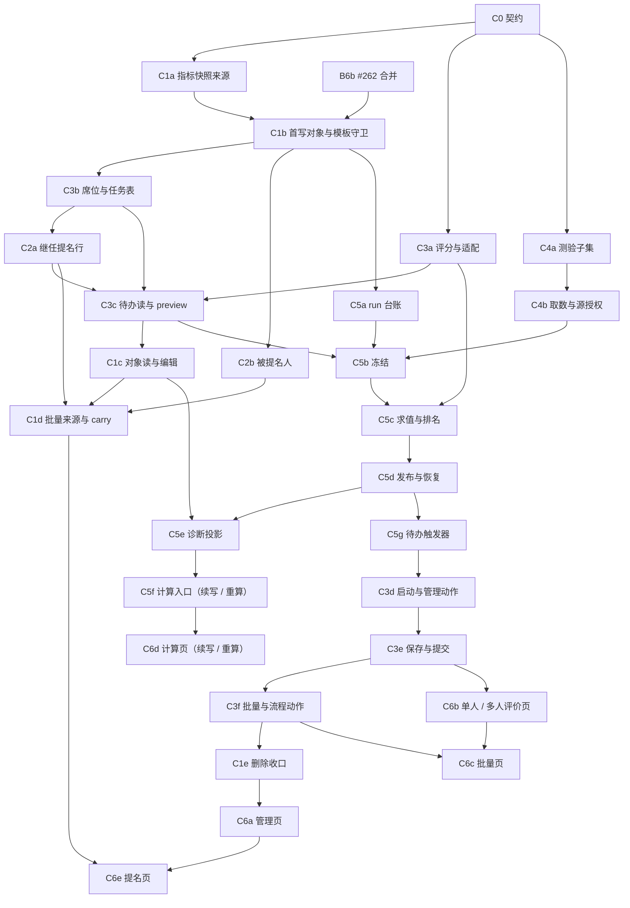

# R3-T04 PR-C 拆分方案

> 状态：设计完成，待第 1 轮审查；U-C01 / [#274](https://github.com/Avatar0327/italent-replica/issues/274) 已按 DEC-444 选 B，主动取消延期到 F-098；本文不授权开始实现，不修改设计正文。
> 依据：`R3-T04_人才盘点_设计.md`（下称“设计”）§2.5、§3～§7、§9、§10、§12；
> `R3-T04_PR-B_拆分方案.md`；规格 `26_人才盘点_规格.md`、REQ-TR-001；DEC-353、376⑤、387、391、418⑧、430①、436③、439③、444。
> 作用对象：复刻系统。本文只登记北森测试租户的取证需求，不操作原站。
> 拟拆 **28 个子 PR（1 个契约 + 27 个实现）**，业务代码、手写接线及测试合计约 **37,750 行**，每片 **1,000～1,500 行**。
> 当前核对基点：`d8b36c4554c9dec0ab5d3d1af9ba132b1f16fb5b`；GitHub 状态核对日期 2026-10-12 UTC。
> B1～B7b 中除 B6b #262 外均已合并；#262 尚未合并，不能把其扩展点契约测试记为真实对象引用覆盖。

## 1. 子 PR 允许修改的范围

本次文档 PR 只新增本文；下表是**方案审定后**各实现片的归属，不是本次修改清单。无需另改派发登记或共享恢复点。

| 位置 | 允许内容与归属 |
|---|---|
| `apps/api/src/modules/talent-review/` | 对象、席位、评价任务、提名、计算的服务 / 路由 / 输入 / 投影；复用 B 系列的命令事务、引用守卫与 `project-guards.ts`，在模块内追加登记。 |
| `packages/domain/src/talent-review/` | `catalog.ts` 对象 / 按钮 / 审计元数据，评分、适配、运行时状态转换及依赖图纯函数；不得引入 IO。 |
| `packages/db/src/schema/talent-review.ts` 及本模块拆出的 schema 文件 | §2.5 的表、序列、索引、复合外键；拆文件的导出位由 C0 先占好。不得改写 B 系列的结构语义。 |
| `packages/db/migrations/` | 每个有表或约束的子 PR 自带新增迁移、RLS 与必要自定义 SQL；快照 / journal 由工具生成。不预占迁移号，不改旧迁移；按 DEC-430① 用 `pnpm merge:main` 统一顺延、重算。 |
| `packages/domain/src/personnel/fields.ts`、`packages/db/src/schema/personnel.ts` | **仅 C4a**：设计 §12 已列的“测验结果”子集、`SUBSETS` 登记及其版本表；沿用既有子集写入、权限、审计，不新造另一套人事存储。 |
| `apps/api/src/modules/personnel/` | 仅 C4a 所需的测验子集策略 / 接入文件；如通用子集接口缺登记位，先在 C0 契约中明确，不在实现片暗改通用行为。 |
| `apps/web/src/talent-review/` | C6a～C6e 的页面、请求状态、中文资源文件、交互验证；前端总入口由 C0 单独接入模块登记位。 |
| `tests/acceptance/AC-TR-*`、模块内 `*.test.ts` | 每片自己的验收及必要纯函数测试；用子片后缀区分，避免多个 PR 改同一测试文件。先红测，再实现。测验子集验收也以 `AC-TR-assessment-subset-*` 追溯。 |
| 本模块 `policy.ts`、`tests/acceptance/support/route-policy/required/talent-review.ts` 及相关证据登记 | 新增 / 修改路由随片补 F-039 声明与反例证据；测验子集涉及 personnel 路由时补其对应义务。路由声明文档随片提交。 |
| 共享文件：`apps/api/src/audit/visibility.ts`、审计登记 / 导出文件、schema / domain 导出、`apps/web/src/App.tsx`、标准授权登记文件 | **只由 C0 契约 PR 修改并先合并**：为项目 × 人员审计谓词、模块前端入口、对象目录与标准身份留登记位。能用现有扩展点的直接登记，不重建扩展点。实现片发现清单外共享接线时另报契约需求。 |

- B1 留下的 `registerTenantFieldSource('TalentReview.Object', …)` 在 C0 登记：预置 / 自定义字段统一用 `field:<code>`，缺省范围为空。C1b 首次写对象前，该目录与其真实字段授权测试必须已合并。
- 新对象标准管理员授权依 DEC-415；系统主体仍须显式指定与授权，不因新增目录自动获得全租户访问。版本 / 指纹按 DEC-404、439④ 合并时统一处理。
- 不修改审批引擎、表达式引擎或 T05 的实现来凑本片；F-048、F-049、T05 协议均复用。性能若必须修改引擎，按共享契约规则另报范围，不降低验收目标。
- `evidence-core.ts` / `core-digests.ts` 不在计划修改范围。生成物变更不等于获准修改核心门禁；确需修改时按 AGENTS §9 第 8 条单独审定。

## 2. 总表与分项估算

沿用 PR-B 以 #144 准备度字典为样本的估法，并采用本次派发指定的单位：**R = 约 200 行 / 路由**，含入口、输入、基础服务、F-039 声明、常规正反例；**T = 约 150 行 / 表**，含 schema、手写 RLS / 约束和夹具。复用既有路由的新增业务接线也计入工作量，不按“没有新增 URL”免计。

专有算法、状态机、跨表事务、投影、真 PG 交错、性能用例、前端及其交互测试另外逐项计入；不重复计算 R 已含的常规测试。计入所有手写代码 / 测试与手写迁移；不计生成的 SQL、迁移快照、F-039 自动生成图 / 摘要等。实际 diff 超过约 1,500 行时先报告拆分，不减少负例、不挪走本片首写引用的外键或守卫。

下表表名省略 `talent_review_` 前缀；“无迁移”仍要验证所依赖迁移。测试名均置于 `tests/acceptance/`，可加片号与 `-pg` 后缀，不是新增产品 AC。所有片的共同前置是：本文审定、设计 §12 的已确认开工门禁、C0（C0 自身除外）；**T05 实现均非本表各片的硬前置**，具体原因见 §3.3。

| 子 PR | 能力 | 内容（设计章节） | 表 / 迁移 | 估算行数（分项） | 前置（另加共同前置） | 测试清单 / 验收 AC |
|---|---|---|---|---|---|---|
| **C0 契约接入** | 首写前接好权限目录与共享入口 | §6、§12；Object / Assessment / Evaluator / Succession / Nomination / CalcRun 目录；B1 动态字段登记；项目 × 人员审计与嵌套投影的模块登记契约；前端模块入口。无对象写入、无计算路由 | 无业务表；只在新增授权项确有需要时附授权登记迁移 | **1000** = 共享登记 400 + 模块权限 / 投影契约 300 + 契约测试 300 | PR-A #144；B1 #148；B7b #267 | `AC-TR-field-catalog`、`AC-TR-projection-contract`：预置 / 自定义字段均可授权，TalentReview 无范围为空，审计缺登记不放行；旧目录 / 入口回归 |
| **C1a 创建快照来源** | 对象创建取得稳定的指标快照 | §5.1；人才标准指定 / 主职职务绑定、任职资格端口调用；解析模块、指标、目标、权重及冻结配置；只读适配器，不创建对象 | 无迁移 | **1000** = 来源解析 500 + 来源 / 快照测试 500 | B2a #180、B3 #229、B6a #244 / B6a-2 #245；T01 #106、T02 C1-3 #185 | `AC-TR-indicator-snapshot`、`AC-TR-15-freeze`：未绑定 / 无端口 / 无当前资格按设计定码；来源修改不改已生成快照；类型筛选与停用历史口径复用端口 |
| **C1b 首次写对象与模板引用** | 手动新增对象，同时兑现真实引用保护 | §2.5、§7；一人一项目、员工范围、模板启用 / 可见、锁定版本、调用 C1a 冻结指标；登记真实项目非空检查与模板引用守卫；按人计算规则引用校验 | `objects`、`object_values`、`object_value_options`、`object_modules`、`object_items`；`talent_review_result_seq`；**两个模板引用外键在本片完成**（§4.1） | **1450** = 5T×150 + 1R×200 + 引用接线 / 真 PG 专项 500 | C1a；B1、B5 #184、B6a / B6a-2、**B6b #262 已合并**、B7a #256、B7b | `AC-TR-objects`、`AC-TR-template-reference`、`AC-TR-15-freeze`、AC-TR-01：真实对象阻止删模板 / 项目，历史版本也阻止；跨租户及错配版本拒绝；新增引用 × 删除双向真 PG 交错 |
| **C1c 对象读与字段编辑** | 管理端按当前权限读取、编辑对象 | §6.1 / 6.5 / 6.6、§7；对象列表 / 详情 / 评估明细读 / 字段编辑共 4 个入口；统一项目可见 ∧ 人员范围，字段与嵌套投影；显式清空、类型列 / 多选行校验 | 无新表；无迁移 | **1400** = 4R×200 + 嵌套 / 审计投影 300 + 专项负例 300 | C1b；评估明细接线另等 C3c；B7b | `AC-TR-object-fields`、`AC-TR-projection-objects`、AC-TR-02 / 13：ended 全拒、calibrating 管理编辑拒绝、system_written 拒写；只读 403 / 范围外 404；字段、删除快照与重放裁剪 |
| **C1d 批量来源与带入上次** | 从其他项目、导入与映射带入共用创建命令 | TR-R8 / R9、§7；来源候选、跨项目添加、导入 3 个入口；覆盖对象 / 继任者 / 被提名人 / 提名人四种来源；补手动新增的 carry 选项；不重复实现 C1b | 无新表；无迁移 | **1400** = 3R×200 + 时间排序 / 排除分类 / 映射 350 + 批量专项 450 | C1b、C1c、C2a、C2b；B2b #219；B7a | `AC-TR-09-carry-last`、`AC-TR-objects-import`：按当前项目计划开始前选来源，开始倒序再结束倒序，排除分类；类型 / 选项映射、标签、多来源去重；500 边界、末条非法整体回滚 |
| **C1e 对象删除收口** | 删除对象的子记录、快照与引用一致 | §7、§9；流程内先取消任务；字段 / 模块 / 指标 / 评估 / 席位 / 提名依附记录按既定删除语义处理，逐类验权、留审计；PR-D 路径清理由 D 首建路径表时接入 | 既有 C 表的级联 / 引用约束补齐（若需新增约束则随片迁移）；不建 D 表 | **1100** = 1R×200 + 删除 / 快照 450 + 真 PG / 重放 450 | C1c、C2a、C2b、C3f、C5d（C 范围引用方齐备） | `AC-TR-object-delete`、`AC-TR-template-reference-delete`：子对象无删除权整单不写，快照当前权裁剪；删最后一个对象后模板 / 项目可删；删除与对象写串行，无孤儿 |
| **C2a 盘点继任提名行** | 保存 successor / target 两方向提名 | §2.5、§3.6、§6.4；新增 / 编辑 / 删除 3 个入口；SC-R13 组织负责人、关键职位、兼职开关、在职 / 非本人、准备度启用；资格快照与方向表单；只写项目内记录 | `succession_entries`；准备度租户外键及真实 `registerReadinessReferenceGuard` | **1400** = 1T×150 + 3R×200 + SC-R13 300 + 权限专项 350 | C1b、C3b；PR-A 准备度；B1 开关、B6a-2 表单；**不等 T05 同步** | `AC-TR-succession-entry`：四种 kind × direction、稳定行 ID、required / edit / view / hidden、准备度被引用拒删、撤权重放；不得写 T05 继任记录 |
| **C2b 被提名人** | 提名人员并由管理员加入项目或忽略 | TR-R6、§6.3、§7；本人列表 / 提名、管理列表 / 加入 / 忽略 5 个入口；理由必填；直线下级 ∪ 负责部门；加入复用 C1b，carry 能力在 C1d 接齐 | `nominations`；加入后的 object 引用 | **1450** = 1T×150 + 5R×200 + 候选范围 / 复用 150 + 专项 150 | C1b；B7b；不依赖 C1d，避免与来源查询循环依赖 | `AC-TR-nomination`：关系入口无管理范围可提名、管理员加入仍验人员范围、重复对象拒绝、理由必填、状态 / 幂等 / 审计 |
| **C3a 评分与适配纯函数** | 四种算分与公式输出共用确定语义 | §4.2 / 4.5(d)；角色平均、步骤权重、unable / invalid、按数目最后有效步骤；adjusted 优先；四位存储与等级边界；`coerceToField` 的空值 / 类型 / 选项 / 溢出 | 无迁移 | **1400** = 评分 500 + 输出适配 250 + 纯函数验收 650 | B2a、B6a；PR-A 定点舍入；F-049 #118 | `AC-TR-05-06-scoring`、`AC-TR-calc-output`：4.4、同人多角色、零有效评价、4 位边界、2.345→2.35、非法选项 / 溢出；适配失败下游不读原值 |
| **C3b 席位与执行人维护** | 同人多席与执行人解析可持久化 | §3.4、§7；设置 / 导入 2 个入口；direct / indirect / self / designated；员工锁与唯一约束；启动后加席位生成相应任务 | `evaluators`、`tasks`；两类唯一键，租户外键 / RLS | **1300** = 2T×150 + 2R×200 + 解析 300 + 真 PG / 导入 300 | C1b；B1 角色、B3 流程、B6a 冻结步骤 | `AC-TR-evaluators`：同人不同角色合法、同角色同人重复 409、末条非法回滚、来源保存；任职调动后冻结执行人不变；双向并发 |
| **C3c 待办读与预算分** | 席位隔离读取与无副作用 preview | §3.3、§4.4、§6.3～6.6；待办列表 / 详情 / preview 3 个入口；表单三档 × 对象字段权；本人自评复用本人 pending 席位，不建成果页 | `assessments`、`assessment_comments`；角色维度唯一键 | **1450** = 2T×150 + 3R×200 + 席位投影 300 + 无副作用等专项 250 | C3a、C3b、C2a；B6a-2 | `AC-TR-form-permissions`、`AC-TR-preview`、`AC-TR-projection-tasks`：自评不见他席，同人多席分别读；hidden 键缺席；preview 不改业务 / 台账 / 审计 / outbox |
| **C3d 启动、管理干预与调整** | 项目进入评价流程且管理动作可恢复 | §3.1～3.4、§4.4、§7；接 B7a start；撤销 / 重开 / 调整入口；缺人整批不启动，round / invalid 留痕；调整只写 adjusted / final，不自动计算 | 无迁移 | **1400** = 4R×200（含既有 start 接线）+ 状态转换 250 + 专项 350 | C3c、C5g；B7a / B7b | `AC-TR-start`、`AC-TR-flow-runtime-admin`、AC-TR-12、`AC-TR-01-02-13-project-lifecycle`：缺人不改项目及任何对象，撤销 / 重开触发矩阵、调整不重算、结束 / 重启不改对象状态且不自动同步 |
| **C3e 保存与单席提交** | 待办写入并推进 single / countersign | §3.3、§4.4、§6.4；保存 / 提交 2 个入口；评分、评语、信息字段、提名行整笔写；required；先写①，再按引用变化建②③ run；会签全席提交才前进 | 无迁移 | **1400** = 2R×200 + 原子保存 / 节点推进 500 + 真 PG / 授权专项 500 | C3d、C2a、C5g；B6a-2 | `AC-TR-flow-runtime-submit`、`AC-TR-calc-trigger-save`：无管理范围合法评估人成功；错误席位 / 动作 / 字段拒绝；两席并发不丢分；提交 × 项目结束两种先后 |
| **C3f 批量与流程动作** | 批量提交、驳回、转交、不同意同一运行时 | §3.3、§4.4、§7；4 个入口；return 重开上一轮、transfer 随席位转记录、disagree invalid / terminated；批量 500 / 整体事务；为 D 比例校验留提交事务内接线位 | 无迁移 | **1500** = 4R×200 + 流程动作 300 + 真 PG / 原子性专项 400 | C3e；比例真实实现及 AC-TR-07 仍属 PR-D（§4.4） | `AC-TR-flow-runtime-actions`、`AC-TR-calc-trigger-actions`：动作开关、round、invalid、同键台账 +0、终止排除；未选对象不误提交；D 接线前不宣称比例验收已覆盖 |
| **C4a 测验结果子集** | 测评取数具备真实存储与既有写入口 | DEC-031、设计 §5 / §12；测验名称 / 维度名称 / 总分 / 维度得分 / 测验时间 / 来源；`SUBSETS` 与通用写入 / 导入适配；沿用版本记录和来源权限 | personnel 的测验结果头表 + `_versions`，共 2 表；RLS、租户外键、版本保护及权限登记 | **1400** = 2T×150 + 子集登记 / 既有写入复用 450 + 验收 650 | C0；现有 personnel 子集与导入契约；无 T05 前置 | `AC-TR-assessment-subset`：写入 / 导入 / 版本 / 删除快照、跨租户拒绝、字段范围、批量回滚；不向 T04 系统主体隐式授权 |
| **C4b 取数宿主与源授权** | 真实端口可冻结且能逐来源复核 | §5；Performance / Survey360 / Assessment / PersonnelSubset；计划日期租户时区边界；`source_refs`；T02 评定端口有条件注入；不注入 Ranking / ParameterRule | 无迁移 | **1400** = 端口宿主 / 授权 700 + 取数专项 700 | C4a；B5；F-046 #133、F-049；T02 C2 合并只影响其自身端口启用 | `AC-TR-11-ports`、`AC-TR-calc-principal-sources`：第 N 年不连续、空≠0、360 排序 / 别名、测验双时间窗、时区边界、forbidden≠empty；未注入评定 / 参数规则为 DATA_UNAVAILABLE |
| **C5a run 台账与身份** | 登记一个完整逻辑计算的身份 | §2.5、§4.1 / 4.5(a)、§9；状态转换与选择仓储；all / filter / explicit、500 是页大小；run_seq；principal / owner / actor 分工；校验绑定状态；先交内部服务，无未完成的执行路由 | `calc_runs`、`calc_run_selections`；补对象 `last_calc_run_id` 外键（首次写该列前） | **1200** = 2T×150 + 状态 / 身份 / 选择 400 + 验收 500 | C1b；B1、B5、B7b；F-082 全部片 | `AC-TR-calc-population-register`、`AC-TR-calc-principal`：explicit 两页 501 后封存、封存只读、对象去重、terminated 排除、actor 范围与主体缺失、CALC_RULE_NEEDS_REBIND |
| **C5b 冻结输入与排名成员** | 后续计算和续写只读持久化快照 | §4.5(b)(c)；scoring_inputs 全项、外部 port_snapshot / source_refs、规则 ID 绑定存档、非 run 排名成员；每页复核；合计 20,000 上限 | `calc_run_inputs`、`calc_run_population`；冻结后的不可变约束 | **1400** = 2T×150 + 冻结 500 + 分页 / 授权 / 竞态专项 600 | C5a、C3c、C4b；B6a-2、F-082 | `AC-TR-calc-freeze`、`AC-TR-calc-population`：501 同 run；评分 / invalid / 权重 / 外部数据在冻结后改变不影响快照；非 run 值冻结，20,001 失败不写值；每页撤权明确失败 |
| **C5c 三层求值与排名** | 同一次计算按适配后新值求值 | §4.2～4.6；管理①冻结评分、②模板版本分组、③按（规则组, 项目）建图；跨组排名边、依赖失败传播；不把同名目标合成一个节点；结构化失败 | `calc_run_outputs`；`calc_failures` 视图；无公共裸视图入口 | **1450** = 1T×150 + 视图 100 + 求值 / 依赖图 550 + 验收 650 | C3a、C5b；F-045 #114、F-049、F-082；DEC-391 | `AC-TR-ranking`、`AC-TR-calc-output`、`AC-TR-calc-evaluate`：部分重算 F3、跨规则无假环 / 真排名环、33.33 / 3.13、适配失败传播、单项类型失败其余成功 |
| **C5d 分页发布与恢复** | 对象级原子发布且旧 run 不回盖 | §4.5(e)、§9；worker 阶段推进、每页当前源权 / owner / 规则复核、revision + run_seq、cursor、stale / superseded / partial_rules_changed、失败收尾；保留 adjusted | 无新表；无迁移 | **1450** = 发布 / 续写 650 + 真 PG / 失败注入 800 | C5c、C4b；B7a 项目锁 | `AC-TR-calc-publish`、`AC-TR-calc-principal-pg`：中途退出续写、首页前后规则变化、两 run 并发、旧失败不覆盖新成功、冻结后撤对象 / 字段 / 来源 / 排名成员权；不更新项目结果版本 |
| **C5e run 详情与诊断** | 查看人安全读取结果与来源 | §4.5(e)、§4.6、§6.6；详情 / outputs / inputs / 来源诊断 4 个入口；对象范围内计数，来源对象 × 人员 × 字段当前权限，失败文案 / 审计 / 历史统一投影 | 无迁移 | **1400** = 4R×200 + 来源 / 错误投影 300 + 泄露反例 300 | C5d、C1c、C4b；B7b | `AC-TR-projection-calc`：port_snapshot 键永不返回；无 360 权则整项及数量消失；仅可见 2/3 条时 count=2；撤权历史重读 / 重放；OUTPUT_* 原值与表达式名裁剪 |
| **C5f 管理计算入口** | 管理员可发起、续写与重算 | §4.5、§7；登记 / 追加 / seal / 开始 / 续写共 5 个入口；重算复用登记 / 开始计算流程，不新增重算路由；接项目 end 的 running 守卫；全量完成更新 last_full_calc_at、项目 calc_state；**主动取消延期到 F-098（DEC-444）** | 无迁移；本轮不新增取消终态或状态约束 | **1300** = 5R×200 + 项目守卫 / 调度接线 100 + 链路验收 200 | C5d、C5e；B7a / B7b；不依赖 F-098 | `AC-TR-11-12-calc`、`AC-TR-calc-entry`、`AC-TR-calc-perf`：all / filter / explicit 真入口、running 拒绝项目结束、全量时间 / 状态、续写与重算；主动取消入口不开放，取消状态机验收归 F-098；常量与 Ranking 的两档性能 |
| **C5g 待办联动计算** | 所有评价动作共用引用变化触发器 | §4.4；命令事务内直接写① / result_seq；按 ID 引用闭包比较前后；无变化不建 run，有变化只算受影响②③；排名跳过；内部入口按席位而非管理员范围授权 | 无迁移 | **1300** = 变化闭包 350 + 直接写入 / run 接线 350 + 触发矩阵验收 600 | C3a、C3c、C5d；不等 C3d～C3f，不反向依赖管理按钮入口 C5f | `AC-TR-calc-trigger`：字段变 / 不变、逐格、表单 / 提名保存、全部流程动作；无管理范围但合法席位的 run 非空；preview 无持久化；①两条路径差异 |
| **C6a 对象管理页面** | 管理员操作对象与执行人 | §12 页面；对象列表 / 详情、手动 / 跨项目 / 导入、carry、字段编辑、删除、执行人设置 / 导入、启动 / 管理干预；复用公共表单与请求状态 | 无迁移 | **1450** = 页面 / 请求状态 1050 + 交互验收 400 | C1c～C1e、C3d；B7b | `AC-TR-ui-objects`：只读、403 / 404、409 显式刷新重提、导入失败回执、隐藏字段不补值、开始 / 结束 / 重启状态一致 |
| **C6b 单人及多人评价页面** | 本席位评价、预算分与提交可用 | §3 / §6；单人页面、同人多席选择、评分 / 评语 / 信息 / 两方向提名表单、preview / save / submit；自评复用席位，不加本人成果页 | 无迁移 | **1450** = 页面 / 请求状态 1050 + 交互验收 400 | C3e、C2a；C3c；B6a-2 | `AC-TR-ui-evaluation`：三档 / required、自评不出现盘点列表与九宫格、同人多席隔离；preview 不误保存、重放撤权不回显 |
| **C6c 批量及流程动作页面** | 批量逐格保存与节点动作可用 | §3.3、TR-R44；批量列表 / 提交、return / transfer / disagree、节点动作开关、冲突后刷新；比例提示 / 强控展示在 D 接入真实校验后验收 | 无迁移 | **1400** = 页面 / 请求状态 1000 + 交互验收 400 | C6b、C3f；D 的比例 / 九宫格不是本片实现 | `AC-TR-ui-batch`：逐格触发、500 边界、整批错误、不盲重试、动作禁用与服务端结果一致；AC-TR-07 界面回归归 D |
| **C6d 计算与诊断页面** | 跨页选择、续写与重算可用 | §4.5；all / filter / explicit 多页封存，状态 / 每对象结果 / 失败 / 来源诊断；只提供续写与重算，不把 501 人拆成两个 run；主动取消交互延期到 F-098（DEC-444） | 无迁移 | **1200** = 页面 / 请求状态 850 + 交互验收 350 | C5e、C5f；不依赖 F-098 | `AC-TR-ui-calc`：501 人一个 run、续写与显式重算、partial_rules_changed 重算提示、stale 不当成功、来源隐藏、结果未知先回查原 run，不重复发起；不显示主动取消操作，取消交互验收归 F-098 |
| **C6e 提名管理页面** | 提名人及管理员完成提名加入链路 | TR-R6 / §12；本人提名 / 理由、管理员列表 / 加入 / 忽略；项目内继任记录管理表单；不写继任地图、不提供入池 / 人才评定操作 | 无迁移 | **1300** = 页面 / 请求状态 900 + 交互验收 400 | C2a、C2b、C1d；C6a 的共用组件 | `AC-TR-ui-nomination`：候选范围、理由、重复、加入的模板 / carry、两方向权限与准备度；正式继任记录保持不变 |

分组小计：C0 **1,000**；C1a～e **6,350**；C2a～b **2,850**；C3a～f **8,450**；C4a～b **2,800**；C5a～g **9,500**；C6a～e **6,800**；合计 **37,750**。DEC-444 收口减少 400 行：C5f 移除 1R×200 的取消入口预算；C6d 移除取消页面 / 请求状态 150 行、交互验收 50 行。F-098 不计入本方案。估算包含验收，不代表这些验收现已实现或通过。

## 3. 依赖图与前置核对

### 3.1 PR-B 与跨模块前置

| 前置 | 核对状态 | PR-C 消费方与边界 |
|---|---|---|
| PR-A #144、种子登记 #160 | 已合并 | C0 / C2a 的目录、舍入、准备度；后续新种子走登记，不改 provisioning。 |
| B1 #148 | 已合并 | C0 动态字段目录；C2a 兼职开关；C3b 角色；C5a 系统主体设置。 |
| B2a #180、B2b #219 | 已合并 | C1a / C3a 评分快照，C1d 映射与 carry。 |
| B3 #229、B4 #182 | 已合并 | C3 系列消费流程 / 表单；C3f / C6c 保留 D 的九宫格 / 比例接线边界，不因 B4 有定义就声称运行校验存在。 |
| B5 #184 | 已合并 | C1b 按人规则引用，C4b 时间参数，C5 规则执行。 |
| B6a #244、B6a-2 #245 | 已合并 | C1b 冻结版本 / 指标；C3 表单与角色；C5 模块 ID / 结果公式；遵循 DEC-387。 |
| **B6b #262** | **尚未合并** | **C1b 首写模板引用的硬前置**；真实 `configReferrer('template')` 由 C1b 登记，详见 §4.1。其他只读 / 纯函数片不因此全阻塞。 |
| B7a #256、B7b #267 | 已合并 | C1b 项目非空检查；C3d start；C5f end 的计算运行守卫；全部管理入口复用项目可见性。 |
| F-045 #114、F-046 #133、F-048 #135 / #145、F-049 #118 | 已合并 | 设计 §12 的旧“待派”勾选已由真实 PR 状态更新；这里只记录现状，不改正文。F-048 的业务适配仍归 D。 |
| F-082 #205 / #214 / #224 / #233 / #236 | 全部已合并 | C5 冻结 / 求值 / 变化检测只用 ID 绑定；`legacy / unresolved` 拒算，不重新按名称解释。 |
| T01 #106、T02 C1-3 #185 | 已合并 | C1a 只读来源；按职务自动绑定仍受 Q-M0-17 限制，无绑定按 `CRITERION_NOT_BOUND`。 |
| T02 C2 的 `loadTalentReviewRecords` | 非整体开工前置，启用时再核对 | C4b 未有真实登记时不注入，按设计返回 `DATA_UNAVAILABLE`；接口出现后由该片接线或独立小片补接，不在 T04 模拟人才评定业务。 |

### 3.2 片间依赖

箭头表示必须先合并；总表中的额外前置同样生效。图只画主干，以总表为完整依赖清单。

C1c 明细读取需要 C3c 的评估表，故实际开工排在 C3c 后；C2b 加入只调用 C1b，C1d 再消费已有提名数据，二者不形成循环。C5g 先交内部触发器，再由 C3d～f 接真实动作，不能让 run 冻结反过来依赖尚未交付的写路由。

### 3.3 T05 与 PR-D 的依赖方向

| 关系 | 本方案处理 |
|---|---|
| C2a 的准备度、SC-R13 | 准备度由 T04 PR-A 提供；资格按当前组织 / 任职 / 关键职位与租户开关判断。不依赖 T05 继任记录写入口、A3 离职任务或 B3 计算 worker，也不把项目内提名立即写进地图。 |
| C4 / C5 与 T05 B3a #253、B3b #255 | **没有实现依赖**。T04 的冻结总体 / ①②③ / 排名 / 发布协议不同，不能直接套 T05 的逐对象保存点框架；仅参考已定工程约束，不改 T05。 |
| T05 B5 健康度、D1～D5 同步消费 | 以 T04 PR-A 的同步类型、替身和共用契约套件开发；真实接线等 **T04 PR-D**。不为等 T05 把全部 PR-C 串行阻塞，也不在 PR-C 增加同步 / 健康度表。 |
| PR-C → PR-D | D 消费对象 / 提名稳定 ID、result_seq、真实计算输出与投影；接落位、比例、校准、结果审批、同步、健康度及删除快照扩展。D 首次写入相应引用时补自己的外键 / 守卫。 |
| PR-D → PR-C 接线回归 | D 实现落位后，回归 C1c 字段编辑、C3e 保存、C5d 发布；D 实现比例后，回归 C3f 批量提交和 B7a 项目结束。这里是 D 的集成验收，不反向要求 C 先实现整套 D。 |

## 4. 不得延后的验收与边界

### 4.1 DEC-436③：C1b 首写引用同片交付

**C1b 是所有手动 / 跨项目 / 导入 / 提名加入最终共用的首次对象写入片**。该片不得只交“以后登记”的挂点，也不得用替身测试替代真实数据库关系。

1. 同片新增对象的 `template_id`、`template_version_id` 非空引用：`(tenant_id, template_id)` → 模板头；`(tenant_id, template_id, template_version_id)` → 对应模板版本的租户 / 模板 / 版本唯一键。必要的版本复合唯一键随本片补齐；删除采用拒绝引用的约束。两条外键同时覆盖跨租户与“同租户但版本属于另一模板”的错配。
2. 通过 `registerConfigReferenceGuard('template', …)` 查询**真实 `talent_review_objects`**，使 #262 的 `configReferrer('template')` / `TEMPLATE_IN_USE` 命中真实引用方；即使引用旧版本、模板停用、对象终止或项目结束，引用仍存在，模板删除仍为 409。响应不带出操作人无权查看的对象 / 员工信息。
3. `registerProjectObjectCheck` 同片接真实对象查询，项目删除得到 `PROJECT_HAS_OBJECTS`。按人计算规则、字段等本片新增引用也必须配套既有引用守卫及租户外键，不能只靠外键 500。
4. 新增对象先按 §9 取员工 / 项目锁，再按配置引用锁约定保护模板头与钉住版本；和模板删除的排他锁互斥。两种顺序都用真 PG 验证：对象引用先提交 → 删模板 409；删模板先提交 → 新增对象得到不可见 / 不存在的规范错误，整命令回滚；不能产生悬空对象。
5. 自动化验收至少包括：当前 / 历史版本引用；模板结构修改后旧对象仍指旧版本；模板停用不改已发起对象；两条 FK 直接约束测试；同键重放不新增引用；撤权重放；并发删除 / 新增；项目删除 guard。C1e 再补“真实对象删净后释放引用”验收。

本项归 `AC-TR-template-reference`（含 `-pg`）与 `AC-TR-15-freeze`，追溯 DEC-436③ / TR-R12。#262 的原契约测试保留，但真实覆盖记在 C1b；B7a 的九宫格 / 计算规则项目引用覆盖不改归属。

### 4.2 写入口与输出不留跨片空档

- 每个公开写入口从首版就有命令 ID、revision、当前权限 / 范围 / 字段复核、同事务审计；失败断言业务、台账、审计及 outbox 的前后变化，不能留到 C1e / C5e 统一“补安全”。
- C0 定投影契约，各片补自己的真实形状；C1c 负责管理对象，C3c 负责席位，C5e 负责 run 诊断。对象响应不夹带逐席位评分，评分明细走 Assessment；继任 / 执行人按各自对象权限；新写响应与重放同样处理。
- 项目 ended 阻止全部 C 写入；只读项目写入为 `PROJECT_READONLY`；初始 / 流程中 / 流程结束 / 校准中 / 校准完成 / 终止按 §3.2 逐格测试。项目结束 / 重启不批量改对象业务状态。
- 对象级结果写入只取 `talent_review_result_seq`，不更新项目“结果版本”。新旧 run 判断、成功发布、失败收尾必须用同一 revision + run_seq 条件；项目状态锁保持 §9 顺序。
- “表 / 内部服务已合并”不代表相应成品链路验收已完成。C5a～d 不暴露假完成的执行入口；C5f 才接完整管理链路，C3d～f 在 C5g 就绪后接动作。C1b 尚未交付的 carry / 批量方式不得静默忽略输入。

### 4.3 计算的交付分界

| 约束 | 首次交付片 | 必须保留的反例 |
|---|---|---|
| ID 绑定执行（DEC-376⑤、387） | C5a 校验、C5b 冻结、C5c 求值、C5g 触发 | `parseStoredFormula` / refFieldIds；冻结 `{itemId,targetFieldId,formula,refFieldIds,ruleRevision}`；改名不改结果；legacy / unresolved → `CALC_RULE_NEEDS_REBIND`。 |
| 类型不一致（DEC-391 优先于正文旧 D-15） | C5c / C5e | 单项失败、其余项目继续；不当作 false；错误表达式按查看人权限显示字段名或占位。 |
| 两条①路径 | C5c / C5d 与 C5g | 管理 run 用 scoring_inputs 暂存后发布；待办命令锁对象后直接写，只有引用闭包变化才建②③ run。 |
| 排名总体 | C5b / C5c | 501 不分页求名次；run 新值 + 非 run 冻结已存值；跨规则图不按目标字段合并；未参与计算对象不回写；terminated 排除。 |
| 当前源权 | C4b / C5b / C5d | 冻结每页、求值开始、发布及续写每页重验；来源 / 字段 / 组织 / 排名成员撤权明确失败，不拿冻结快照绕过。 |
| 失败与来源披露 | 各输出首片、C5e 全诊断 | port_snapshot 永不返回；来源摘要无权整项缺席；只数可见记录；历史 / 审计 / 重放同边界。 |
| 性能 | C5c 算法验证、C5f 真链路验收 | PGlite 与真 PG 均覆盖常量、Ranking 两种负载；2,000×10 Ranking ≤5s、10,000×10 ≤60s。目标不降级；性能不达即报告，不以替身耗时代替全链路。 |

### 4.4 PR-D 保留项

AC-TR-07（比例）、AC-TR-10（校准）、落位 / 绿化率 / 汇总 / 团队视图 / 个人结果页、结果审批与同步仍归 D。C3f 提交事务须有比例校验接线位置，C1c / C3e / C5d 须有落位写回接线位置；**真实比例校验和位置字段回写未由 D 接入前，相关整体验收不能记绿**。D 补校准路径后接对象删除快照；项目重启 supersede 同步消费也由 D 接 B7a guard。

这一分界沿用设计 §1、§4.7、§10、§12，不因拆分把这些功能取消。若要求“C3f 合并即开放带强控比例的生产使用”，须先由总编排调整 C / D 派发边界，不能用空实现声称强控已完成。

## 5. 开工顺序与交付规则

1. **先审本文**；U-C01 已由 DEC-444 选 B 结案，C0 单独合并。依 DEC-439③，后续实现交 Claude（Opus 规划 / 契约、Sonnet 实现）；本窗口不写实现。
2. **基础能力**：C1a、C3a、C4a → C4b 可按目录分线推进；C1b 等 #262 合并后开始。C1b 合并后做 C3b、C2b、C5a；随后 C2a → C3c → C1c → C1d。
3. **计算主干**：C5a + C3c + C4b → C5b → C5c → C5d。之后 C5e → C5f；另一条 C5g → C3d → C3e → C3f。C5f / C6d 按 DEC-444 只做续写与重算；主动取消延期到 F-098，不再作为两片开工前置。
4. **收口与页面**：C1e 等 C 范围真实引用方齐备；C6a～e 各等对应服务合并再做。C6c 的 D 比例联调、D 落位回归单列，不能算成 C 已完成。
5. **每片自检与交审**：先失败测试，再实现；按 `.claude/skills/dev-selfcheck/SKILL.md` 自检；本地只跑 `pnpm lint`、`pnpm typecheck` 与相关测试，真 PG 验证本片交错；全量交 CI。PR 写覆盖 / 未覆盖 AC、偏离依据、reference 使用、新取证 issue、恢复点和核心门禁变化。
6. **合并管理**：有依赖的片不能以“同时送审”替代先合并。无依赖片仍须协调本模块登记、schema 与 F-039 文件；生成物 / 迁移用 `pnpm merge:main`，不手合，不 force push，不在开发窗口改共享恢复点。
7. **交接**：依 DEC-418⑧ / 439③，2026-10-12 17:00Z 仍在途时贴【交接】，列分支 / 完整 head、已完成、剩余清单、未决口径、本地验证命令；已在审的处理遵循该 DEC，不自行合并或关闭 PR。

## 6. 口径决定与取证边界

### 6.1 U-C01 已决：主动取消延期到 F-098（DEC-444）

原问题登记：[需取证 #274](https://github.com/Avatar0327/italent-replica/issues/274)。[DEC-444 决定原文](https://github.com/Avatar0327/italent-replica/pull/275#issuecomment-6117079098) 已选 B：本轮不开放计算 run 主动取消，只做续写与重算。取消能力由 F-098 在主流程稳定后补状态表与实现，不阻塞本方案交审。

| 编号 / 作用对象 | 原问题 | 已确认决定与影响 | 影响片 / 状态 |
|---|---|---|---|
| **U-C01；仅复刻系统** | 设计 §7 / §9 列有 calc run 主动取消，但未定义允许阶段、终态、已发布页 / 未发布输出、对象 calc_status 及取消后续写 / 重放规则。 | **DEC-444 选 B**：主动取消延期到 F-098；本轮移除取消入口、终态扩展、页面交互及对应实现 / 测试预算，仅保留续写与重算。F-098 先补上述状态表再实现；不套用评价任务的 cancelled。 | **已决**；C5f 5 个入口、1,300 行；C6d 1,200 行；移除 U-C01 决策前置。F-098 的状态表与取消 AC 不纳入本轮，不改评价任务撤销等既有语义。 |

### 6.2 正文已有的待取证 / 暂定口径（照录其授权边界）

下列均不是本文新定默认值；已有 DEC 允许的暂定实现与“不提供入口”边界保持不变。原站证据由维护者在本机取得；本次不访问北森测试租户。

| 编号 | 作用对象 | 未决内容 / 既有边界 | 影响片与所需证据 |
|---|---|---|---|
| Q-T04-18 | 复刻系统：比例总体；北森测试租户：评估人数据权限取证 | A = 操作人人员范围，纯评估人为空；B = 加上本步骤持有席位对象。正文 §11.3 已写取证前按 A，本文不重新选择，也不扩大关系入口为管理范围。 | C3f 的 D 接线、D 的 AC-TR-07；需无管理范围评估人在批量提交时的总体 / 比例结果及接口证据。 |
| Q-T04-05 / Q-M0-81⑥ | 复刻系统：取数字段映射；北森测试租户：映射取证 | DEC-306⑤ 暂用得分→final_score、等级→total_grade；其他候选为能力 / 价值观得分与等级，不自行切换。 | C4b；核对同一合成员工子集字段与实际公式取值，必要时只改已隔离的映射。 |
| Q-T04-02 | 复刻系统：测验结果归属；北森测试租户：来源取证 | DEC-031、设计 §5 已授权“测验结果”人员子集及双时间参数；标记手册依据，不改为独立测评产品。 | C4a / C4b；需子集字段 / 导入或接口和最近一次实际取数证据。 |
| Q-T04-06 / Q-T04-12 | 复刻系统：执行身份 / 缺人启动；北森测试租户：行为取证 | DEC-306⑤ 保守口径：显式授权系统主体 + 所属人前置；无执行人整批不启动。不能改成默认全范围或跳过无人对象。 | C3d、C5a / b / d；需主体身份、所属人失效及缺经理 / designated 未配的返回与前后状态。 |
| Q-T04-09 / Q-M0-129 | 复刻系统：本人成果页；北森测试租户：本人账号只读取证 | DEC-312 可后补；取证前不定义成果页路由，self_result_visible 缺省关闭。本人 pending 自评任务不受此项阻塞。 | C3c / C6b 与 D；需本人已办 / 成果页可见条件、字段与开关行为。 |
| Q-T04-10 | 复刻系统：target 方向同步；北森测试租户：正式继任取证 | C2a 只存项目内两方向记录；正文保守同步回执 skipped 属 D / T05，本文不改为正式继任。 | C2a、后续 D / T05；需手动同步 target 后是否生成正式记录的前后证据。 |
| Q-M0-17 | 复刻系统：职务人才标准绑定；北森测试租户：绑定取证 | 当前职务 competency_model_id 无可写绑定；按设计无绑定返回 CRITERION_NOT_BOUND，不猜主职 / 职位替代来源。 | C1a / C1b；待拥有方解决绑定并提供契约，T04 只接读取。 |
| Q-T04-17 / Q-M0-130 | 复刻系统：公式字段类型；北森测试租户：多选公式取证 | DEC-314② 取证前禁止公式引用 / 目标为多选；不影响标签 carry 或多选字段人工编辑。 | C3a、C5a / c / g；复用已有保存拒绝并做执行入口回归，不引入猜测转换。 |

**交审区分**：U-C01 已按 DEC-444 结案，本轮新增待决项为 **0**；§6.2 的 **8 项既有取证遗留**仍保留，继续沿用各自已获授权的暂定口径或取证前不开放入口的边界，不能标为“本次重新批准”。F-098 后补取消能力，不阻塞 C5f / C6d。任何新发现的口径不清，仍按派发规则贴【等决定】，明确选项和作用对象后停下。
